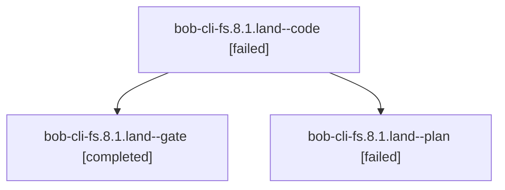

# Session: bob-cli-fs.8.1.land

[Agent Hoods](../README.md) / [bbugyi200](../users/bbugyi200/README.md) / [athena](../users/bbugyi200/machines/athena/README.md) / [bob-cli-fs](../users/bbugyi200/machines/athena/hoods/bob-cli-fs/README.md) / bob-cli-fs.8.1.land

Owner: `bbugyi200.athena` · Hood: `bob-cli-fs` · Members: 3 · Bead: [bob-cli-fs.8.1](https://github.com/bobs-org/bob-cli--beads/blob/main/pages/bob-cli-fs/bob-cli-fs.8.1.md)

## Lineage



The diagram is an optional enhancement; the ordered table below contains the same lineage in accessible text.

| Role | Agent | State | Model / provider | Timing | Commits | Prompt | Chat |
|---|---|---|---|---|---:|---|---|
| <a id="member-code"></a>code | bob-cli-fs.8.1.land--code | failed | gpt-6-luna / codex | 2026-11-02T14:22:55.991685+00:00 → 2026-11-02T15:02:48.007344+00:00 | 0 | — | [Chat](../agents/bbugyi200.athena.bob-cli-fs.8.1.land--code/chat.md) |
| <a id="member-gate"></a>gate | bob-cli-fs.8.1.land--gate | completed | gpt-6-astra / codex | 2026-11-02T14:22:12.398982+00:00 → 2026-11-02T14:22:32.308011+00:00 | 0 | — | [Chat](../agents/bbugyi200.athena.bob-cli-fs.8.1.land--gate/chat.md) |
| <a id="member-plan"></a>plan | bob-cli-fs.8.1.land--plan | failed | gpt-6-astra / codex | 2026-11-02T14:01:28.527332+00:00 → 2026-11-02T15:02:48.007344+00:00 | 0 | [Prompt](../agents/bbugyi200.athena.bob-cli-fs.8.1.land--plan/prompt.md) | [Chat](../agents/bbugyi200.athena.bob-cli-fs.8.1.land--plan/chat.md) |

## Variables

| Role | Variable | Value |
|---|---|---|
| plan | `artifacts` | \[{bead: bob-cli-fs.8.1, kind: file, label: Cycler landing regression probes for bob-cli-fs.8.1, path: /home/bryan/.sase/artifacts/agents/gh\_bobs-org\_\_bob-cli/20261102070958/fs-cycler-landing-probe-68… |

#### artifacts

**Role:** `plan`

```yaml
- bead: bob-cli-fs.8.1
  kind: file
  label: Cycler landing regression probes for bob-cli-fs.8.1
  path: /home/bryan/.sase/artifacts/agents/gh_bobs-org__bob-cli/20261102070958/fs-cycler-landing-probe-68f7079eb8af.cjs
  ref: file:explicit:bcf92583e130ba24ca6dd32d
  source_path: /tmp/fs-cycler-landing-probe.cjs
- bead: bob-cli-fs.8.1
  kind: file
  label: Cycler landing six failing probes with 25 existing wiring passes
  path: /home/bryan/.sase/artifacts/agents/gh_bobs-org__bob-cli/20261102070958/fs-cycler-landing-probe-e007d9e9b695.log
  ref: file:explicit:f1a7a88d67cb76f8a82fbe6d
  source_path: /tmp/fs-cycler-landing-probe.log
- kind: file
  label: Cycler landing existing unrelated plugin test failures
  path: /home/bryan/.sase/artifacts/agents/gh_bobs-org__bob-cli/20261102070958/fs-unrelated-tests-3d34a801f4d5.log
  ref: file:explicit:793fe12a35ddf65729ac6f00
  source_path: /tmp/fs-unrelated-tests.log
```

Values are truncated for display; see each member's agent meta.json for the full values.

## Neighbors

| Agent | Relation | State |
|---|---|---|
| [bob-cli-fs.8](bbugyi200.athena.bob-cli-fs.8.md) (session · 3) | ancestor | active 1, completed 2 |
| [bob-cli-fs.8.1.1](../agents/bbugyi200.athena.bob-cli-fs.8.1.1/README.md) | bob-cli-fs.8.1 hood | completed |
| [bob-cli-fs.8.1.2](../agents/bbugyi200.athena.bob-cli-fs.8.1.2/README.md) | bob-cli-fs.8.1 hood | completed |
| [bob-cli-fs.8.1.3](bbugyi200.athena.bob-cli-fs.8.1.3.md) (session · 5) | bob-cli-fs.8.1 hood | completed 5 |
| [bob-cli-fs.8.1.4](../agents/bbugyi200.athena.bob-cli-fs.8.1.4/README.md) | bob-cli-fs.8.1 hood | completed |
| [bob-cli-fs.1](bbugyi200.athena.bob-cli-fs.1.md) (session · 3) | bob-cli-fs hood | completed 3 |
| [bob-cli-fs.10](../agents/bbugyi200.athena.bob-cli-fs.10/README.md) | bob-cli-fs hood | waiting |
| [bob-cli-fs.11](../agents/bbugyi200.athena.bob-cli-fs.11/README.md) | bob-cli-fs hood | waiting |
| [bob-cli-fs.2](bbugyi200.athena.bob-cli-fs.2.md) (session · 3) | bob-cli-fs hood | active 1, completed 2 |
| [bob-cli-fs.2.1.1](../agents/bbugyi200.athena.bob-cli-fs.2.1.1/README.md) | bob-cli-fs hood | completed |
| [bob-cli-fs.2.1.2](../agents/bbugyi200.athena.bob-cli-fs.2.1.2/README.md) | bob-cli-fs hood | completed |
| [bob-cli-fs.2.1.3](../agents/bbugyi200.athena.bob-cli-fs.2.1.3/README.md) | bob-cli-fs hood | completed |
| [bob-cli-fs.2.1.land](bbugyi200.athena.bob-cli-fs.2.1.land.md) (session · 3) | bob-cli-fs hood | completed 3 |
| [bob-cli-fs.3](bbugyi200.athena.bob-cli-fs.3.md) (session · 5) | bob-cli-fs hood | completed 3, failed 2 |
| [bob-cli-fs.4](bbugyi200.athena.bob-cli-fs.4.md) (session · 3) | bob-cli-fs hood | active 1, completed 2 |
| [bob-cli-fs.4.1.1](bbugyi200.athena.bob-cli-fs.4.1.1.md) (session · 5) | bob-cli-fs hood | completed 4, failed 1 |
| [bob-cli-fs.4.1.2](bbugyi200.athena.bob-cli-fs.4.1.2.md) (session · 2) | bob-cli-fs hood | active 1, completed 1 |
| [bob-cli-fs.4.1.3](../agents/bbugyi200.athena.bob-cli-fs.4.1.3/README.md) | bob-cli-fs hood | waiting |
| [bob-cli-fs.4.1.4](../agents/bbugyi200.athena.bob-cli-fs.4.1.4/README.md) | bob-cli-fs hood | active |
| [bob-cli-fs.4.1.5](../agents/bbugyi200.athena.bob-cli-fs.4.1.5/README.md) | bob-cli-fs hood | active |
| [bob-cli-fs.4.1.6](../agents/bbugyi200.athena.bob-cli-fs.4.1.6/README.md) | bob-cli-fs hood | active |
| [bob-cli-fs.4.1.land](../agents/bbugyi200.athena.bob-cli-fs.4.1.land/README.md) | bob-cli-fs hood | waiting |
| [bob-cli-fs.5](../agents/bbugyi200.athena.bob-cli-fs.5/README.md) | bob-cli-fs hood | waiting |
| [bob-cli-fs.6](../agents/bbugyi200.athena.bob-cli-fs.6/README.md) | bob-cli-fs hood | completed |
| [bob-cli-fs.7](../agents/bbugyi200.athena.bob-cli-fs.7/README.md) | bob-cli-fs hood | completed |
| [bob-cli-fs.9](../agents/bbugyi200.athena.bob-cli-fs.9/README.md) | bob-cli-fs hood | completed |
| [bob-cli-fs.land](../agents/bbugyi200.athena.bob-cli-fs.land/README.md) | bob-cli-fs hood | waiting |
