# Session: bob-cli-fs.land

[Agent Hoods](../README.md) / [bbugyi200](../users/bbugyi200/README.md) / [athena](../users/bbugyi200/machines/athena/README.md) / [bob-cli-fs](../users/bbugyi200/machines/athena/hoods/bob-cli-fs/README.md) / bob-cli-fs.land

Owner: `bbugyi200.athena` · Hood: `bob-cli-fs` · Members: 13 · Bead: [bob-cli-fs](https://github.com/bobs-org/bob-cli--beads/blob/main/pages/bob-cli-fs/README.md)

## Lineage

```mermaid
flowchart TD
  n0["bob-cli-fs.land--mon [completed]"]
  n1["bob-cli-fs.land--mon-1 [failed]"]
  n0 --> n1
  n2["bob-cli-fs.land--mon-2 [failed]"]
  n0 --> n2
  n3["bob-cli-fs.land--plan [completed]"]
  n0 --> n3
  n4["bob-cli-fs.land--mon-0 [completed]"]
  n0 --> n4
  n5["bob-cli-fs.land--gate [completed]"]
  n0 --> n5
  n6["bob-cli-fs.land--code [completed]"]
  n0 --> n6
  n7["bob-cli-fs.land--4 [completed]"]
  n0 --> n7
  n8["bob-cli-fs.land--mon-3 [completed]"]
  n0 --> n8
  n9["bob-cli-fs.land--2 [completed]"]
  n0 --> n9
  n10["bob-cli-fs.land--5 [completed]"]
  n0 --> n10
  n11["bob-cli-fs.land--3 [completed]"]
  n0 --> n11
  n12["bob-cli-fs.land--1 [completed]"]
  n0 --> n12
```

The diagram is an optional enhancement; the ordered table below contains the same lineage in accessible text.

| Role | Agent | State | Model / provider | Timing | Commits | Prompt | Chat |
|---|---|---|---|---|---:|---|---|
| mon | bob-cli-fs.land--mon | completed | gpt-6-luna / codex | 2026-11-03T04:02:04.479975+00:00 → 2026-11-03T04:04:01.863703+00:00 | 0 | — | [Chat](../agents/bbugyi200.athena.bob-cli-fs.land--mon/chat.md) |
| mon-1 | bob-cli-fs.land--mon-1 | failed | grok-4.6 / grok | 2026-11-03T05:06:44.283566+00:00 → 2026-11-03T05:13:56.543454+00:00 | 0 | — | [Chat](../agents/bbugyi200.athena.bob-cli-fs.land--mon-1/chat.md) |
| mon-2 | bob-cli-fs.land--mon-2 | failed | grok-4.6 / grok | 2026-11-03T05:25:21.898795+00:00 → 2026-11-03T05:27:21.873632+00:00 | 0 | — | [Chat](../agents/bbugyi200.athena.bob-cli-fs.land--mon-2/chat.md) |
| plan | bob-cli-fs.land--plan | completed | opus / claude | 2026-11-03T03:36:32.347900+00:00 → 2026-11-03T04:02:11.414544+00:00 | 0 | [Prompt](../agents/bbugyi200.athena.bob-cli-fs.land--plan/prompt.md) | [Chat](../agents/bbugyi200.athena.bob-cli-fs.land--plan/chat.md) |
| mon-0 | bob-cli-fs.land--mon-0 | completed | gpt-6-luna / codex | 2026-11-03T04:06:40.575812+00:00 → 2026-11-03T04:10:20.887515+00:00 | 0 | — | [Chat](../agents/bbugyi200.athena.bob-cli-fs.land--mon-0/chat.md) |
| gate | bob-cli-fs.land--gate | completed | opus / claude | 2026-11-03T03:59:00.884955+00:00 → 2026-11-03T03:59:22.675632+00:00 | 0 | — | [Chat](../agents/bbugyi200.athena.bob-cli-fs.land--gate/chat.md) |
| code | bob-cli-fs.land--code | completed | gpt-6-luna / codex | 2026-11-03T03:59:51.064670+00:00 → 2026-11-03T04:02:11.414544+00:00 | 0 | — | [Chat](../agents/bbugyi200.athena.bob-cli-fs.land--code/chat.md) |
| 4 | bob-cli-fs.land--4 | completed | grok-4.6 / grok | 2026-11-03T05:27:59.562674+00:00 → 2026-11-03T05:32:26.530564+00:00 | 0 | [Prompt](../agents/bbugyi200.athena.bob-cli-fs.land--4/prompt.md) | [Chat](../agents/bbugyi200.athena.bob-cli-fs.land--4/chat.md) |
| mon-3 | bob-cli-fs.land--mon-3 | completed | grok-4.6 / grok | 2026-11-03T05:32:13.493882+00:00 → 2026-11-03T05:40:15.584774+00:00 | 0 | — | [Chat](../agents/bbugyi200.athena.bob-cli-fs.land--mon-3/chat.md) |
| 2 | bob-cli-fs.land--2 | completed | grok-4.6 / grok | 2026-11-03T04:11:06.306462+00:00 → 2026-11-03T05:06:56.522554+00:00 | 0 | [Prompt](../agents/bbugyi200.athena.bob-cli-fs.land--2/prompt.md) | [Chat](../agents/bbugyi200.athena.bob-cli-fs.land--2/chat.md) |
| 5 | bob-cli-fs.land--5 | completed | grok-4.6 / grok | 2026-11-03T05:41:03.485839+00:00 → 2026-11-03T05:44:38.639610+00:00 | [1](../agents/bbugyi200.athena.bob-cli-fs.land--5/README.md#commits) | [Prompt](../agents/bbugyi200.athena.bob-cli-fs.land--5/prompt.md) | [Chat](../agents/bbugyi200.athena.bob-cli-fs.land--5/chat.md) |
| 3 | bob-cli-fs.land--3 | completed | grok-4.6 / grok | 2026-11-03T05:14:48.800276+00:00 → 2026-11-03T05:25:35.457721+00:00 | 0 | [Prompt](../agents/bbugyi200.athena.bob-cli-fs.land--3/prompt.md) | [Chat](../agents/bbugyi200.athena.bob-cli-fs.land--3/chat.md) |
| 1 | bob-cli-fs.land--1 | completed | gpt-6-luna / codex | 2026-11-03T04:04:50.253431+00:00 → 2026-11-03T04:06:47.418743+00:00 | 0 | [Prompt](../agents/bbugyi200.athena.bob-cli-fs.land--1/prompt.md) | [Chat](../agents/bbugyi200.athena.bob-cli-fs.land--1/chat.md) |

## Commits

| Role | Repo | Commit | Subject | Committed |
|---|---|---|---|---|
| 5 | bob-cli | [`65a12f0`](https://github.com/bobs-org/bob-cli/commit/65a12f0aa7694ffc04859de557ccee033a88d2e6) | perf(capture): narrow starts-after relation-source reads on capture close | 2026-11-03 00:43:33 EST |

## Neighbors

| Agent | Relation | State |
|---|---|---|
| [bob-cli-fs.1](bbugyi200.athena.bob-cli-fs.1.md) (session · 3) | bob-cli-fs hood | completed 3 |
| [bob-cli-fs.10](bbugyi200.athena.bob-cli-fs.10.md) (session · 3) | bob-cli-fs hood | active 1, completed 2 |
| [bob-cli-fs.10.1.1](bbugyi200.athena.bob-cli-fs.10.1.1.md) (session · 7) | bob-cli-fs hood | completed 6, failed 1 |
| [bob-cli-fs.10.1.2](../agents/bbugyi200.athena.bob-cli-fs.10.1.2/README.md) | bob-cli-fs hood | completed |
| [bob-cli-fs.10.1.3](../agents/bbugyi200.athena.bob-cli-fs.10.1.3/README.md) | bob-cli-fs hood | completed |
| [bob-cli-fs.10.1.4](bbugyi200.athena.bob-cli-fs.10.1.4.md) (session · 3) | bob-cli-fs hood | completed 3 |
| [bob-cli-fs.10.1.land](bbugyi200.athena.bob-cli-fs.10.1.land.md) (session · 3) | bob-cli-fs hood | completed 3 |
| [bob-cli-fs.11](../agents/bbugyi200.athena.bob-cli-fs.11/README.md) | bob-cli-fs hood | completed |
| [bob-cli-fs.2](bbugyi200.athena.bob-cli-fs.2.md) (session · 3) | bob-cli-fs hood | active 1, completed 2 |
| [bob-cli-fs.2.1.1](../agents/bbugyi200.athena.bob-cli-fs.2.1.1/README.md) | bob-cli-fs hood | completed |
| [bob-cli-fs.2.1.2](../agents/bbugyi200.athena.bob-cli-fs.2.1.2/README.md) | bob-cli-fs hood | completed |
| [bob-cli-fs.2.1.3](../agents/bbugyi200.athena.bob-cli-fs.2.1.3/README.md) | bob-cli-fs hood | completed |
| [bob-cli-fs.2.1.land](bbugyi200.athena.bob-cli-fs.2.1.land.md) (session · 3) | bob-cli-fs hood | completed 3 |
| [bob-cli-fs.3](bbugyi200.athena.bob-cli-fs.3.md) (session · 5) | bob-cli-fs hood | completed 3, failed 2 |
| [bob-cli-fs.4](bbugyi200.athena.bob-cli-fs.4.md) (session · 3) | bob-cli-fs hood | active 1, completed 2 |
| [bob-cli-fs.4.1.1](bbugyi200.athena.bob-cli-fs.4.1.1.md) (session · 5) | bob-cli-fs hood | completed 4, failed 1 |
| [bob-cli-fs.4.1.2](bbugyi200.athena.bob-cli-fs.4.1.2.md) (session · 5) | bob-cli-fs hood | completed 4, failed 1 |
| [bob-cli-fs.4.1.3](../agents/bbugyi200.athena.bob-cli-fs.4.1.3/README.md) | bob-cli-fs hood | completed |
| [bob-cli-fs.4.1.4](../agents/bbugyi200.athena.bob-cli-fs.4.1.4/README.md) | bob-cli-fs hood | completed |
| [bob-cli-fs.4.1.5](../agents/bbugyi200.athena.bob-cli-fs.4.1.5/README.md) | bob-cli-fs hood | completed |
| [bob-cli-fs.4.1.6](bbugyi200.athena.bob-cli-fs.4.1.6.md) (session · 11) | bob-cli-fs hood | completed 8, failed 3 |
| [bob-cli-fs.4.1.land](bbugyi200.athena.bob-cli-fs.4.1.land.md) (session · 5) | bob-cli-fs hood | completed 5 |
| [bob-cli-fs.5](bbugyi200.athena.bob-cli-fs.5.md) (session · 3) | bob-cli-fs hood | completed 3 |
| [bob-cli-fs.6](../agents/bbugyi200.athena.bob-cli-fs.6/README.md) | bob-cli-fs hood | completed |
| [bob-cli-fs.7](../agents/bbugyi200.athena.bob-cli-fs.7/README.md) | bob-cli-fs hood | completed |
| [bob-cli-fs.8](bbugyi200.athena.bob-cli-fs.8.md) (session · 3) | bob-cli-fs hood | active 1, completed 2 |
| [bob-cli-fs.8.1.1](../agents/bbugyi200.athena.bob-cli-fs.8.1.1/README.md) | bob-cli-fs hood | completed |
| [bob-cli-fs.8.1.2](../agents/bbugyi200.athena.bob-cli-fs.8.1.2/README.md) | bob-cli-fs hood | completed |
| [bob-cli-fs.8.1.3](bbugyi200.athena.bob-cli-fs.8.1.3.md) (session · 5) | bob-cli-fs hood | completed 5 |
| [bob-cli-fs.8.1.4](../agents/bbugyi200.athena.bob-cli-fs.8.1.4/README.md) | bob-cli-fs hood | completed |
| [bob-cli-fs.8.1.land](bbugyi200.athena.bob-cli-fs.8.1.land.md) (session · 3) | bob-cli-fs hood | completed 1, failed 2 |
| [bob-cli-fs.8.1.land](../agents/bbugyi200.athena.bob-cli-fs.8.1.land/README.md) | bob-cli-fs hood | completed |
| [bob-cli-fs.9](../agents/bbugyi200.athena.bob-cli-fs.9/README.md) | bob-cli-fs hood | completed |
