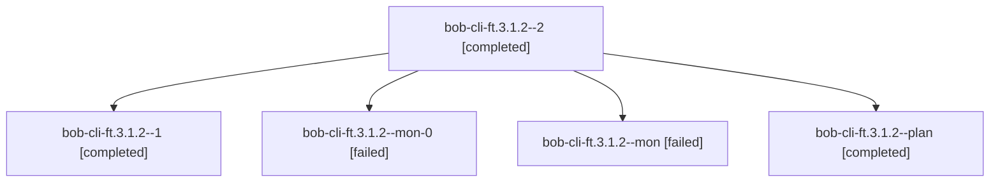

# Session: bob-cli-ft.3.1.2

[Agent Hoods](../README.md) / [bbugyi200](../users/bbugyi200/README.md) / [athena](../users/bbugyi200/machines/athena/README.md) / [bob-cli-ft](../users/bbugyi200/machines/athena/hoods/bob-cli-ft/README.md) / bob-cli-ft.3.1.2

Owner: `bbugyi200.athena` · Hood: `bob-cli-ft` · Members: 5 · Bead: [bob-cli-ft.3.1.2](https://github.com/bobs-org/bob-cli--beads/blob/main/pages/bob-cli-ft/bob-cli-ft.3.1.2.md)

## Lineage

The diagram is an optional enhancement; the ordered table below contains the same lineage in accessible text.

| Role | Agent | State | Model / provider | Timing | Commits | Prompt | Chat |
|---|---|---|---|---|---:|---|---|
| 2 | bob-cli-ft.3.1.2--2 | completed | gpt-6-luna / codex | 2026-11-02T13:31:04.451401+00:00 → 2026-11-02T13:35:49.626032+00:00 | 0 | [Prompt](../agents/bbugyi200.athena.bob-cli-ft.3.1.2--2/prompt.md) | [Chat](../agents/bbugyi200.athena.bob-cli-ft.3.1.2--2/chat.md) |
| 1 | bob-cli-ft.3.1.2--1 | completed | gpt-6-luna / codex | 2026-11-02T13:24:46.503986+00:00 → 2026-11-02T13:27:14.813875+00:00 | 0 | [Prompt](../agents/bbugyi200.athena.bob-cli-ft.3.1.2--1/prompt.md) | [Chat](../agents/bbugyi200.athena.bob-cli-ft.3.1.2--1/chat.md) |
| mon-0 | bob-cli-ft.3.1.2--mon-0 | failed | gpt-6-luna / codex | 2026-11-02T13:27:08.208801+00:00 → 2026-11-02T13:30:48.687763+00:00 | 0 | — | — |
| mon | bob-cli-ft.3.1.2--mon | failed | gpt-6-luna / codex | 2026-11-02T13:20:27.838276+00:00 → 2026-11-02T13:24:39.593533+00:00 | 0 | — | — |
| plan | bob-cli-ft.3.1.2--plan | completed | gpt-6-luna / codex | 2026-11-02T13:02:36.822328+00:00 → 2026-11-02T13:20:35.520626+00:00 | 0 | [Prompt](../agents/bbugyi200.athena.bob-cli-ft.3.1.2--plan/prompt.md) | [Chat](../agents/bbugyi200.athena.bob-cli-ft.3.1.2--plan/chat.md) |

## Neighbors

| Agent | Relation | State |
|---|---|---|
| [bob-cli-ft.3](bbugyi200.athena.bob-cli-ft.3.md) (session · 3) | ancestor | active 1, completed 2 |
| [bob-cli-ft.3.1.1](../agents/bbugyi200.athena.bob-cli-ft.3.1.1/README.md) | bob-cli-ft.3.1 hood | completed |
| [bob-cli-ft.3.1.3](../agents/bbugyi200.athena.bob-cli-ft.3.1.3/README.md) | bob-cli-ft.3.1 hood | completed |
| [bob-cli-ft.3.1.4](../agents/bbugyi200.athena.bob-cli-ft.3.1.4/README.md) | bob-cli-ft.3.1 hood | completed |
| [bob-cli-ft.3.1.land](bbugyi200.athena.bob-cli-ft.3.1.land.md) (session · 5) | bob-cli-ft.3.1 hood | completed 5 |
| [bob-cli-ft.1](../agents/bbugyi200.athena.bob-cli-ft.1/README.md) | bob-cli-ft hood | completed |
| [bob-cli-ft.2](../agents/bbugyi200.athena.bob-cli-ft.2/README.md) | bob-cli-ft hood | completed |
| [bob-cli-ft.4](../agents/bbugyi200.athena.bob-cli-ft.4/README.md) | bob-cli-ft hood | completed |
| [bob-cli-ft.5](../agents/bbugyi200.athena.bob-cli-ft.5/README.md) | bob-cli-ft hood | completed |
| [bob-cli-ft.6](../agents/bbugyi200.athena.bob-cli-ft.6/README.md) | bob-cli-ft hood | completed |
| [bob-cli-ft.7](../agents/bbugyi200.athena.bob-cli-ft.7/README.md) | bob-cli-ft hood | completed |
| [bob-cli-ft.8](../agents/bbugyi200.athena.bob-cli-ft.8/README.md) | bob-cli-ft hood | completed |
| [bob-cli-ft.land](bbugyi200.athena.bob-cli-ft.land.md) (session · 3) | bob-cli-ft hood | active 2, completed 1 |
