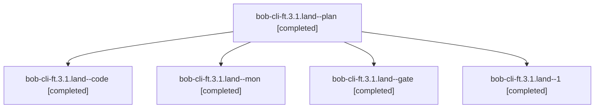

# Session: bob-cli-ft.3.1.land

[Agent Hoods](../README.md) / [bbugyi200](../users/bbugyi200/README.md) / [athena](../users/bbugyi200/machines/athena/README.md) / [bob-cli-ft](../users/bbugyi200/machines/athena/hoods/bob-cli-ft/README.md) / bob-cli-ft.3.1.land

Owner: `bbugyi200.athena` · Hood: `bob-cli-ft` · Members: 5 · Bead: [bob-cli-ft.3.1](https://github.com/bobs-org/bob-cli--beads/blob/main/pages/bob-cli-ft/bob-cli-ft.3.1.md)

## Lineage



The diagram is an optional enhancement; the ordered table below contains the same lineage in accessible text.

| Role | Agent | State | Model / provider | Timing | Commits | Prompt | Chat |
|---|---|---|---|---|---:|---|---|
| <a id="member-plan"></a>plan | bob-cli-ft.3.1.land--plan | completed | gpt-6-astra / codex | 2026-11-02T15:17:26.265188+00:00 → 2026-11-02T16:35:34.751200+00:00 | 0 | [Prompt](../agents/bbugyi200.athena.bob-cli-ft.3.1.land--plan/prompt.md) | [Chat](../agents/bbugyi200.athena.bob-cli-ft.3.1.land--plan/chat.md) |
| <a id="member-code"></a>code | bob-cli-ft.3.1.land--code | completed | grok-4.6 / grok | 2026-11-02T15:38:48.676504+00:00 → 2026-11-02T16:35:34.751200+00:00 | 0 | — | [Chat](../agents/bbugyi200.athena.bob-cli-ft.3.1.land--code/chat.md) |
| <a id="member-mon"></a>mon | bob-cli-ft.3.1.land--mon | completed | grok-4.6 / grok | 2026-11-02T16:35:21.693444+00:00 → 2026-11-02T16:43:08.610098+00:00 | 0 | — | [Chat](../agents/bbugyi200.athena.bob-cli-ft.3.1.land--mon/chat.md) |
| <a id="member-gate"></a>gate | bob-cli-ft.3.1.land--gate | completed | gpt-6-astra / codex | 2026-11-02T15:38:01.265470+00:00 → 2026-11-02T15:38:24.914918+00:00 | 0 | — | [Chat](../agents/bbugyi200.athena.bob-cli-ft.3.1.land--gate/chat.md) |
| <a id="member-1"></a>1 | bob-cli-ft.3.1.land--1 | completed | grok-4.6 / grok | 2026-11-02T16:44:04.373578+00:00 → 2026-11-02T16:47:55.237375+00:00 | [1](../agents/bbugyi200.athena.bob-cli-ft.3.1.land--1/README.md#commits) | [Prompt](../agents/bbugyi200.athena.bob-cli-ft.3.1.land--1/prompt.md) | [Chat](../agents/bbugyi200.athena.bob-cli-ft.3.1.land--1/chat.md) |

## Commits

| Role | Repo | Commit | Subject | Committed |
|---|---|---|---|---|
| 1 | bob-cli | [`217341c`](https://github.com/bobs-org/bob-cli/commit/217341c40c6842f824e565dc52e8c42d2e7b76ae) | docs(blocked-marks): record landing-repair live verification | 2026-11-02 11:46:56 EST |

## Variables

| Role | Variable | Value |
|---|---|---|
| code | `artifacts` | \[{bead: bob-cli-ft.3.1, kind: file, label: bob-cli-ft.3.1 real-Obsidian block-marks e2e report (114/114 pass), path: /home/bryan/.sase/artifacts/agents/gh\_bobs-org\_\_bob-cli/20261102103848/report-0a36… |
| plan | `artifacts` | \[{bead: bob-cli-ft.3.1, kind: file, label: Blocked marks landing regression probes, path: /home/bryan/.sase/artifacts/agents/gh\_bobs-org\_\_bob-cli/20261102073634/tmp-block-marks-land-probes-7384006b02… |

#### artifacts

**Role:** `code`

```yaml
- bead: bob-cli-ft.3.1
  kind: file
  label: bob-cli-ft.3.1 real-Obsidian block-marks e2e report (114/114 pass)
  path: /home/bryan/.sase/artifacts/agents/gh_bobs-org__bob-cli/20261102103848/report-0a3645c5269f.json
  ref: file:explicit:f826b23ed46ccb980f3496b6
  source_path: /home/bryan/.local/state/sase/workspaces/bobs-org/bob-cli/bob-cli_18/sase/repos/linked/bob-plugins/.tmp-bm-e2e/report.json
- bead: bob-cli-ft.3.1
  kind: image
  label: block-marks Live Preview light screenshot
  path: /home/bryan/.sase/artifacts/agents/gh_bobs-org__bob-cli/20261102103848/e2e-block-marks-live-light-7783e7f4d10d.png
  ref: file:explicit:b2825fb913c4cb5f79048abc
  source_path: /home/bryan/.local/state/sase/workspaces/bobs-org/bob-cli/bob-cli_18/sase/repos/linked/bob-plugins/.tmp-bm-e2e/out/e2e-block-marks-live-light.png
- bead: bob-cli-ft.3.1
  kind: image
  label: block-marks Live Preview dark screenshot
  path: /home/bryan/.sase/artifacts/agents/gh_bobs-org__bob-cli/20261102103848/e2e-block-marks-live-dark-7d962e1a2508.png
  ref: file:explicit:560a0424655432c08f3a62b5
  source_path: /home/bryan/.local/state/sase/workspaces/bobs-org/bob-cli/bob-cli_18/sase/repos/linked/bob-plugins/.tmp-bm-e2e/out/e2e-block-marks-live-dark.png
- bead: bob-cli-ft.3.1
  kind: image
  label: block-marks reading-view light screenshot
  path: /home/bryan/.sase/artifacts/agents/gh_bobs-org__bob-cli/20261102103848/e2e-block-marks-reading-light-d3ef9b4a7414.png
  ref: file:explicit:460358b1b87b654ffd8f5e5c
  source_path: /home/bryan/.local/state/sase/workspaces/bobs-org/bob-cli/bob-cli_18/sase/repos/linked/bob-plugins/.tmp-bm-e2e/out/e2e-block-marks-reading-light.png
- bead: bob-cli-ft.3.1
  kind: image
  label: block-marks reading-view dark screenshot
  path: /home/bryan/.sase/artifacts/agents/gh_bobs-org__bob-cli/20261102103848/e2e-block-marks-reading-dark-4689cf36befa.png
  ref: file:explicit:43f614454c48c21b61cea418
  source_path: /home/bryan/.local/state/sase/workspaces/bobs-org/bob-cli/bob-cli_18/sase/repos/linked/bob-plugins/.tmp-bm-e2e/out/e2e-block-marks-reading-dark.png
- bead: bob-cli-ft.3.1
  kind: image
  label: block-marks embed-host screenshot
  path: /home/bryan/.sase/artifacts/agents/gh_bobs-org__bob-cli/20261102103848/e2e-block-marks-embed-60ecef972d44.png
  ref: file:explicit:123b0af950b157cd98921769
  source_path: /home/bryan/.local/state/sase/workspaces/bobs-org/bob-cli/bob-cli_18/sase/repos/linked/bob-plugins/.tmp-bm-e2e/out/e2e-block-marks-embed.png
- bead: bob-cli-ft.3.1
  kind: image
  label: block-marks hover-popover screenshot
  path: /home/bryan/.sase/artifacts/agents/gh_bobs-org__bob-cli/20261102103848/e2e-block-marks-hover-450d338b1c16.png
  ref: file:explicit:3dc753f559a57517a7a5bed9
  source_path: /home/bryan/.local/state/sase/workspaces/bobs-org/bob-cli/bob-cli_18/sase/repos/linked/bob-plugins/.tmp-bm-e2e/out/e2e-block-marks-hover.png
- bead: bob-cli-ft.3.1
  kind: image
  label: block-marks Dataview TASK screenshot
  path: /home/bryan/.sase/artifacts/agents/gh_bobs-org__bob-cli/20261102103848/e2e-block-marks-dataview-1cd21a2664da.png
  ref: file:explicit:3ee7ff7fe8a3e65c2a00b7ca
  source_path: /home/bryan/.local/state/sase/workspaces/bobs-org/bob-cli/bob-cli_18/sase/repos/linked/bob-plugins/.tmp-bm-e2e/out/e2e-block-marks-dataview.png
```

#### artifacts

**Role:** `plan`

```yaml
- bead: bob-cli-ft.3.1
  kind: file
  label: Blocked marks landing regression probes
  path: /home/bryan/.sase/artifacts/agents/gh_bobs-org__bob-cli/20261102073634/tmp-block-marks-land-probes-7384006b02c2.cjs
  ref: file:explicit:d56219a291b8599f2685ac7e
  source_path: /home/bryan/.local/state/sase/workspaces/bobs-org/bob-cli/bob-cli_18/sase/repos/linked/bob-plugins/scripts/.tmp-block-marks-land-probes.cjs
- bead: bob-cli-ft.3.1
  kind: file
  label: Blocked marks landing three failing regressions
  path: /home/bryan/.sase/artifacts/agents/gh_bobs-org__bob-cli/20261102073634/tmp-block-marks-land-probes-1b55c9c38eec.log
  ref: file:explicit:7a6f9f6a48c085ec27cb91b6
  source_path: /home/bryan/.local/state/sase/workspaces/bobs-org/bob-cli/bob-cli_18/sase/repos/linked/bob-plugins/.tmp-block-marks-land-probes.log
- bead: bob-cli-ft.3.1
  kind: file
  label: Blocked marks landing pre-existing test corroboration
  path: /home/bryan/.sase/artifacts/agents/gh_bobs-org__bob-cli/20261102073634/tmp-block-marks-external-tests-75814853ca12.log
  ref: file:explicit:55a612058c1373e9ca6880b1
  source_path: /home/bryan/.local/state/sase/workspaces/bobs-org/bob-cli/bob-cli_18/sase/repos/linked/bob-plugins/.tmp-block-marks-external-tests.log
- bead: bob-cli-ft.3.1
  kind: file
  label: Blocked marks landing four failing regression probes
  path: /home/bryan/.sase/artifacts/agents/gh_bobs-org__bob-cli/20261102073634/tmp-block-marks-land-probes-49b005150f74.cjs
  ref: file:explicit:1656bef2dea171eba6964f38
  source_path: /home/bryan/.local/state/sase/workspaces/bobs-org/bob-cli/bob-cli_18/sase/repos/linked/bob-plugins/scripts/.tmp-block-marks-land-probes.cjs
```

Values are truncated for display; see each member's agent meta.json for the full values.

## Neighbors

| Agent | Relation | State |
|---|---|---|
| [bob-cli-ft.3](bbugyi200.athena.bob-cli-ft.3.md) (session · 3) | ancestor | active 1, completed 2 |
| [bob-cli-ft.3.1.1](../agents/bbugyi200.athena.bob-cli-ft.3.1.1/README.md) | bob-cli-ft.3.1 hood | completed |
| [bob-cli-ft.3.1.2](bbugyi200.athena.bob-cli-ft.3.1.2.md) (session · 5) | bob-cli-ft.3.1 hood | completed 3, failed 2 |
| [bob-cli-ft.3.1.3](../agents/bbugyi200.athena.bob-cli-ft.3.1.3/README.md) | bob-cli-ft.3.1 hood | completed |
| [bob-cli-ft.3.1.4](../agents/bbugyi200.athena.bob-cli-ft.3.1.4/README.md) | bob-cli-ft.3.1 hood | completed |
| [bob-cli-ft.1](../agents/bbugyi200.athena.bob-cli-ft.1/README.md) | bob-cli-ft hood | completed |
| [bob-cli-ft.2](../agents/bbugyi200.athena.bob-cli-ft.2/README.md) | bob-cli-ft hood | completed |
| [bob-cli-ft.4](../agents/bbugyi200.athena.bob-cli-ft.4/README.md) | bob-cli-ft hood | completed |
| [bob-cli-ft.5](../agents/bbugyi200.athena.bob-cli-ft.5/README.md) | bob-cli-ft hood | completed |
| [bob-cli-ft.6](../agents/bbugyi200.athena.bob-cli-ft.6/README.md) | bob-cli-ft hood | waiting |
| [bob-cli-ft.7](../agents/bbugyi200.athena.bob-cli-ft.7/README.md) | bob-cli-ft hood | completed |
| [bob-cli-ft.8](../agents/bbugyi200.athena.bob-cli-ft.8/README.md) | bob-cli-ft hood | waiting |
| [bob-cli-ft.land](../agents/bbugyi200.athena.bob-cli-ft.land/README.md) | bob-cli-ft hood | waiting |
