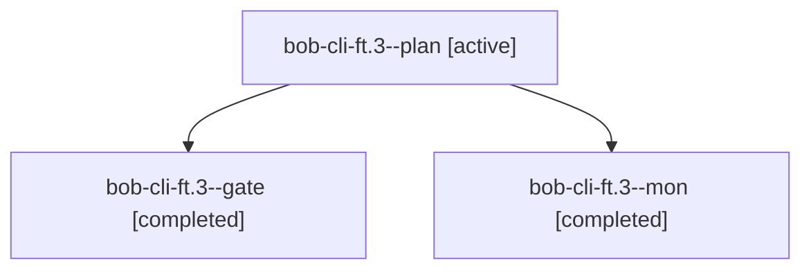

# Session: bob-cli-ft.3

[Agent Hoods](../README.md) / [bbugyi200](../users/bbugyi200/README.md) / [athena](../users/bbugyi200/machines/athena/README.md) / [bob-cli-ft](../users/bbugyi200/machines/athena/hoods/bob-cli-ft/README.md) / bob-cli-ft.3

Owner: `bbugyi200.athena` · Hood: `bob-cli-ft` · Members: 3 · Bead: [bob-cli-ft.3](https://github.com/bobs-org/bob-cli--beads/blob/main/pages/bob-cli-ft/bob-cli-ft.3.md)

## Lineage

The diagram is an optional enhancement; the ordered table below contains the same lineage in accessible text.

| Role | Agent | State | Model / provider | Timing | Commits | Prompt | Chat |
|---|---|---|---|---|---:|---|---|
| plan | bob-cli-ft.3--plan | active | gpt-6-astra / codex | 2026-11-02T12:21:32.510322+00:00 → 2026-11-02T12:34:45.434416+00:00 | 0 | [Prompt](../agents/bbugyi200.athena.bob-cli-ft.3--plan/prompt.md) | [Chat](../agents/bbugyi200.athena.bob-cli-ft.3--plan/chat.md) |
| gate | bob-cli-ft.3--gate | completed | gpt-6-astra / codex | 2026-11-02T12:34:16.814506+00:00 → 2026-11-02T12:34:41.066242+00:00 | 0 | — | [Chat](../agents/bbugyi200.athena.bob-cli-ft.3--gate/chat.md) |
| mon | bob-cli-ft.3--mon | completed | gpt-6-astra / codex | 2026-11-02T12:34:39.923087+00:00 → 2026-11-02T12:37:16.448882+00:00 | 0 | — | [Chat](../agents/bbugyi200.athena.bob-cli-ft.3--mon/chat.md) |

## Neighbors

| Agent | Relation | State |
|---|---|---|
| [bob-cli-ft.3.1.1](../agents/bbugyi200.athena.bob-cli-ft.3.1.1/README.md) | descendant | completed |
| [bob-cli-ft.3.1.2](bbugyi200.athena.bob-cli-ft.3.1.2.md) (session · 5) | descendant | completed 3, failed 2 |
| [bob-cli-ft.3.1.3](../agents/bbugyi200.athena.bob-cli-ft.3.1.3/README.md) | descendant | completed |
| [bob-cli-ft.3.1.4](../agents/bbugyi200.athena.bob-cli-ft.3.1.4/README.md) | descendant | completed |
| [bob-cli-ft.3.1.land](bbugyi200.athena.bob-cli-ft.3.1.land.md) (session · 5) | descendant | completed 5 |
| [bob-cli-ft.1](../agents/bbugyi200.athena.bob-cli-ft.1/README.md) | bob-cli-ft hood | completed |
| [bob-cli-ft.2](../agents/bbugyi200.athena.bob-cli-ft.2/README.md) | bob-cli-ft hood | completed |
| [bob-cli-ft.4](../agents/bbugyi200.athena.bob-cli-ft.4/README.md) | bob-cli-ft hood | completed |
| [bob-cli-ft.5](../agents/bbugyi200.athena.bob-cli-ft.5/README.md) | bob-cli-ft hood | completed |
| [bob-cli-ft.6](../agents/bbugyi200.athena.bob-cli-ft.6/README.md) | bob-cli-ft hood | waiting |
| [bob-cli-ft.7](../agents/bbugyi200.athena.bob-cli-ft.7/README.md) | bob-cli-ft hood | completed |
| [bob-cli-ft.8](../agents/bbugyi200.athena.bob-cli-ft.8/README.md) | bob-cli-ft hood | waiting |
| [bob-cli-ft.land](../agents/bbugyi200.athena.bob-cli-ft.land/README.md) | bob-cli-ft hood | waiting |
