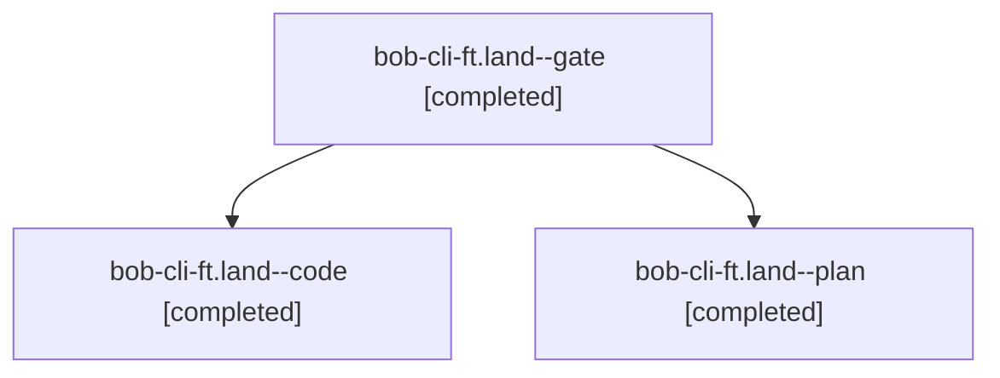

# Session: bob-cli-ft.land

[Agent Hoods](../README.md) / [bbugyi200](../users/bbugyi200/README.md) / [athena](../users/bbugyi200/machines/athena/README.md) / [bob-cli-ft](../users/bbugyi200/machines/athena/hoods/bob-cli-ft/README.md) / bob-cli-ft.land

Owner: `bbugyi200.athena` · Hood: `bob-cli-ft` · Members: 3 · Bead: [bob-cli-ft](https://github.com/bobs-org/bob-cli--beads/blob/main/pages/bob-cli-ft/README.md)

## Lineage

The diagram is an optional enhancement; the ordered table below contains the same lineage in accessible text.

| Role | Agent | State | Model / provider | Timing | Commits | Prompt | Chat |
|---|---|---|---|---|---:|---|---|
| gate | bob-cli-ft.land--gate | completed | opus / claude | 2026-11-02T19:08:19.356055+00:00 → 2026-11-02T19:08:41.838713+00:00 | 0 | — | [Chat](../agents/bbugyi200.athena.bob-cli-ft.land--gate/chat.md) |
| code | bob-cli-ft.land--code | completed | grok-4.6 / grok | 2026-11-02T19:09:01.862437+00:00 → 2026-11-02T20:14:43.228314+00:00 | [1](../agents/bbugyi200.athena.bob-cli-ft.land--code/README.md#commits) | — | [Chat](../agents/bbugyi200.athena.bob-cli-ft.land--code/chat.md) |
| plan | bob-cli-ft.land--plan | completed | opus / claude | 2026-11-02T18:47:33.453977+00:00 → 2026-11-02T20:14:43.228314+00:00 | 0 | [Prompt](../agents/bbugyi200.athena.bob-cli-ft.land--plan/prompt.md) | [Chat](../agents/bbugyi200.athena.bob-cli-ft.land--plan/chat.md) |

## Commits

| Role | Repo | Commit | Subject | Committed |
|---|---|---|---|---|
| code | bob-cli | [`8f2f1f1`](https://github.com/bobs-org/bob-cli/commit/8f2f1f1be16857be25fc2c595fd08069c4a2e82f) | docs(blocked-marks): finalize chip marks live-verification checklist | 2026-11-02 14:59:56 EST |

## Neighbors

| Agent | Relation | State |
|---|---|---|
| [bob-cli-ft.1](../agents/bbugyi200.athena.bob-cli-ft.1/README.md) | bob-cli-ft hood | completed |
| [bob-cli-ft.2](../agents/bbugyi200.athena.bob-cli-ft.2/README.md) | bob-cli-ft hood | completed |
| [bob-cli-ft.3](bbugyi200.athena.bob-cli-ft.3.md) (session · 3) | bob-cli-ft hood | active 1, completed 2 |
| [bob-cli-ft.3.1.1](../agents/bbugyi200.athena.bob-cli-ft.3.1.1/README.md) | bob-cli-ft hood | completed |
| [bob-cli-ft.3.1.2](bbugyi200.athena.bob-cli-ft.3.1.2.md) (session · 5) | bob-cli-ft hood | completed 3, failed 2 |
| [bob-cli-ft.3.1.3](../agents/bbugyi200.athena.bob-cli-ft.3.1.3/README.md) | bob-cli-ft hood | completed |
| [bob-cli-ft.3.1.4](../agents/bbugyi200.athena.bob-cli-ft.3.1.4/README.md) | bob-cli-ft hood | completed |
| [bob-cli-ft.3.1.land](bbugyi200.athena.bob-cli-ft.3.1.land.md) (session · 5) | bob-cli-ft hood | completed 5 |
| [bob-cli-ft.4](../agents/bbugyi200.athena.bob-cli-ft.4/README.md) | bob-cli-ft hood | completed |
| [bob-cli-ft.5](../agents/bbugyi200.athena.bob-cli-ft.5/README.md) | bob-cli-ft hood | completed |
| [bob-cli-ft.6](../agents/bbugyi200.athena.bob-cli-ft.6/README.md) | bob-cli-ft hood | completed |
| [bob-cli-ft.7](../agents/bbugyi200.athena.bob-cli-ft.7/README.md) | bob-cli-ft hood | completed |
| [bob-cli-ft.8](../agents/bbugyi200.athena.bob-cli-ft.8/README.md) | bob-cli-ft hood | completed |
