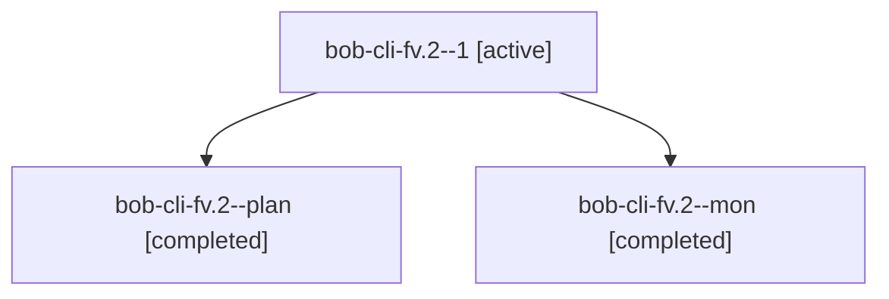

# Session: bob-cli-fv.2

[Agent Hoods](../README.md) / [bbugyi200](../users/bbugyi200/README.md) / [athena](../users/bbugyi200/machines/athena/README.md) / [bob-cli-fv](../users/bbugyi200/machines/athena/hoods/bob-cli-fv/README.md) / bob-cli-fv.2

Owner: `bbugyi200.athena` · Hood: `bob-cli-fv` · Members: 3 · Bead: [bob-cli-fv.2](https://github.com/bobs-org/bob-cli--beads/blob/main/pages/bob-cli-fv/bob-cli-fv.2.md)

## Lineage

The diagram is an optional enhancement; the ordered table below contains the same lineage in accessible text.

| Role | Agent | State | Model / provider | Timing | Commits | Prompt | Chat |
|---|---|---|---|---|---:|---|---|
| 1 | bob-cli-fv.2--1 | active | grok-4.6 / grok | 2026-11-02T14:49:34.830717+00:00 | 0 | [Prompt](../agents/bbugyi200.athena.bob-cli-fv.2--1/prompt.md) | — |
| plan | bob-cli-fv.2--plan | completed | grok-4.6 / grok | 2026-11-02T14:31:36.193886+00:00 → 2026-11-02T14:43:59.837485+00:00 | 0 | [Prompt](../agents/bbugyi200.athena.bob-cli-fv.2--plan/prompt.md) | [Chat](../agents/bbugyi200.athena.bob-cli-fv.2--plan/chat.md) |
| mon | bob-cli-fv.2--mon | completed | grok-4.6 / grok | 2026-11-02T14:43:54.548483+00:00 → 2026-11-02T14:48:43.058856+00:00 | 0 | — | [Chat](../agents/bbugyi200.athena.bob-cli-fv.2--mon/chat.md) |

## Neighbors

| Agent | Relation | State |
|---|---|---|
| [bob-cli-fv.1](../agents/bbugyi200.athena.bob-cli-fv.1/README.md) | bob-cli-fv hood | completed |
| [bob-cli-fv.3](../agents/bbugyi200.athena.bob-cli-fv.3/README.md) | bob-cli-fv hood | active |
| [bob-cli-fv.4](../agents/bbugyi200.athena.bob-cli-fv.4/README.md) | bob-cli-fv hood | waiting |
| [bob-cli-fv.5](../agents/bbugyi200.athena.bob-cli-fv.5/README.md) | bob-cli-fv hood | waiting |
| [bob-cli-fv.6](../agents/bbugyi200.athena.bob-cli-fv.6/README.md) | bob-cli-fv hood | waiting |
| [bob-cli-fv.7](../agents/bbugyi200.athena.bob-cli-fv.7/README.md) | bob-cli-fv hood | waiting |
| [bob-cli-fv.8](../agents/bbugyi200.athena.bob-cli-fv.8/README.md) | bob-cli-fv hood | waiting |
| [bob-cli-fv.land](../agents/bbugyi200.athena.bob-cli-fv.land/README.md) | bob-cli-fv hood | waiting |
