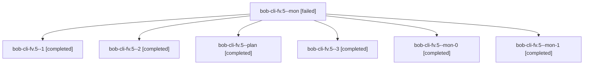

# Session: bob-cli-fv.5

[Agent Hoods](../README.md) / [bbugyi200](../users/bbugyi200/README.md) / [athena](../users/bbugyi200/machines/athena/README.md) / [bob-cli-fv](../users/bbugyi200/machines/athena/hoods/bob-cli-fv/README.md) / bob-cli-fv.5

Owner: `bbugyi200.athena` · Hood: `bob-cli-fv` · Members: 7 · Bead: [bob-cli-fv.5](https://github.com/bobs-org/bob-cli--beads/blob/main/pages/bob-cli-fv/bob-cli-fv.5.md)

## Lineage

The diagram is an optional enhancement; the ordered table below contains the same lineage in accessible text.

| Role | Agent | State | Model / provider | Timing | Commits | Prompt | Chat |
|---|---|---|---|---|---:|---|---|
| mon | bob-cli-fv.5--mon | failed | gpt-6-luna / codex | 2026-11-02T15:59:29.160956+00:00 → 2026-11-02T16:02:50.858063+00:00 | 0 | — | [Chat](../agents/bbugyi200.athena.bob-cli-fv.5--mon/chat.md) |
| 1 | bob-cli-fv.5--1 | completed | gpt-6-luna / codex | 2026-11-02T16:03:40.848979+00:00 → 2026-11-02T16:06:07.430492+00:00 | 0 | [Prompt](../agents/bbugyi200.athena.bob-cli-fv.5--1/prompt.md) | [Chat](../agents/bbugyi200.athena.bob-cli-fv.5--1/chat.md) |
| 2 | bob-cli-fv.5--2 | completed | gpt-6-luna / codex | 2026-11-02T16:09:55.420201+00:00 → 2026-11-02T16:12:50.944800+00:00 | 0 | [Prompt](../agents/bbugyi200.athena.bob-cli-fv.5--2/prompt.md) | [Chat](../agents/bbugyi200.athena.bob-cli-fv.5--2/chat.md) |
| plan | bob-cli-fv.5--plan | completed | gpt-6-luna / codex | 2026-11-02T15:32:42.976093+00:00 → 2026-11-02T15:59:35.557686+00:00 | 0 | [Prompt](../agents/bbugyi200.athena.bob-cli-fv.5--plan/prompt.md) | [Chat](../agents/bbugyi200.athena.bob-cli-fv.5--plan/chat.md) |
| 3 | bob-cli-fv.5--3 | completed | gpt-6-luna / codex | 2026-11-02T16:21:04.024250+00:00 → 2026-11-02T16:31:51.779454+00:00 | [1](../agents/bbugyi200.athena.bob-cli-fv.5--3/README.md#commits) | [Prompt](../agents/bbugyi200.athena.bob-cli-fv.5--3/prompt.md) | [Chat](../agents/bbugyi200.athena.bob-cli-fv.5--3/chat.md) |
| mon-0 | bob-cli-fv.5--mon-0 | completed | gpt-6-luna / codex | 2026-11-02T16:06:00.624164+00:00 → 2026-11-02T16:09:13.915018+00:00 | 0 | — | [Chat](../agents/bbugyi200.athena.bob-cli-fv.5--mon-0/chat.md) |
| mon-1 | bob-cli-fv.5--mon-1 | completed | gpt-6-luna / codex | 2026-11-02T16:12:44.084345+00:00 → 2026-11-02T16:20:24.519972+00:00 | 0 | — | [Chat](../agents/bbugyi200.athena.bob-cli-fv.5--mon-1/chat.md) |

## Commits

| Role | Repo | Commit | Subject | Committed |
|---|---|---|---|---|
| 3 | bob-cli | [`3d251ba`](https://github.com/bobs-org/bob-cli/commit/3d251ba21e35d421402475c659112cd7fed1228e) | feat(gcal): render calendar description bullets | 2026-11-02 11:31:01 EST |

## Neighbors

| Agent | Relation | State |
|---|---|---|
| [bob-cli-fv.1](../agents/bbugyi200.athena.bob-cli-fv.1/README.md) | bob-cli-fv hood | completed |
| [bob-cli-fv.2](bbugyi200.athena.bob-cli-fv.2.md) (session · 3) | bob-cli-fv hood | completed 3 |
| [bob-cli-fv.3](../agents/bbugyi200.athena.bob-cli-fv.3/README.md) | bob-cli-fv hood | completed |
| [bob-cli-fv.4](../agents/bbugyi200.athena.bob-cli-fv.4/README.md) | bob-cli-fv hood | completed |
| [bob-cli-fv.6](../agents/bbugyi200.athena.bob-cli-fv.6/README.md) | bob-cli-fv hood | completed |
| [bob-cli-fv.7](bbugyi200.athena.bob-cli-fv.7.md) (session · 3) | bob-cli-fv hood | completed 3 |
| [bob-cli-fv.8](../agents/bbugyi200.athena.bob-cli-fv.8/README.md) | bob-cli-fv hood | waiting |
| [bob-cli-fv.land](../agents/bbugyi200.athena.bob-cli-fv.land/README.md) | bob-cli-fv hood | waiting |
