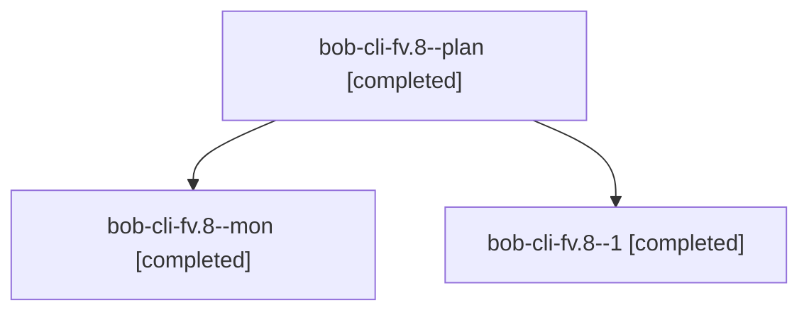

# Session: bob-cli-fv.8

[Agent Hoods](../README.md) / [bbugyi200](../users/bbugyi200/README.md) / [athena](../users/bbugyi200/machines/athena/README.md) / [bob-cli-fv](../users/bbugyi200/machines/athena/hoods/bob-cli-fv/README.md) / bob-cli-fv.8

Owner: `bbugyi200.athena` · Hood: `bob-cli-fv` · Members: 3 · Bead: [bob-cli-fv.8](https://github.com/bobs-org/bob-cli--beads/blob/main/pages/bob-cli-fv/bob-cli-fv.8.md)

## Lineage

The diagram is an optional enhancement; the ordered table below contains the same lineage in accessible text.

| Role | Agent | State | Model / provider | Timing | Commits | Prompt | Chat |
|---|---|---|---|---|---:|---|---|
| plan | bob-cli-fv.8--plan | completed | gpt-6-luna / codex | 2026-11-02T18:02:25.890493+00:00 → 2026-11-02T18:09:35.089746+00:00 | 0 | [Prompt](../agents/bbugyi200.athena.bob-cli-fv.8--plan/prompt.md) | [Chat](../agents/bbugyi200.athena.bob-cli-fv.8--plan/chat.md) |
| mon | bob-cli-fv.8--mon | completed | gpt-6-luna / codex | 2026-11-02T18:09:26.074896+00:00 → 2026-11-02T18:17:11.701019+00:00 | 0 | — | [Chat](../agents/bbugyi200.athena.bob-cli-fv.8--mon/chat.md) |
| 1 | bob-cli-fv.8--1 | completed | gpt-6-luna / codex | 2026-11-02T18:18:02.033336+00:00 → 2026-11-02T18:23:20.667623+00:00 | [1](../agents/bbugyi200.athena.bob-cli-fv.8--1/README.md#commits) | [Prompt](../agents/bbugyi200.athena.bob-cli-fv.8--1/prompt.md) | [Chat](../agents/bbugyi200.athena.bob-cli-fv.8--1/chat.md) |

## Commits

| Role | Repo | Commit | Subject | Committed |
|---|---|---|---|---|
| 1 | bob-cli | [`8c140e4`](https://github.com/bobs-org/bob-cli/commit/8c140e43d22cf562e063c4a0983cd0c939339c54) | docs(cli): refresh capture and relation contracts | 2026-11-02 13:22:59 EST |

## Neighbors

| Agent | Relation | State |
|---|---|---|
| [bob-cli-fv.1](../agents/bbugyi200.athena.bob-cli-fv.1/README.md) | bob-cli-fv hood | completed |
| [bob-cli-fv.2](bbugyi200.athena.bob-cli-fv.2.md) (session · 3) | bob-cli-fv hood | completed 3 |
| [bob-cli-fv.3](../agents/bbugyi200.athena.bob-cli-fv.3/README.md) | bob-cli-fv hood | completed |
| [bob-cli-fv.4](../agents/bbugyi200.athena.bob-cli-fv.4/README.md) | bob-cli-fv hood | completed |
| [bob-cli-fv.5](bbugyi200.athena.bob-cli-fv.5.md) (session · 7) | bob-cli-fv hood | completed 6, failed 1 |
| [bob-cli-fv.6](../agents/bbugyi200.athena.bob-cli-fv.6/README.md) | bob-cli-fv hood | completed |
| [bob-cli-fv.7](bbugyi200.athena.bob-cli-fv.7.md) (session · 3) | bob-cli-fv hood | completed 3 |
| [bob-cli-fv.land](../agents/bbugyi200.athena.bob-cli-fv.land/README.md) | bob-cli-fv hood | completed |
