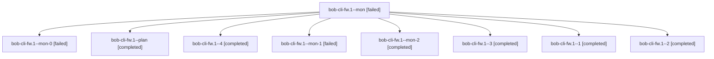

# Session: bob-cli-fw.1

[Agent Hoods](../README.md) / [bbugyi200](../users/bbugyi200/README.md) / [athena](../users/bbugyi200/machines/athena/README.md) / [bob-cli-fw](../users/bbugyi200/machines/athena/hoods/bob-cli-fw/README.md) / bob-cli-fw.1

Owner: `bbugyi200.athena` · Hood: `bob-cli-fw` · Members: 9 · Bead: [bob-cli-fw.1](https://github.com/bobs-org/bob-cli--beads/blob/main/pages/bob-cli-fw/bob-cli-fw.1.md)

## Lineage

The diagram is an optional enhancement; the ordered table below contains the same lineage in accessible text.

| Role | Agent | State | Model / provider | Timing | Commits | Prompt | Chat |
|---|---|---|---|---|---:|---|---|
| mon | bob-cli-fw.1--mon | failed | gpt-6-luna / codex | 2026-11-02T15:15:46.118222+00:00 → 2026-11-02T15:19:01.859543+00:00 | 0 | — | [Chat](../agents/bbugyi200.athena.bob-cli-fw.1--mon/chat.md) |
| mon-0 | bob-cli-fw.1--mon-0 | failed | gpt-6-luna / codex | 2026-11-02T15:21:39.595547+00:00 → 2026-11-02T15:29:21.598671+00:00 | 0 | — | [Chat](../agents/bbugyi200.athena.bob-cli-fw.1--mon-0/chat.md) |
| plan | bob-cli-fw.1--plan | completed | gpt-6-luna / codex | 2026-11-02T14:58:17.863377+00:00 → 2026-11-02T15:16:01.580006+00:00 | 0 | [Prompt](../agents/bbugyi200.athena.bob-cli-fw.1--plan/prompt.md) | [Chat](../agents/bbugyi200.athena.bob-cli-fw.1--plan/chat.md) |
| 4 | bob-cli-fw.1--4 | completed | gpt-6-luna / codex | 2026-11-02T15:48:02.719228+00:00 → 2026-11-02T15:53:43.658848+00:00 | [1](../agents/bbugyi200.athena.bob-cli-fw.1--4/README.md#commits) | [Prompt](../agents/bbugyi200.athena.bob-cli-fw.1--4/prompt.md) | [Chat](../agents/bbugyi200.athena.bob-cli-fw.1--4/chat.md) |
| mon-1 | bob-cli-fw.1--mon-1 | failed | gpt-6-luna / codex | 2026-11-02T15:33:30.389252+00:00 → 2026-11-02T15:35:27.488170+00:00 | 0 | — | [Chat](../agents/bbugyi200.athena.bob-cli-fw.1--mon-1/chat.md) |
| mon-2 | bob-cli-fw.1--mon-2 | completed | gpt-6-luna / codex | 2026-11-02T15:38:00.976333+00:00 → 2026-11-02T15:47:11.871376+00:00 | 0 | — | [Chat](../agents/bbugyi200.athena.bob-cli-fw.1--mon-2/chat.md) |
| 3 | bob-cli-fw.1--3 | completed | gpt-6-luna / codex | 2026-11-02T15:36:20.025186+00:00 → 2026-11-02T15:38:16.847332+00:00 | 0 | [Prompt](../agents/bbugyi200.athena.bob-cli-fw.1--3/prompt.md) | [Chat](../agents/bbugyi200.athena.bob-cli-fw.1--3/chat.md) |
| 1 | bob-cli-fw.1--1 | completed | gpt-6-luna / codex | 2026-11-02T15:19:46.738494+00:00 → 2026-11-02T15:21:55.509451+00:00 | 0 | [Prompt](../agents/bbugyi200.athena.bob-cli-fw.1--1/prompt.md) | [Chat](../agents/bbugyi200.athena.bob-cli-fw.1--1/chat.md) |
| 2 | bob-cli-fw.1--2 | completed | gpt-6-luna / codex | 2026-11-02T15:30:13.831562+00:00 → 2026-11-02T15:33:46.718177+00:00 | 0 | [Prompt](../agents/bbugyi200.athena.bob-cli-fw.1--2/prompt.md) | [Chat](../agents/bbugyi200.athena.bob-cli-fw.1--2/chat.md) |

## Commits

| Role | Repo | Commit | Subject | Committed |
|---|---|---|---|---|
| 4 | bob-cli | [`5088721`](https://github.com/bobs-org/bob-cli/commit/508872164ecc7f2c71fd4ec03c8fdd69acd9ccce) | feat(capture): merge the next planned Pomodoro by default | 2026-11-02 10:53:16 EST |

## Neighbors

| Agent | Relation | State |
|---|---|---|
| [bob-cli-fw.2](../agents/bbugyi200.athena.bob-cli-fw.2/README.md) | bob-cli-fw hood | completed |
| [bob-cli-fw.land](bbugyi200.athena.bob-cli-fw.land.md) (session · 3) | bob-cli-fw hood | completed 3 |
