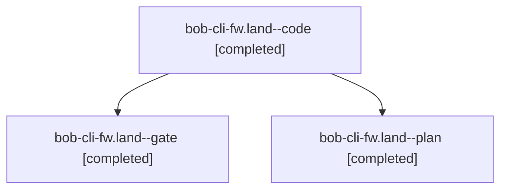

# Session: bob-cli-fw.land

[Agent Hoods](../README.md) / [bbugyi200](../users/bbugyi200/README.md) / [athena](../users/bbugyi200/machines/athena/README.md) / [bob-cli-fw](../users/bbugyi200/machines/athena/hoods/bob-cli-fw/README.md) / bob-cli-fw.land

Owner: `bbugyi200.athena` · Hood: `bob-cli-fw` · Members: 3 · Bead: [bob-cli-fw](https://github.com/bobs-org/bob-cli--beads/blob/main/pages/bob-cli-fw/README.md)

## Lineage

The diagram is an optional enhancement; the ordered table below contains the same lineage in accessible text.

| Role | Agent | State | Model / provider | Timing | Commits | Prompt | Chat |
|---|---|---|---|---|---:|---|---|
| code | bob-cli-fw.land--code | completed | grok-4.6 / grok | 2026-11-02T16:22:00.728137+00:00 → 2026-11-02T16:53:34.994433+00:00 | [1](../agents/bbugyi200.athena.bob-cli-fw.land--code/README.md#commits) | — | [Chat](../agents/bbugyi200.athena.bob-cli-fw.land--code/chat.md) |
| gate | bob-cli-fw.land--gate | completed | gpt-6-astra / codex | 2026-11-02T16:21:11.543175+00:00 → 2026-11-02T16:21:31.785014+00:00 | 0 | — | [Chat](../agents/bbugyi200.athena.bob-cli-fw.land--gate/chat.md) |
| plan | bob-cli-fw.land--plan | completed | gpt-6-astra / codex | 2026-11-02T16:12:19.940839+00:00 → 2026-11-02T16:53:34.994433+00:00 | 0 | [Prompt](../agents/bbugyi200.athena.bob-cli-fw.land--plan/prompt.md) | [Chat](../agents/bbugyi200.athena.bob-cli-fw.land--plan/chat.md) |

## Commits

| Role | Repo | Commit | Subject | Committed |
|---|---|---|---|---|
| code | bob-cli | [`2d45cd0`](https://github.com/bobs-org/bob-cli/commit/2d45cd02d168ce080d7c5d694a493db83d01288c) | fix(capture): keep implied merge dest identity through ledger edits | 2026-11-02 11:52:52 EST |

## Neighbors

| Agent | Relation | State |
|---|---|---|
| [bob-cli-fw.1](bbugyi200.athena.bob-cli-fw.1.md) (session · 9) | bob-cli-fw hood | completed 6, failed 3 |
| [bob-cli-fw.2](../agents/bbugyi200.athena.bob-cli-fw.2/README.md) | bob-cli-fw hood | completed |
