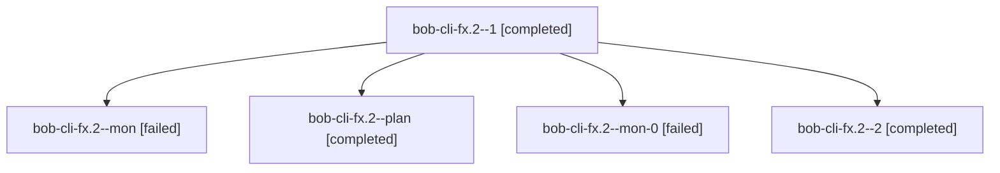

# Session: bob-cli-fx.2

[Agent Hoods](../README.md) / [bbugyi200](../users/bbugyi200/README.md) / [athena](../users/bbugyi200/machines/athena/README.md) / [bob-cli-fx](../users/bbugyi200/machines/athena/hoods/bob-cli-fx/README.md) / bob-cli-fx.2

Owner: `bbugyi200.athena` · Hood: `bob-cli-fx` · Members: 5 · Bead: [bob-cli-fx.2](https://github.com/bobs-org/bob-cli--beads/blob/main/pages/bob-cli-fx/bob-cli-fx.2.md)

## Lineage

The diagram is an optional enhancement; the ordered table below contains the same lineage in accessible text.

| Role | Agent | State | Model / provider | Timing | Commits | Prompt | Chat |
|---|---|---|---|---|---:|---|---|
| 1 | bob-cli-fx.2--1 | completed | gpt-6-luna / codex | 2026-11-02T15:58:18.227460+00:00 → 2026-11-02T16:01:15.459355+00:00 | 0 | [Prompt](../agents/bbugyi200.athena.bob-cli-fx.2--1/prompt.md) | [Chat](../agents/bbugyi200.athena.bob-cli-fx.2--1/chat.md) |
| mon | bob-cli-fx.2--mon | failed | gpt-6-luna / codex | 2026-11-02T15:55:18.907992+00:00 → 2026-11-02T15:57:32.242840+00:00 | 0 | — | — |
| plan | bob-cli-fx.2--plan | completed | gpt-6-luna / codex | 2026-11-02T15:48:22.512492+00:00 → 2026-11-02T15:55:29.791067+00:00 | 0 | [Prompt](../agents/bbugyi200.athena.bob-cli-fx.2--plan/prompt.md) | [Chat](../agents/bbugyi200.athena.bob-cli-fx.2--plan/chat.md) |
| mon-0 | bob-cli-fx.2--mon-0 | failed | gpt-6-luna / codex | 2026-11-02T16:01:03.958987+00:00 → 2026-11-02T16:03:18.867569+00:00 | 0 | — | — |
| 2 | bob-cli-fx.2--2 | completed | muse-spark-1.3-contributor / muse | 2026-11-02T16:03:55.414495+00:00 → 2026-11-02T16:08:16.522604+00:00 | [1](../agents/bbugyi200.athena.bob-cli-fx.2--2/README.md#commits) | — | — |

## Commits

| Role | Repo | Commit | Subject | Committed |
|---|---|---|---|---|
| 2 | bob-cli | [`876ae77`](https://github.com/bobs-org/bob-cli/commit/876ae775e2681ad981383278b6fd5b61ab704fe6) | docs(capture): Obsidian Ctrl+Enter mirrors MEET-continuation-last placement | 2026-11-02 11:07:38 EST |

## Neighbors

| Agent | Relation | State |
|---|---|---|
| [bob-cli-fx.1](../agents/bbugyi200.athena.bob-cli-fx.1/README.md) | bob-cli-fx hood | completed |
| [bob-cli-fx.land](bbugyi200.athena.bob-cli-fx.land.md) (session · 3) | bob-cli-fx hood | completed 3 |
