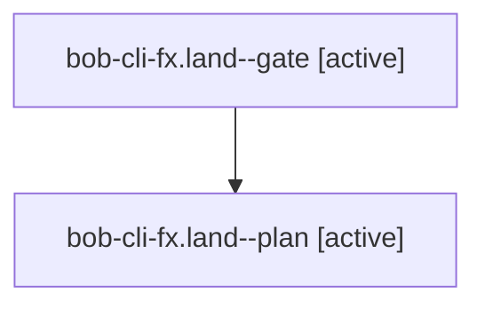

# Session: bob-cli-fx.land

[Agent Hoods](../README.md) / [bbugyi200](../users/bbugyi200/README.md) / [athena](../users/bbugyi200/machines/athena/README.md) / [bob-cli-fx](../users/bbugyi200/machines/athena/hoods/bob-cli-fx/README.md) / bob-cli-fx.land

Owner: `bbugyi200.athena` · Hood: `bob-cli-fx` · Members: 2 · Bead: [bob-cli-fx](https://github.com/bobs-org/bob-cli--beads/blob/main/pages/bob-cli-fx/README.md)

## Lineage



The diagram is an optional enhancement; the ordered table below contains the same lineage in accessible text.

| Role | Agent | State | Model / provider | Timing | Commits | Prompt | Chat |
|---|---|---|---|---|---:|---|---|
| <a id="member-gate"></a>gate | bob-cli-fx.land--gate | active | gpt-6-astra / codex | 2026-11-02T16:24:16.712572+00:00 | 0 | — | — |
| <a id="member-plan"></a>plan | bob-cli-fx.land--plan | active | gpt-6-astra / codex | 2026-11-02T16:08:39.729149+00:00 | 0 | [Prompt](../agents/bbugyi200.athena.bob-cli-fx.land--plan/prompt.md) | — |

## Variables

| Role | Variable | Value |
|---|---|---|
| plan | `artifacts` | \[{bead: bob-cli-fx, kind: file, label: MEET landing: five pre-existing plugin test failures, path: /home/bryan/.sase/artifacts/agents/gh\_bobs-org\_\_bob-cli/20261102100757/bob-fx-plugin-audit-be951dd49… |

#### artifacts

**Role:** `plan`

```yaml
- bead: bob-cli-fx
  kind: file
  label: MEET landing: five pre-existing plugin test failures
  path: /home/bryan/.sase/artifacts/agents/gh_bobs-org__bob-cli/20261102100757/bob-fx-plugin-audit-be951dd49929.log
  ref: file:explicit:0201e20ab57a269a1d560ad4
  source_path: /tmp/bob-fx-plugin-audit.log
- bead: bob-cli-fx
  kind: file
  label: MEET landing: existing wikilink CPU budget failures
  path: /home/bryan/.sase/artifacts/agents/gh_bobs-org__bob-cli/20261102100757/bob-fx-perf-audit-a33ca4d3f541.log
  ref: file:explicit:dd79208b8c6d14c0a47fb839
  source_path: /tmp/bob-fx-perf-audit.log
- bead: bob-cli-fx
  kind: file
  label: MEET landing: reproduced placement and successor gaps, fixture and docs audit
  path: /home/bryan/.sase/artifacts/agents/gh_bobs-org__bob-cli/20261102100757/bob-fx-placement-probes-22d9fbc05b0a.log
  ref: file:explicit:09e9d220720061d1919e7c2e
  source_path: /tmp/bob-fx-placement-probes.log
```

Values are truncated for display; see each member's agent meta.json for the full values.

## Neighbors

| Agent | Relation | State |
|---|---|---|
| [bob-cli-fx.1](../agents/bbugyi200.athena.bob-cli-fx.1/README.md) | bob-cli-fx hood | completed |
| [bob-cli-fx.2](bbugyi200.athena.bob-cli-fx.2.md) (session · 5) | bob-cli-fx hood | completed 3, failed 2 |
