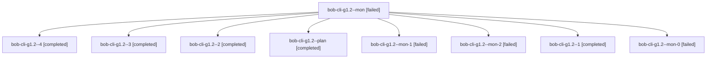

# Session: bob-cli-g1.2

[Agent Hoods](../README.md) / [bbugyi200](../users/bbugyi200/README.md) / [athena](../users/bbugyi200/machines/athena/README.md) / [bob-cli-g1](../users/bbugyi200/machines/athena/hoods/bob-cli-g1/README.md) / bob-cli-g1.2

Owner: `bbugyi200.athena` · Hood: `bob-cli-g1` · Members: 9 · Bead: [bob-cli-g1.2](https://github.com/bobs-org/bob-cli--beads/blob/main/pages/bob-cli-g1/bob-cli-g1.2.md)

## Lineage

The diagram is an optional enhancement; the ordered table below contains the same lineage in accessible text.

| Role | Agent | State | Model / provider | Timing | Commits | Prompt | Chat |
|---|---|---|---|---|---:|---|---|
| mon | bob-cli-g1.2--mon | failed | gpt-6-luna / codex | 2026-11-02T18:14:55.430598+00:00 → 2026-11-02T19:01:18.592757+00:00 | 0 | — | — |
| 4 | bob-cli-g1.2--4 | completed | muse-spark-1.3-contributor / muse | 2026-11-02T19:36:19.125021+00:00 → 2026-11-02T19:46:10.294786+00:00 | 0 | — | — |
| 3 | bob-cli-g1.2--3 | completed | gpt-6-luna / codex | 2026-11-02T19:26:33.137215+00:00 → 2026-11-02T19:29:43.226754+00:00 | 0 | — | — |
| 2 | bob-cli-g1.2--2 | completed | gpt-6-luna / codex | 2026-11-02T19:17:23.301621+00:00 → 2026-11-02T19:22:46.779936+00:00 | 0 | — | — |
| plan | bob-cli-g1.2--plan | completed | gpt-6-luna / codex | 2026-11-02T17:59:38.260671+00:00 → 2026-11-02T18:15:01.438754+00:00 | 0 | [Prompt](../agents/bbugyi200.athena.bob-cli-g1.2--plan/prompt.md) | [Chat](../agents/bbugyi200.athena.bob-cli-g1.2--plan/chat.md) |
| mon-1 | bob-cli-g1.2--mon-1 | failed | gpt-6-luna / codex | 2026-11-02T19:22:40.495068+00:00 → 2026-11-02T19:25:38.770218+00:00 | 0 | — | — |
| mon-2 | bob-cli-g1.2--mon-2 | failed | gpt-6-luna / codex | 2026-11-02T19:29:36.730846+00:00 → 2026-11-02T19:35:30.708634+00:00 | 0 | — | — |
| 1 | bob-cli-g1.2--1 | completed | gpt-6-luna / codex | 2026-11-02T19:01:54.164551+00:00 → 2026-11-02T19:13:47.741201+00:00 | 0 | [Prompt](../agents/bbugyi200.athena.bob-cli-g1.2--1/prompt.md) | — |
| mon-0 | bob-cli-g1.2--mon-0 | failed | gpt-6-luna / codex | 2026-11-02T19:13:40.927876+00:00 → 2026-11-02T19:16:36.636382+00:00 | 0 | — | — |

## Neighbors

| Agent | Relation | State |
|---|---|---|
| [bob-cli-g1.1](../agents/bbugyi200.athena.bob-cli-g1.1/README.md) | bob-cli-g1 hood | completed |
| [bob-cli-g1.3](../agents/bbugyi200.athena.bob-cli-g1.3/README.md) | bob-cli-g1 hood | completed |
| [bob-cli-g1.land](bbugyi200.athena.bob-cli-g1.land.md) (session · 2) | bob-cli-g1 hood | active 2 |
