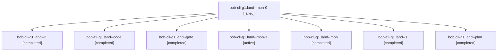

# Session: bob-cli-g1.land

[Agent Hoods](../README.md) / [bbugyi200](../users/bbugyi200/README.md) / [athena](../users/bbugyi200/machines/athena/README.md) / [bob-cli-g1](../users/bbugyi200/machines/athena/hoods/bob-cli-g1/README.md) / bob-cli-g1.land

Owner: `bbugyi200.athena` · Hood: `bob-cli-g1` · Members: 8 · Bead: [bob-cli-g1](https://github.com/bobs-org/bob-cli--beads/blob/main/pages/bob-cli-g1/README.md)

## Lineage



The diagram is an optional enhancement; the ordered table below contains the same lineage in accessible text.

| Role | Agent | State | Model / provider | Timing | Commits | Prompt | Chat |
|---|---|---|---|---|---:|---|---|
| <a id="member-mon-0"></a>mon-0 | bob-cli-g1.land--mon-0 | failed | gpt-6-luna / codex | 2026-11-02T20:57:34.130829+00:00 → 2026-11-02T21:03:46.103360+00:00 | 0 | — | — |
| <a id="member-2"></a>2 | bob-cli-g1.land--2 | completed | grok-4.6 / grok | 2026-11-02T21:04:36.155705+00:00 → 2026-11-02T21:14:55.206200+00:00 | 0 | [Prompt](../agents/bbugyi200.athena.bob-cli-g1.land--2/prompt.md) | [Chat](../agents/bbugyi200.athena.bob-cli-g1.land--2/chat.md) |
| <a id="member-code"></a>code | bob-cli-g1.land--code | completed | gpt-6-luna / codex | 2026-11-02T20:44:47.698333+00:00 → 2026-11-02T20:52:50.459346+00:00 | 0 | — | [Chat](../agents/bbugyi200.athena.bob-cli-g1.land--code/chat.md) |
| <a id="member-gate"></a>gate | bob-cli-g1.land--gate | completed | gpt-6-astra / codex | 2026-11-02T20:43:55.879851+00:00 → 2026-11-02T20:44:18.787594+00:00 | 0 | — | [Chat](../agents/bbugyi200.athena.bob-cli-g1.land--gate/chat.md) |
| <a id="member-mon-1"></a>mon-1 | bob-cli-g1.land--mon-1 | active | grok-4.6 / grok | 2026-11-02T21:14:47.207104+00:00 | 0 | — | — |
| <a id="member-mon"></a>mon | bob-cli-g1.land--mon | completed | gpt-6-luna / codex | 2026-11-02T20:52:41.557687+00:00 → 2026-11-02T20:54:26.769931+00:00 | 0 | — | [Chat](../agents/bbugyi200.athena.bob-cli-g1.land--mon/chat.md) |
| <a id="member-1"></a>1 | bob-cli-g1.land--1 | completed | gpt-6-luna / codex | 2026-11-02T20:55:23.576476+00:00 → 2026-11-02T20:57:40.641998+00:00 | 0 | [Prompt](../agents/bbugyi200.athena.bob-cli-g1.land--1/prompt.md) | [Chat](../agents/bbugyi200.athena.bob-cli-g1.land--1/chat.md) |
| <a id="member-plan"></a>plan | bob-cli-g1.land--plan | completed | gpt-6-astra / codex | 2026-11-02T20:31:32.430527+00:00 → 2026-11-02T20:52:50.459346+00:00 | 0 | [Prompt](../agents/bbugyi200.athena.bob-cli-g1.land--plan/prompt.md) | [Chat](../agents/bbugyi200.athena.bob-cli-g1.land--plan/chat.md) |

## Variables

| Role | Variable | Value |
|---|---|---|
| plan | `artifacts` | \[{bead: bob-cli-g1, kind: file, label: bob-cli-g1 landing: seven known plugin baseline failures on a28d1af, path: /home/bryan/.sase/artifacts/agents/gh\_bobs-org\_\_bob-cli/20261102124712/g1-land-baseli… |

#### artifacts

**Role:** `plan`

```yaml
- bead: bob-cli-g1
  kind: file
  label: bob-cli-g1 landing: seven known plugin baseline failures on a28d1af
  path: /home/bryan/.sase/artifacts/agents/gh_bobs-org__bob-cli/20261102124712/g1-land-baseline-d93d29130db5.log
  ref: file:explicit:1c86942de5e48357b13f472a
  source_path: /home/bryan/.local/state/sase/workspaces/bobs-org/bob-cli/bob-cli_15/sase/repos/linked/bob-plugins/.g1-land-baseline.log
```

Values are truncated for display; see each member's agent meta.json for the full values.

## Neighbors

| Agent | Relation | State |
|---|---|---|
| [bob-cli-g1.1](../agents/bbugyi200.athena.bob-cli-g1.1/README.md) | bob-cli-g1 hood | completed |
| [bob-cli-g1.2](bbugyi200.athena.bob-cli-g1.2.md) (session · 9) | bob-cli-g1 hood | completed 5, failed 4 |
| [bob-cli-g1.3](../agents/bbugyi200.athena.bob-cli-g1.3/README.md) | bob-cli-g1 hood | completed |
