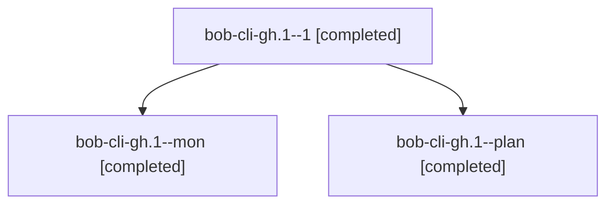

# Session: bob-cli-gh.1

[Agent Hoods](../README.md) / [bbugyi200](../users/bbugyi200/README.md) / [athena](../users/bbugyi200/machines/athena/README.md) / [bob-cli-gh](../users/bbugyi200/machines/athena/hoods/bob-cli-gh/README.md) / bob-cli-gh.1

Owner: `bbugyi200.athena` · Hood: `bob-cli-gh` · Members: 3 · Bead: [bob-cli-gh.1](https://github.com/bobs-org/bob-cli--beads/blob/main/pages/bob-cli-gh/bob-cli-gh.1.md)

## Lineage

The diagram is an optional enhancement; the ordered table below contains the same lineage in accessible text.

| Role | Agent | State | Model / provider | Timing | Commits | Prompt | Chat |
|---|---|---|---|---|---:|---|---|
| 1 | bob-cli-gh.1--1 | completed | grok-4.6 / grok | 2026-11-03T16:23:24.111341+00:00 → 2026-11-03T16:25:02.692722+00:00 | 0 | [Prompt](../agents/bbugyi200.athena.bob-cli-gh.1--1/prompt.md) | [Chat](../agents/bbugyi200.athena.bob-cli-gh.1--1/chat.md) |
| mon | bob-cli-gh.1--mon | completed | grok-4.6 / grok | 2026-11-03T16:08:50.601732+00:00 → 2026-11-03T16:19:11.509009+00:00 | 0 | — | [Chat](../agents/bbugyi200.athena.bob-cli-gh.1--mon/chat.md) |
| plan | bob-cli-gh.1--plan | completed | grok-4.6 / grok | 2026-11-03T16:04:29.759576+00:00 → 2026-11-03T16:10:20.834759+00:00 | [1](../agents/bbugyi200.athena.bob-cli-gh.1--plan/README.md#commits) | [Prompt](../agents/bbugyi200.athena.bob-cli-gh.1--plan/prompt.md) | [Chat](../agents/bbugyi200.athena.bob-cli-gh.1--plan/chat.md) |

## Commits

| Role | Repo | Commit | Subject | Committed |
|---|---|---|---|---|
| plan | bob-cli | [`2a9640a`](https://github.com/bobs-org/bob-cli/commit/2a9640a6b20c4bcb42e5e0a7cfe3eb347b5d1b44) | docs(memory): add Stats Strip and Period Note glossary strands | 2026-11-03 11:09:56 EST |

## Neighbors

| Agent | Relation | State |
|---|---|---|
| [bob-cli-gh.2](../agents/bbugyi200.athena.bob-cli-gh.2/README.md) | bob-cli-gh hood | completed |
| [bob-cli-gh.3](bbugyi200.athena.bob-cli-gh.3.md) (session · 9) | bob-cli-gh hood | completed 6, failed 3 |
| [bob-cli-gh.4](../agents/bbugyi200.athena.bob-cli-gh.4/README.md) | bob-cli-gh hood | completed |
| [bob-cli-gh.5](../agents/bbugyi200.athena.bob-cli-gh.5/README.md) | bob-cli-gh hood | waiting |
| [bob-cli-gh.6](../agents/bbugyi200.athena.bob-cli-gh.6/README.md) | bob-cli-gh hood | completed |
| [bob-cli-gh.7](../agents/bbugyi200.athena.bob-cli-gh.7/README.md) | bob-cli-gh hood | completed |
| [bob-cli-gh.8](../agents/bbugyi200.athena.bob-cli-gh.8/README.md) | bob-cli-gh hood | waiting |
| [bob-cli-gh.9](../agents/bbugyi200.athena.bob-cli-gh.9/README.md) | bob-cli-gh hood | waiting |
| [bob-cli-gh.land](../agents/bbugyi200.athena.bob-cli-gh.land/README.md) | bob-cli-gh hood | waiting |
