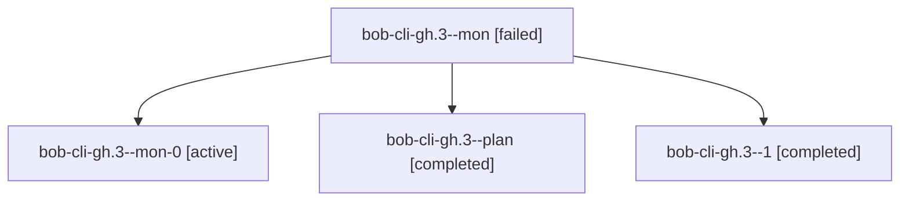

# Session: bob-cli-gh.3

[Agent Hoods](../README.md) / [bbugyi200](../users/bbugyi200/README.md) / [athena](../users/bbugyi200/machines/athena/README.md) / [bob-cli-gh](../users/bbugyi200/machines/athena/hoods/bob-cli-gh/README.md) / bob-cli-gh.3

Owner: `bbugyi200.athena` · Hood: `bob-cli-gh` · Members: 4 · Bead: [bob-cli-gh.3](https://github.com/bobs-org/bob-cli--beads/blob/main/pages/bob-cli-gh/bob-cli-gh.3.md)

## Lineage

The diagram is an optional enhancement; the ordered table below contains the same lineage in accessible text.

| Role | Agent | State | Model / provider | Timing | Commits | Prompt | Chat |
|---|---|---|---|---|---:|---|---|
| mon | bob-cli-gh.3--mon | failed | gpt-6-luna / codex | 2026-11-03T17:29:22.410280+00:00 → 2026-11-03T17:32:48.292960+00:00 | 0 | — | [Chat](../agents/bbugyi200.athena.bob-cli-gh.3--mon/chat.md) |
| mon-0 | bob-cli-gh.3--mon-0 | active | gpt-6-luna / codex | 2026-11-03T17:38:01.586215+00:00 | 0 | — | — |
| plan | bob-cli-gh.3--plan | completed | gpt-6-luna / codex | 2026-11-03T17:00:07.929355+00:00 → 2026-11-03T17:29:55.417799+00:00 | 0 | [Prompt](../agents/bbugyi200.athena.bob-cli-gh.3--plan/prompt.md) | [Chat](../agents/bbugyi200.athena.bob-cli-gh.3--plan/chat.md) |
| 1 | bob-cli-gh.3--1 | completed | gpt-6-luna / codex | 2026-11-03T17:33:30.750712+00:00 → 2026-11-03T17:40:11.481251+00:00 | 0 | [Prompt](../agents/bbugyi200.athena.bob-cli-gh.3--1/prompt.md) | [Chat](../agents/bbugyi200.athena.bob-cli-gh.3--1/chat.md) |

## Neighbors

| Agent | Relation | State |
|---|---|---|
| [bob-cli-gh.1](bbugyi200.athena.bob-cli-gh.1.md) (session · 3) | bob-cli-gh hood | completed 3 |
| [bob-cli-gh.2](../agents/bbugyi200.athena.bob-cli-gh.2/README.md) | bob-cli-gh hood | completed |
| [bob-cli-gh.4](../agents/bbugyi200.athena.bob-cli-gh.4/README.md) | bob-cli-gh hood | waiting |
| [bob-cli-gh.5](../agents/bbugyi200.athena.bob-cli-gh.5/README.md) | bob-cli-gh hood | waiting |
| [bob-cli-gh.6](../agents/bbugyi200.athena.bob-cli-gh.6/README.md) | bob-cli-gh hood | completed |
| [bob-cli-gh.7](../agents/bbugyi200.athena.bob-cli-gh.7/README.md) | bob-cli-gh hood | waiting |
| [bob-cli-gh.8](../agents/bbugyi200.athena.bob-cli-gh.8/README.md) | bob-cli-gh hood | waiting |
| [bob-cli-gh.9](../agents/bbugyi200.athena.bob-cli-gh.9/README.md) | bob-cli-gh hood | waiting |
| [bob-cli-gh.land](../agents/bbugyi200.athena.bob-cli-gh.land/README.md) | bob-cli-gh hood | waiting |
