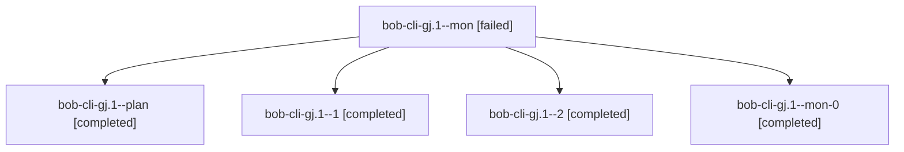

# Session: bob-cli-gj.1

[Agent Hoods](../README.md) / [bbugyi200](../users/bbugyi200/README.md) / [athena](../users/bbugyi200/machines/athena/README.md) / [bob-cli-gj](../users/bbugyi200/machines/athena/hoods/bob-cli-gj/README.md) / bob-cli-gj.1

Owner: `bbugyi200.athena` · Hood: `bob-cli-gj` · Members: 5 · Bead: [bob-cli-gj.1](https://github.com/bobs-org/bob-cli--beads/blob/main/pages/bob-cli-gj/bob-cli-gj.1.md)

## Lineage

The diagram is an optional enhancement; the ordered table below contains the same lineage in accessible text.

| Role | Agent | State | Model / provider | Timing | Commits | Prompt | Chat |
|---|---|---|---|---|---:|---|---|
| mon | bob-cli-gj.1--mon | failed | gpt-6-luna / codex | 2026-11-03T17:08:11.307993+00:00 → 2026-11-03T17:12:15.373327+00:00 | 0 | — | [Chat](../agents/bbugyi200.athena.bob-cli-gj.1--mon/chat.md) |
| plan | bob-cli-gj.1--plan | completed | gpt-6-luna / codex | 2026-11-03T16:59:37.200424+00:00 → 2026-11-03T17:08:51.733142+00:00 | 0 | [Prompt](../agents/bbugyi200.athena.bob-cli-gj.1--plan/prompt.md) | [Chat](../agents/bbugyi200.athena.bob-cli-gj.1--plan/chat.md) |
| 1 | bob-cli-gj.1--1 | completed | gpt-6-luna / codex | 2026-11-03T17:13:05.655573+00:00 → 2026-11-03T17:14:38.443235+00:00 | 0 | [Prompt](../agents/bbugyi200.athena.bob-cli-gj.1--1/prompt.md) | [Chat](../agents/bbugyi200.athena.bob-cli-gj.1--1/chat.md) |
| 2 | bob-cli-gj.1--2 | completed | muse-spark-1.3-contributor / muse | 2026-11-03T17:19:43.254114+00:00 → 2026-11-03T17:22:11.942059+00:00 | [1](../agents/bbugyi200.athena.bob-cli-gj.1--2/README.md#commits) | [Prompt](../agents/bbugyi200.athena.bob-cli-gj.1--2/prompt.md) | [Chat](../agents/bbugyi200.athena.bob-cli-gj.1--2/chat.md) |
| mon-0 | bob-cli-gj.1--mon-0 | completed | gpt-6-luna / codex | 2026-11-03T17:14:00.852329+00:00 → 2026-11-03T17:18:50.914045+00:00 | 0 | — | [Chat](../agents/bbugyi200.athena.bob-cli-gj.1--mon-0/chat.md) |

## Commits

| Role | Repo | Commit | Subject | Committed |
|---|---|---|---|---|
| 2 | bob-cli | [`fa077d2`](https://github.com/bobs-org/bob-cli/commit/fa077d2f8eb8783f2c6d9a65147ba9ef6844bcd8) | docs(contract): note-pull contract docs, copy, and NP vectors | 2026-11-03 12:21:39 EST |

## Neighbors

| Agent | Relation | State |
|---|---|---|
| [bob-cli-gj.2](../agents/bbugyi200.athena.bob-cli-gj.2/README.md) | bob-cli-gj hood | waiting |
| [bob-cli-gj.3](../agents/bbugyi200.athena.bob-cli-gj.3/README.md) | bob-cli-gj hood | waiting |
| [bob-cli-gj.land](../agents/bbugyi200.athena.bob-cli-gj.land/README.md) | bob-cli-gj hood | waiting |
