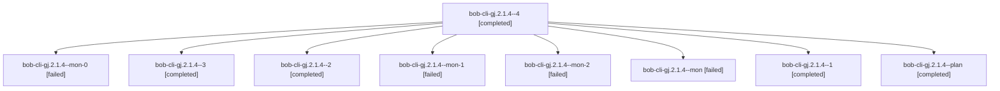

# Session: bob-cli-gj.2.1.4

[Agent Hoods](../README.md) / [bbugyi200](../users/bbugyi200/README.md) / [athena](../users/bbugyi200/machines/athena/README.md) / [bob-cli-gj](../users/bbugyi200/machines/athena/hoods/bob-cli-gj/README.md) / bob-cli-gj.2.1.4

Owner: `bbugyi200.athena` · Hood: `bob-cli-gj` · Members: 9 · Bead: [bob-cli-gj.2.1.4](https://github.com/bobs-org/bob-cli--beads/blob/main/pages/bob-cli-gj/bob-cli-gj.2.1.4.md)

## Lineage

The diagram is an optional enhancement; the ordered table below contains the same lineage in accessible text.

| Role | Agent | State | Model / provider | Timing | Commits | Prompt | Chat |
|---|---|---|---|---|---:|---|---|
| 4 | bob-cli-gj.2.1.4--4 | completed | gpt-6-luna / codex | 2026-11-03T21:22:57.783625+00:00 → 2026-11-03T22:25:48.487877+00:00 | [1](../agents/bbugyi200.athena.bob-cli-gj.2.1.4--4/README.md#commits) | [Prompt](../agents/bbugyi200.athena.bob-cli-gj.2.1.4--4/prompt.md) | [Chat](../agents/bbugyi200.athena.bob-cli-gj.2.1.4--4/chat.md) |
| mon-0 | bob-cli-gj.2.1.4--mon-0 | failed | gpt-6-luna / codex | 2026-11-03T20:58:14.657850+00:00 → 2026-11-03T21:03:30.847275+00:00 | 0 | — | [Chat](../agents/bbugyi200.athena.bob-cli-gj.2.1.4--mon-0/chat.md) |
| 3 | bob-cli-gj.2.1.4--3 | completed | gpt-6-luna / codex | 2026-11-03T21:14:46.161654+00:00 → 2026-11-03T21:17:56.868851+00:00 | 0 | [Prompt](../agents/bbugyi200.athena.bob-cli-gj.2.1.4--3/prompt.md) | [Chat](../agents/bbugyi200.athena.bob-cli-gj.2.1.4--3/chat.md) |
| 2 | bob-cli-gj.2.1.4--2 | completed | gpt-6-luna / codex | 2026-11-03T21:04:47.904445+00:00 → 2026-11-03T21:09:53.444439+00:00 | 0 | [Prompt](../agents/bbugyi200.athena.bob-cli-gj.2.1.4--2/prompt.md) | [Chat](../agents/bbugyi200.athena.bob-cli-gj.2.1.4--2/chat.md) |
| mon-1 | bob-cli-gj.2.1.4--mon-1 | failed | gpt-6-luna / codex | 2026-11-03T21:09:22.665999+00:00 → 2026-11-03T21:13:53.211662+00:00 | 0 | — | [Chat](../agents/bbugyi200.athena.bob-cli-gj.2.1.4--mon-1/chat.md) |
| mon-2 | bob-cli-gj.2.1.4--mon-2 | failed | gpt-6-luna / codex | 2026-11-03T21:17:27.116105+00:00 → 2026-11-03T21:22:03.939101+00:00 | 0 | — | [Chat](../agents/bbugyi200.athena.bob-cli-gj.2.1.4--mon-2/chat.md) |
| mon | bob-cli-gj.2.1.4--mon | failed | gpt-6-luna / codex | 2026-11-03T20:51:11.790813+00:00 → 2026-11-03T20:55:08.302273+00:00 | 0 | — | [Chat](../agents/bbugyi200.athena.bob-cli-gj.2.1.4--mon/chat.md) |
| 1 | bob-cli-gj.2.1.4--1 | completed | gpt-6-luna / codex | 2026-11-03T20:55:56.151515+00:00 → 2026-11-03T20:58:47.506998+00:00 | 0 | [Prompt](../agents/bbugyi200.athena.bob-cli-gj.2.1.4--1/prompt.md) | [Chat](../agents/bbugyi200.athena.bob-cli-gj.2.1.4--1/chat.md) |
| plan | bob-cli-gj.2.1.4--plan | completed | gpt-6-luna / codex | 2026-11-03T20:22:46.256288+00:00 → 2026-11-03T20:52:12.024867+00:00 | 0 | [Prompt](../agents/bbugyi200.athena.bob-cli-gj.2.1.4--plan/prompt.md) | [Chat](../agents/bbugyi200.athena.bob-cli-gj.2.1.4--plan/chat.md) |

## Commits

| Role | Repo | Commit | Subject | Committed |
|---|---|---|---|---|
| 4 | bob-cli | [`093dcea`](https://github.com/bobs-org/bob-cli/commit/093dceade9085d57cbd4cdda96478258bed779b9) | feat(capture): add note-pull conformance evidence | 2026-11-03 17:25:17 EST |

## Neighbors

| Agent | Relation | State |
|---|---|---|
| [bob-cli-gj.2](bbugyi200.athena.bob-cli-gj.2.md) (session · 3) | ancestor | active 1, completed 2 |
| [bob-cli-gj.2.1.1](../agents/bbugyi200.athena.bob-cli-gj.2.1.1/README.md) | bob-cli-gj.2.1 hood | completed |
| [bob-cli-gj.2.1.2](../agents/bbugyi200.athena.bob-cli-gj.2.1.2/README.md) | bob-cli-gj.2.1 hood | completed |
| [bob-cli-gj.2.1.3](../agents/bbugyi200.athena.bob-cli-gj.2.1.3/README.md) | bob-cli-gj.2.1 hood | completed |
| [bob-cli-gj.2.1.land](bbugyi200.athena.bob-cli-gj.2.1.land.md) (session · 3) | bob-cli-gj.2.1 hood | completed 3 |
| [bob-cli-gj.1](bbugyi200.athena.bob-cli-gj.1.md) (session · 5) | bob-cli-gj hood | completed 4, failed 1 |
| [bob-cli-gj.3](bbugyi200.athena.bob-cli-gj.3.md) (session · 9) | bob-cli-gj hood | active 1, completed 4, failed 4 |
| [bob-cli-gj.land](../agents/bbugyi200.athena.bob-cli-gj.land/README.md) | bob-cli-gj hood | waiting |
