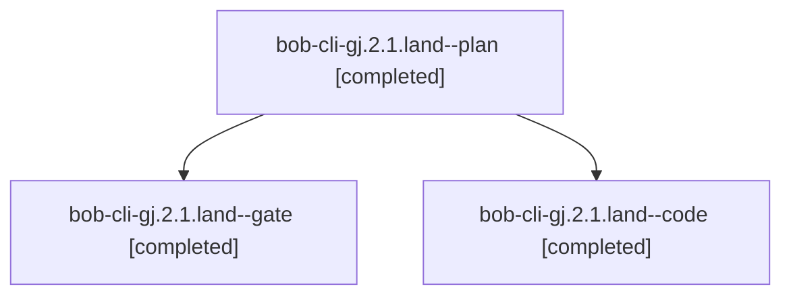

# Session: bob-cli-gj.2.1.land

[Agent Hoods](../README.md) / [bbugyi200](../users/bbugyi200/README.md) / [athena](../users/bbugyi200/machines/athena/README.md) / [bob-cli-gj](../users/bbugyi200/machines/athena/hoods/bob-cli-gj/README.md) / bob-cli-gj.2.1.land

Owner: `bbugyi200.athena` · Hood: `bob-cli-gj` · Members: 3 · Bead: [bob-cli-gj.2.1](https://github.com/bobs-org/bob-cli--beads/blob/main/pages/bob-cli-gj/bob-cli-gj.2.1.md)

## Lineage

The diagram is an optional enhancement; the ordered table below contains the same lineage in accessible text.

| Role | Agent | State | Model / provider | Timing | Commits | Prompt | Chat |
|---|---|---|---|---|---:|---|---|
| plan | bob-cli-gj.2.1.land--plan | completed | opus / claude | 2026-11-04T11:50:54.280994+00:00 → 2026-11-04T14:44:53.892294+00:00 | 0 | [Prompt](../agents/bbugyi200.athena.bob-cli-gj.2.1.land--plan/prompt.md) | [Chat](../agents/bbugyi200.athena.bob-cli-gj.2.1.land--plan/chat.md) |
| gate | bob-cli-gj.2.1.land--gate | completed | opus / claude | 2026-11-04T12:29:00.293208+00:00 → 2026-11-04T12:29:21.813104+00:00 | 0 | — | [Chat](../agents/bbugyi200.athena.bob-cli-gj.2.1.land--gate/chat.md) |
| code | bob-cli-gj.2.1.land--code | completed | muse-spark-1.3-contributor / muse | 2026-11-04T12:30:13.739712+00:00 → 2026-11-04T14:44:53.892294+00:00 | [1](../agents/bbugyi200.athena.bob-cli-gj.2.1.land--code/README.md#commits) | — | [Chat](../agents/bbugyi200.athena.bob-cli-gj.2.1.land--code/chat.md) |

## Commits

| Role | Repo | Commit | Subject | Committed |
|---|---|---|---|---|
| code | bob-cli | [`cbc35ad`](https://github.com/bobs-org/bob-cli/commit/cbc35adf64a843f25a8adc9855e823f696b088ed) | feat(capture): optimize note-pull landing with move-aware ownership | 2026-11-04 09:43:56 EST |

## Neighbors

| Agent | Relation | State |
|---|---|---|
| [bob-cli-gj.2](bbugyi200.athena.bob-cli-gj.2.md) (session · 3) | ancestor | active 1, completed 2 |
| [bob-cli-gj.2.1.1](../agents/bbugyi200.athena.bob-cli-gj.2.1.1/README.md) | bob-cli-gj.2.1 hood | completed |
| [bob-cli-gj.2.1.2](../agents/bbugyi200.athena.bob-cli-gj.2.1.2/README.md) | bob-cli-gj.2.1 hood | completed |
| [bob-cli-gj.2.1.3](../agents/bbugyi200.athena.bob-cli-gj.2.1.3/README.md) | bob-cli-gj.2.1 hood | completed |
| [bob-cli-gj.2.1.4](bbugyi200.athena.bob-cli-gj.2.1.4.md) (session · 9) | bob-cli-gj.2.1 hood | completed 5, failed 4 |
| [bob-cli-gj.1](bbugyi200.athena.bob-cli-gj.1.md) (session · 5) | bob-cli-gj hood | completed 4, failed 1 |
| [bob-cli-gj.3](bbugyi200.athena.bob-cli-gj.3.md) (session · 9) | bob-cli-gj hood | active 1, completed 4, failed 4 |
| [bob-cli-gj.land](../agents/bbugyi200.athena.bob-cli-gj.land/README.md) | bob-cli-gj hood | waiting |
