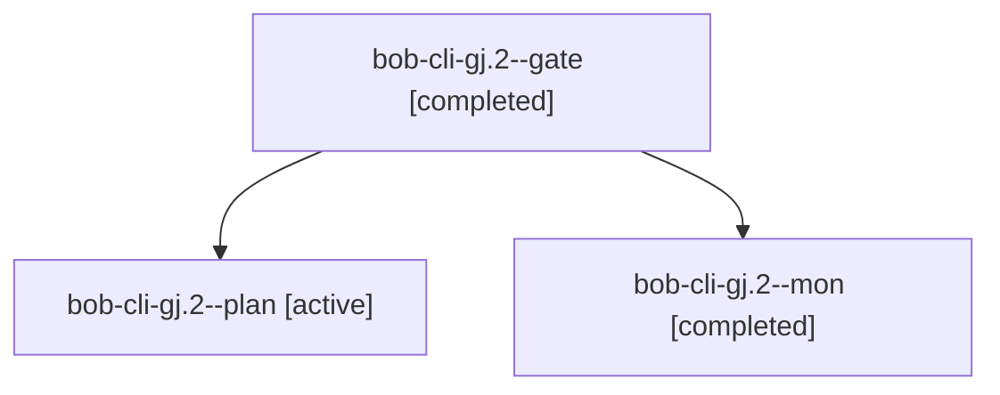

# Session: bob-cli-gj.2

[Agent Hoods](../README.md) / [bbugyi200](../users/bbugyi200/README.md) / [athena](../users/bbugyi200/machines/athena/README.md) / [bob-cli-gj](../users/bbugyi200/machines/athena/hoods/bob-cli-gj/README.md) / bob-cli-gj.2

Owner: `bbugyi200.athena` · Hood: `bob-cli-gj` · Members: 3 · Bead: [bob-cli-gj.2](https://github.com/bobs-org/bob-cli--beads/blob/main/pages/bob-cli-gj/bob-cli-gj.2.md)

## Lineage

The diagram is an optional enhancement; the ordered table below contains the same lineage in accessible text.

| Role | Agent | State | Model / provider | Timing | Commits | Prompt | Chat |
|---|---|---|---|---|---:|---|---|
| gate | bob-cli-gj.2--gate | completed | gpt-6-astra / codex | 2026-11-03T17:30:42.874483+00:00 → 2026-11-03T17:31:10.156492+00:00 | 0 | — | [Chat](../agents/bbugyi200.athena.bob-cli-gj.2--gate/chat.md) |
| plan | bob-cli-gj.2--plan | active | gpt-6-astra / codex | 2026-11-03T17:22:35.002440+00:00 → 2026-11-03T17:31:21.509871+00:00 | 0 | [Prompt](../agents/bbugyi200.athena.bob-cli-gj.2--plan/prompt.md) | [Chat](../agents/bbugyi200.athena.bob-cli-gj.2--plan/chat.md) |
| mon | bob-cli-gj.2--mon | completed | gpt-6-astra / codex | 2026-11-03T17:31:08.711020+00:00 → 2026-11-03T17:34:35.278031+00:00 | 0 | — | [Chat](../agents/bbugyi200.athena.bob-cli-gj.2--mon/chat.md) |

## Neighbors

| Agent | Relation | State |
|---|---|---|
| [bob-cli-gj.2.1.1](../agents/bbugyi200.athena.bob-cli-gj.2.1.1/README.md) | descendant | completed |
| [bob-cli-gj.2.1.2](../agents/bbugyi200.athena.bob-cli-gj.2.1.2/README.md) | descendant | completed |
| [bob-cli-gj.2.1.3](../agents/bbugyi200.athena.bob-cli-gj.2.1.3/README.md) | descendant | completed |
| [bob-cli-gj.2.1.4](bbugyi200.athena.bob-cli-gj.2.1.4.md) (session · 9) | descendant | completed 5, failed 4 |
| [bob-cli-gj.2.1.land](../agents/bbugyi200.athena.bob-cli-gj.2.1.land/README.md) | descendant | waiting |
| [bob-cli-gj.1](bbugyi200.athena.bob-cli-gj.1.md) (session · 5) | bob-cli-gj hood | completed 4, failed 1 |
| [bob-cli-gj.3](../agents/bbugyi200.athena.bob-cli-gj.3/README.md) | bob-cli-gj hood | waiting |
| [bob-cli-gj.land](../agents/bbugyi200.athena.bob-cli-gj.land/README.md) | bob-cli-gj hood | waiting |
