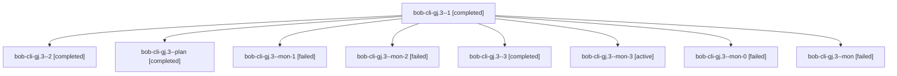

# Session: bob-cli-gj.3

[Agent Hoods](../README.md) / [bbugyi200](../users/bbugyi200/README.md) / [athena](../users/bbugyi200/machines/athena/README.md) / [bob-cli-gj](../users/bbugyi200/machines/athena/hoods/bob-cli-gj/README.md) / bob-cli-gj.3

Owner: `bbugyi200.athena` · Hood: `bob-cli-gj` · Members: 9 · Bead: [bob-cli-gj.3](https://github.com/bobs-org/bob-cli--beads/blob/main/pages/bob-cli-gj/bob-cli-gj.3.md)

## Lineage

The diagram is an optional enhancement; the ordered table below contains the same lineage in accessible text.

| Role | Agent | State | Model / provider | Timing | Commits | Prompt | Chat |
|---|---|---|---|---|---:|---|---|
| 1 | bob-cli-gj.3--1 | completed | gpt-6-luna / codex | 2026-11-04T14:08:13.060247+00:00 → 2026-11-04T14:13:07.706155+00:00 | 0 | [Prompt](../agents/bbugyi200.athena.bob-cli-gj.3--1/prompt.md) | [Chat](../agents/bbugyi200.athena.bob-cli-gj.3--1/chat.md) |
| 2 | bob-cli-gj.3--2 | completed | gpt-6-luna / codex | 2026-11-04T14:18:13.637672+00:00 → 2026-11-04T14:26:59.302002+00:00 | 0 | [Prompt](../agents/bbugyi200.athena.bob-cli-gj.3--2/prompt.md) | [Chat](../agents/bbugyi200.athena.bob-cli-gj.3--2/chat.md) |
| plan | bob-cli-gj.3--plan | completed | gpt-6-luna / codex | 2026-11-04T13:32:55.968371+00:00 → 2026-11-04T14:02:08.492824+00:00 | 0 | [Prompt](../agents/bbugyi200.athena.bob-cli-gj.3--plan/prompt.md) | [Chat](../agents/bbugyi200.athena.bob-cli-gj.3--plan/chat.md) |
| mon-1 | bob-cli-gj.3--mon-1 | failed | gpt-6-luna / codex | 2026-11-04T14:12:23.878342+00:00 → 2026-11-04T14:17:18.135100+00:00 | 0 | — | [Chat](../agents/bbugyi200.athena.bob-cli-gj.3--mon-1/chat.md) |
| mon-2 | bob-cli-gj.3--mon-2 | failed | gpt-6-luna / codex | 2026-11-04T14:26:24.142009+00:00 → 2026-11-04T14:35:33.076259+00:00 | 0 | — | [Chat](../agents/bbugyi200.athena.bob-cli-gj.3--mon-2/chat.md) |
| 3 | bob-cli-gj.3--3 | completed | gpt-6-luna / codex | 2026-11-04T14:36:43.075132+00:00 → 2026-11-04T14:38:55.374277+00:00 | 0 | [Prompt](../agents/bbugyi200.athena.bob-cli-gj.3--3/prompt.md) | [Chat](../agents/bbugyi200.athena.bob-cli-gj.3--3/chat.md) |
| mon-3 | bob-cli-gj.3--mon-3 | active | gpt-6-luna / codex | 2026-11-04T14:38:25.000606+00:00 | 0 | — | — |
| mon-0 | bob-cli-gj.3--mon-0 | failed | gpt-6-luna / codex | 2026-11-04T14:01:02.899467+00:00 → 2026-11-04T14:06:01.023403+00:00 | 0 | — | [Chat](../agents/bbugyi200.athena.bob-cli-gj.3--mon-0/chat.md) |
| mon | bob-cli-gj.3--mon | failed | gpt-6-luna / codex | 2026-11-04T13:59:08.269058+00:00 → 2026-11-04T13:59:10.391842+00:00 | 0 | — | — |

## Neighbors

| Agent | Relation | State |
|---|---|---|
| [bob-cli-gj.1](bbugyi200.athena.bob-cli-gj.1.md) (session · 5) | bob-cli-gj hood | completed 4, failed 1 |
| [bob-cli-gj.2](bbugyi200.athena.bob-cli-gj.2.md) (session · 3) | bob-cli-gj hood | active 1, completed 2 |
| [bob-cli-gj.2.1.1](../agents/bbugyi200.athena.bob-cli-gj.2.1.1/README.md) | bob-cli-gj hood | completed |
| [bob-cli-gj.2.1.2](../agents/bbugyi200.athena.bob-cli-gj.2.1.2/README.md) | bob-cli-gj hood | completed |
| [bob-cli-gj.2.1.3](../agents/bbugyi200.athena.bob-cli-gj.2.1.3/README.md) | bob-cli-gj hood | completed |
| [bob-cli-gj.2.1.4](bbugyi200.athena.bob-cli-gj.2.1.4.md) (session · 9) | bob-cli-gj hood | completed 5, failed 4 |
| [bob-cli-gj.2.1.land](bbugyi200.athena.bob-cli-gj.2.1.land.md) (session · 3) | bob-cli-gj hood | completed 3 |
| [bob-cli-gj.land](../agents/bbugyi200.athena.bob-cli-gj.land/README.md) | bob-cli-gj hood | waiting |
