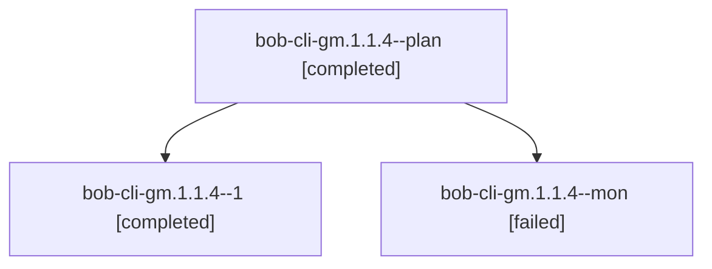

# Session: bob-cli-gm.1.1.4

[Agent Hoods](../README.md) / [bbugyi200](../users/bbugyi200/README.md) / [athena](../users/bbugyi200/machines/athena/README.md) / [bob-cli-gm](../users/bbugyi200/machines/athena/hoods/bob-cli-gm/README.md) / bob-cli-gm.1.1.4

Owner: `bbugyi200.athena` · Hood: `bob-cli-gm` · Members: 3 · Bead: [bob-cli-gm.1.1.4](https://github.com/bobs-org/bob-cli--beads/blob/main/pages/bob-cli-gm/bob-cli-gm.1.1.4.md)

## Lineage

The diagram is an optional enhancement; the ordered table below contains the same lineage in accessible text.

| Role | Agent | State | Model / provider | Timing | Commits | Prompt | Chat |
|---|---|---|---|---|---:|---|---|
| plan | bob-cli-gm.1.1.4--plan | completed | gpt-6-luna / codex | 2026-11-03T23:51:18.757383+00:00 → 2026-11-04T00:22:01.107115+00:00 | 0 | [Prompt](../agents/bbugyi200.athena.bob-cli-gm.1.1.4--plan/prompt.md) | [Chat](../agents/bbugyi200.athena.bob-cli-gm.1.1.4--plan/chat.md) |
| 1 | bob-cli-gm.1.1.4--1 | completed | gpt-6-luna / codex | 2026-11-04T00:28:47.011969+00:00 → 2026-11-04T00:53:47.752627+00:00 | [1](../agents/bbugyi200.athena.bob-cli-gm.1.1.4--1/README.md#commits) | [Prompt](../agents/bbugyi200.athena.bob-cli-gm.1.1.4--1/prompt.md) | [Chat](../agents/bbugyi200.athena.bob-cli-gm.1.1.4--1/chat.md) |
| mon | bob-cli-gm.1.1.4--mon | failed | gpt-6-luna / codex | 2026-11-04T00:21:00.378548+00:00 → 2026-11-04T00:27:58.581587+00:00 | 0 | — | [Chat](../agents/bbugyi200.athena.bob-cli-gm.1.1.4--mon/chat.md) |

## Commits

| Role | Repo | Commit | Subject | Committed |
|---|---|---|---|---|
| 1 | bob-cli | [`c341649`](https://github.com/bobs-org/bob-cli/commit/c341649a46ad1dd58f81a0be4f3930b9315964c8) | feat(capture): activate multi-target capture runs | 2026-11-03 19:53:10 EST |

## Neighbors

| Agent | Relation | State |
|---|---|---|
| [bob-cli-gm.1](bbugyi200.athena.bob-cli-gm.1.md) (session · 3) | ancestor | active 1, completed 2 |
| [bob-cli-gm.1.1.1](../agents/bbugyi200.athena.bob-cli-gm.1.1.1/README.md) | bob-cli-gm.1.1 hood | completed |
| [bob-cli-gm.1.1.2](../agents/bbugyi200.athena.bob-cli-gm.1.1.2/README.md) | bob-cli-gm.1.1 hood | completed |
| [bob-cli-gm.1.1.3](../agents/bbugyi200.athena.bob-cli-gm.1.1.3/README.md) | bob-cli-gm.1.1 hood | completed |
| [bob-cli-gm.1.1.land](bbugyi200.athena.bob-cli-gm.1.1.land.md) (session · 3) | bob-cli-gm.1.1 hood | completed 3 |
| [bob-cli-gm.2](bbugyi200.athena.bob-cli-gm.2.md) (session · 3) | bob-cli-gm hood | completed 3 |
| [bob-cli-gm.3](../agents/bbugyi200.athena.bob-cli-gm.3/README.md) | bob-cli-gm hood | completed |
| [bob-cli-gm.land](bbugyi200.athena.bob-cli-gm.land.md) (session · 3) | bob-cli-gm hood | completed 3 |
