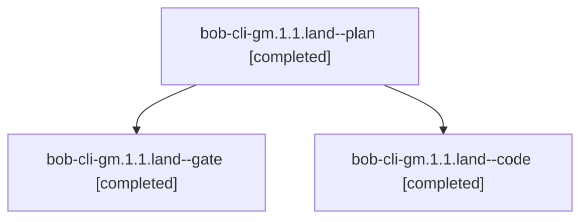

# Session: bob-cli-gm.1.1.land

[Agent Hoods](../README.md) / [bbugyi200](../users/bbugyi200/README.md) / [athena](../users/bbugyi200/machines/athena/README.md) / [bob-cli-gm](../users/bbugyi200/machines/athena/hoods/bob-cli-gm/README.md) / bob-cli-gm.1.1.land

Owner: `bbugyi200.athena` · Hood: `bob-cli-gm` · Members: 3 · Bead: [bob-cli-gm.1.1](https://github.com/bobs-org/bob-cli--beads/blob/main/pages/bob-cli-gm/bob-cli-gm.1.1.md)

## Lineage

The diagram is an optional enhancement; the ordered table below contains the same lineage in accessible text.

| Role | Agent | State | Model / provider | Timing | Commits | Prompt | Chat |
|---|---|---|---|---|---:|---|---|
| plan | bob-cli-gm.1.1.land--plan | completed | gpt-6-astra / codex | 2026-11-04T00:56:59.239171+00:00 → 2026-11-04T02:14:37.763372+00:00 | 0 | [Prompt](../agents/bbugyi200.athena.bob-cli-gm.1.1.land--plan/prompt.md) | [Chat](../agents/bbugyi200.athena.bob-cli-gm.1.1.land--plan/chat.md) |
| gate | bob-cli-gm.1.1.land--gate | completed | gpt-6-astra / codex | 2026-11-04T01:10:02.736063+00:00 → 2026-11-04T01:10:29.365390+00:00 | 0 | — | [Chat](../agents/bbugyi200.athena.bob-cli-gm.1.1.land--gate/chat.md) |
| code | bob-cli-gm.1.1.land--code | completed | gpt-6-luna / codex | 2026-11-04T01:10:57.485586+00:00 → 2026-11-04T02:14:37.763372+00:00 | [1](../agents/bbugyi200.athena.bob-cli-gm.1.1.land--code/README.md#commits) | — | [Chat](../agents/bbugyi200.athena.bob-cli-gm.1.1.land--code/chat.md) |

## Commits

| Role | Repo | Commit | Subject | Committed |
|---|---|---|---|---|
| code | bob-cli | [`ebedfca`](https://github.com/bobs-org/bob-cli/commit/ebedfca8e666a9a79e9cc2989aca0a6b78edd983) | feat(capture)!: complete target-run grammar and landing | 2026-11-03 21:13:52 EST |

## Neighbors

| Agent | Relation | State |
|---|---|---|
| [bob-cli-gm.1](bbugyi200.athena.bob-cli-gm.1.md) (session · 3) | ancestor | active 1, completed 2 |
| [bob-cli-gm.1.1.1](../agents/bbugyi200.athena.bob-cli-gm.1.1.1/README.md) | bob-cli-gm.1.1 hood | completed |
| [bob-cli-gm.1.1.2](../agents/bbugyi200.athena.bob-cli-gm.1.1.2/README.md) | bob-cli-gm.1.1 hood | completed |
| [bob-cli-gm.1.1.3](../agents/bbugyi200.athena.bob-cli-gm.1.1.3/README.md) | bob-cli-gm.1.1 hood | completed |
| [bob-cli-gm.1.1.4](bbugyi200.athena.bob-cli-gm.1.1.4.md) (session · 3) | bob-cli-gm.1.1 hood | completed 2, failed 1 |
| [bob-cli-gm.2](bbugyi200.athena.bob-cli-gm.2.md) (session · 2) | bob-cli-gm hood | active 1, completed 1 |
| [bob-cli-gm.3](../agents/bbugyi200.athena.bob-cli-gm.3/README.md) | bob-cli-gm hood | completed |
| [bob-cli-gm.land](../agents/bbugyi200.athena.bob-cli-gm.land/README.md) | bob-cli-gm hood | waiting |
