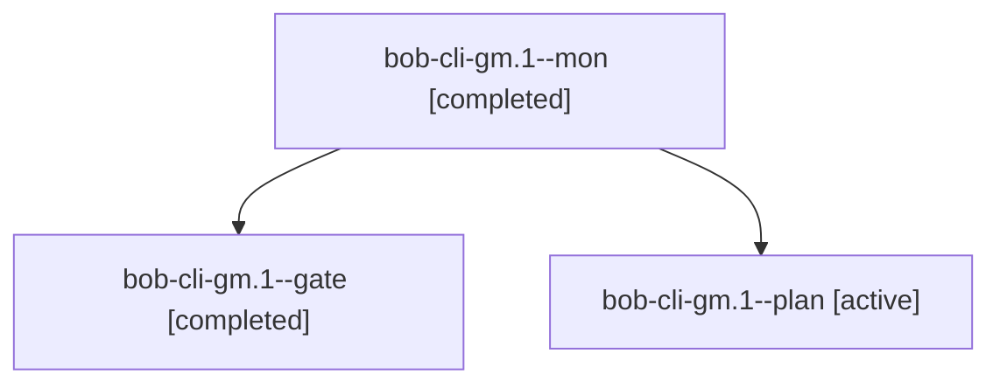

# Session: bob-cli-gm.1

[Agent Hoods](../README.md) / [bbugyi200](../users/bbugyi200/README.md) / [athena](../users/bbugyi200/machines/athena/README.md) / [bob-cli-gm](../users/bbugyi200/machines/athena/hoods/bob-cli-gm/README.md) / bob-cli-gm.1

Owner: `bbugyi200.athena` · Hood: `bob-cli-gm` · Members: 3 · Bead: [bob-cli-gm.1](https://github.com/bobs-org/bob-cli--beads/blob/main/pages/bob-cli-gm/bob-cli-gm.1.md)

## Lineage

The diagram is an optional enhancement; the ordered table below contains the same lineage in accessible text.

| Role | Agent | State | Model / provider | Timing | Commits | Prompt | Chat |
|---|---|---|---|---|---:|---|---|
| mon | bob-cli-gm.1--mon | completed | gpt-6-astra / codex | 2026-11-03T21:48:48.980000+00:00 → 2026-11-03T21:51:23.411875+00:00 | 0 | — | [Chat](../agents/bbugyi200.athena.bob-cli-gm.1--mon/chat.md) |
| gate | bob-cli-gm.1--gate | completed | gpt-6-astra / codex | 2026-11-03T21:48:26.472615+00:00 → 2026-11-03T21:48:50.086364+00:00 | 0 | — | [Chat](../agents/bbugyi200.athena.bob-cli-gm.1--gate/chat.md) |
| plan | bob-cli-gm.1--plan | active | gpt-6-astra / codex | 2026-11-03T21:42:22.022927+00:00 → 2026-11-03T21:48:54.800185+00:00 | 0 | [Prompt](../agents/bbugyi200.athena.bob-cli-gm.1--plan/prompt.md) | [Chat](../agents/bbugyi200.athena.bob-cli-gm.1--plan/chat.md) |

## Neighbors

| Agent | Relation | State |
|---|---|---|
| [bob-cli-gm.1.1.1](../agents/bbugyi200.athena.bob-cli-gm.1.1.1/README.md) | descendant | completed |
| [bob-cli-gm.1.1.2](../agents/bbugyi200.athena.bob-cli-gm.1.1.2/README.md) | descendant | completed |
| [bob-cli-gm.1.1.3](../agents/bbugyi200.athena.bob-cli-gm.1.1.3/README.md) | descendant | completed |
| [bob-cli-gm.1.1.4](../agents/bbugyi200.athena.bob-cli-gm.1.1.4/README.md) | descendant | waiting |
| [bob-cli-gm.1.1.land](../agents/bbugyi200.athena.bob-cli-gm.1.1.land/README.md) | descendant | waiting |
| [bob-cli-gm.2](../agents/bbugyi200.athena.bob-cli-gm.2/README.md) | bob-cli-gm hood | waiting |
| [bob-cli-gm.3](../agents/bbugyi200.athena.bob-cli-gm.3/README.md) | bob-cli-gm hood | waiting |
| [bob-cli-gm.land](../agents/bbugyi200.athena.bob-cli-gm.land/README.md) | bob-cli-gm hood | waiting |
