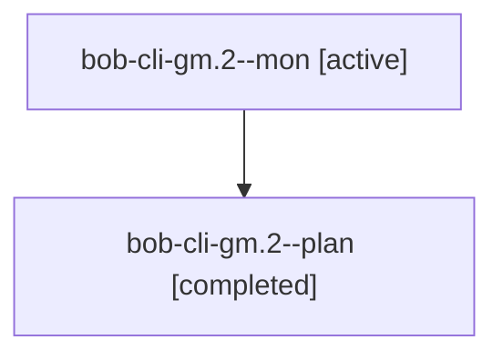

# Session: bob-cli-gm.2

[Agent Hoods](../README.md) / [bbugyi200](../users/bbugyi200/README.md) / [athena](../users/bbugyi200/machines/athena/README.md) / [bob-cli-gm](../users/bbugyi200/machines/athena/hoods/bob-cli-gm/README.md) / bob-cli-gm.2

Owner: `bbugyi200.athena` · Hood: `bob-cli-gm` · Members: 2 · Bead: [bob-cli-gm.2](https://github.com/bobs-org/bob-cli--beads/blob/main/pages/bob-cli-gm/bob-cli-gm.2.md)

## Lineage

The diagram is an optional enhancement; the ordered table below contains the same lineage in accessible text.

| Role | Agent | State | Model / provider | Timing | Commits | Prompt | Chat |
|---|---|---|---|---|---:|---|---|
| mon | bob-cli-gm.2--mon | active | gpt-6-luna / codex | 2026-11-04T03:04:38.255154+00:00 | 0 | — | — |
| plan | bob-cli-gm.2--plan | completed | gpt-6-luna / codex | 2026-11-04T02:12:07.606817+00:00 → 2026-11-04T03:30:03.944248+00:00 | [1](../agents/bbugyi200.athena.bob-cli-gm.2--plan/README.md#commits) | [Prompt](../agents/bbugyi200.athena.bob-cli-gm.2--plan/prompt.md) | [Chat](../agents/bbugyi200.athena.bob-cli-gm.2--plan/chat.md) |

## Commits

| Role | Repo | Commit | Subject | Committed |
|---|---|---|---|---|
| plan | bob-cli | [`66828cf`](https://github.com/bobs-org/bob-cli/commit/66828cfd83236c78e2844926c12cd12c861c3c5c) | feat(capture): execute adjacent task target runs | 2026-11-03 22:28:47 EST |

## Neighbors

| Agent | Relation | State |
|---|---|---|
| [bob-cli-gm.1](bbugyi200.athena.bob-cli-gm.1.md) (session · 3) | bob-cli-gm hood | active 1, completed 2 |
| [bob-cli-gm.1.1.1](../agents/bbugyi200.athena.bob-cli-gm.1.1.1/README.md) | bob-cli-gm hood | completed |
| [bob-cli-gm.1.1.2](../agents/bbugyi200.athena.bob-cli-gm.1.1.2/README.md) | bob-cli-gm hood | completed |
| [bob-cli-gm.1.1.3](../agents/bbugyi200.athena.bob-cli-gm.1.1.3/README.md) | bob-cli-gm hood | completed |
| [bob-cli-gm.1.1.4](bbugyi200.athena.bob-cli-gm.1.1.4.md) (session · 3) | bob-cli-gm hood | completed 2, failed 1 |
| [bob-cli-gm.1.1.land](bbugyi200.athena.bob-cli-gm.1.1.land.md) (session · 3) | bob-cli-gm hood | completed 3 |
| [bob-cli-gm.3](../agents/bbugyi200.athena.bob-cli-gm.3/README.md) | bob-cli-gm hood | completed |
| [bob-cli-gm.land](../agents/bbugyi200.athena.bob-cli-gm.land/README.md) | bob-cli-gm hood | waiting |
