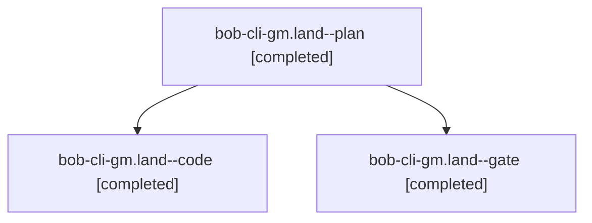

# Session: bob-cli-gm.land

[Agent Hoods](../README.md) / [bbugyi200](../users/bbugyi200/README.md) / [athena](../users/bbugyi200/machines/athena/README.md) / [bob-cli-gm](../users/bbugyi200/machines/athena/hoods/bob-cli-gm/README.md) / bob-cli-gm.land

Owner: `bbugyi200.athena` · Hood: `bob-cli-gm` · Members: 3 · Bead: [bob-cli-gm](https://github.com/bobs-org/bob-cli--beads/blob/main/pages/bob-cli-gm/README.md)

## Lineage

The diagram is an optional enhancement; the ordered table below contains the same lineage in accessible text.

| Role | Agent | State | Model / provider | Timing | Commits | Prompt | Chat |
|---|---|---|---|---|---:|---|---|
| plan | bob-cli-gm.land--plan | completed | gpt-6-astra / codex | 2026-11-04T03:42:21.195125+00:00 → 2026-11-04T04:37:52.614306+00:00 | 0 | [Prompt](../agents/bbugyi200.athena.bob-cli-gm.land--plan/prompt.md) | [Chat](../agents/bbugyi200.athena.bob-cli-gm.land--plan/chat.md) |
| code | bob-cli-gm.land--code | completed | gpt-6-luna / codex | 2026-11-04T03:54:50.882569+00:00 → 2026-11-04T04:37:52.614306+00:00 | [1](../agents/bbugyi200.athena.bob-cli-gm.land--code/README.md#commits) | — | [Chat](../agents/bbugyi200.athena.bob-cli-gm.land--code/chat.md) |
| gate | bob-cli-gm.land--gate | completed | gpt-6-astra / codex | 2026-11-04T03:54:01.887815+00:00 → 2026-11-04T03:54:22.478584+00:00 | 0 | — | [Chat](../agents/bbugyi200.athena.bob-cli-gm.land--gate/chat.md) |

## Commits

| Role | Repo | Commit | Subject | Committed |
|---|---|---|---|---|
| code | bob-cli | [`97b9d13`](https://github.com/bobs-org/bob-cli/commit/97b9d13108770debd96f1a9d19363cbfa02214d9) | fix(capture): handle multi-target completion edge cases | 2026-11-03 23:37:03 EST |

## Neighbors

| Agent | Relation | State |
|---|---|---|
| [bob-cli-gm.1](bbugyi200.athena.bob-cli-gm.1.md) (session · 3) | bob-cli-gm hood | active 1, completed 2 |
| [bob-cli-gm.1.1.1](../agents/bbugyi200.athena.bob-cli-gm.1.1.1/README.md) | bob-cli-gm hood | completed |
| [bob-cli-gm.1.1.2](../agents/bbugyi200.athena.bob-cli-gm.1.1.2/README.md) | bob-cli-gm hood | completed |
| [bob-cli-gm.1.1.3](../agents/bbugyi200.athena.bob-cli-gm.1.1.3/README.md) | bob-cli-gm hood | completed |
| [bob-cli-gm.1.1.4](bbugyi200.athena.bob-cli-gm.1.1.4.md) (session · 3) | bob-cli-gm hood | completed 2, failed 1 |
| [bob-cli-gm.1.1.land](bbugyi200.athena.bob-cli-gm.1.1.land.md) (session · 3) | bob-cli-gm hood | completed 3 |
| [bob-cli-gm.2](bbugyi200.athena.bob-cli-gm.2.md) (session · 3) | bob-cli-gm hood | completed 3 |
| [bob-cli-gm.3](../agents/bbugyi200.athena.bob-cli-gm.3/README.md) | bob-cli-gm hood | completed |
