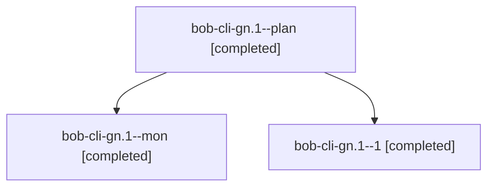

# Session: bob-cli-gn.1

[Agent Hoods](../README.md) / [bbugyi200](../users/bbugyi200/README.md) / [athena](../users/bbugyi200/machines/athena/README.md) / [bob-cli-gn](../users/bbugyi200/machines/athena/hoods/bob-cli-gn/README.md) / bob-cli-gn.1

Owner: `bbugyi200.athena` · Hood: `bob-cli-gn` · Members: 3 · Bead: [bob-cli-gn.1](https://github.com/bobs-org/bob-cli--beads/blob/main/pages/bob-cli-gn/bob-cli-gn.1.md)

## Lineage

The diagram is an optional enhancement; the ordered table below contains the same lineage in accessible text.

| Role | Agent | State | Model / provider | Timing | Commits | Prompt | Chat |
|---|---|---|---|---|---:|---|---|
| plan | bob-cli-gn.1--plan | completed | muse-spark-1.3-contributor / muse | 2026-11-03T19:56:29.545402+00:00 → 2026-11-03T21:06:11.481129+00:00 | 0 | [Prompt](../agents/bbugyi200.athena.bob-cli-gn.1--plan/prompt.md) | [Chat](../agents/bbugyi200.athena.bob-cli-gn.1--plan/chat.md) |
| mon | bob-cli-gn.1--mon | completed | muse-spark-1.3-contributor / muse | 2026-11-03T21:05:09.310100+00:00 → 2026-11-03T21:09:26.788134+00:00 | 0 | — | [Chat](../agents/bbugyi200.athena.bob-cli-gn.1--mon/chat.md) |
| 1 | bob-cli-gn.1--1 | completed | muse-spark-1.3-contributor / muse | 2026-11-03T21:10:20.747480+00:00 → 2026-11-03T21:33:07.801962+00:00 | [1](../agents/bbugyi200.athena.bob-cli-gn.1--1/README.md#commits) | [Prompt](../agents/bbugyi200.athena.bob-cli-gn.1--1/prompt.md) | [Chat](../agents/bbugyi200.athena.bob-cli-gn.1--1/chat.md) |

## Commits

| Role | Repo | Commit | Subject | Committed |
|---|---|---|---|---|
| 1 | bob-cli | [`0b4cebd`](https://github.com/bobs-org/bob-cli/commit/0b4cebdf90cdd8fb8bb69ed60e07b2936c480906) | feat(attachments): record attachment origins and ship bob attachments | 2026-11-03 16:32:51 EST |

## Neighbors

| Agent | Relation | State |
|---|---|---|
| [bob-cli-gn.2](../agents/bbugyi200.athena.bob-cli-gn.2/README.md) | bob-cli-gn hood | completed |
| [bob-cli-gn.3](../agents/bbugyi200.athena.bob-cli-gn.3/README.md) | bob-cli-gn hood | completed |
| [bob-cli-gn.land](../agents/bbugyi200.athena.bob-cli-gn.land/README.md) | bob-cli-gn hood | waiting |
