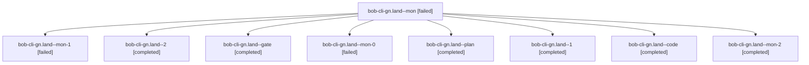

# Session: bob-cli-gn.land

[Agent Hoods](../README.md) / [bbugyi200](../users/bbugyi200/README.md) / [athena](../users/bbugyi200/machines/athena/README.md) / [bob-cli-gn](../users/bbugyi200/machines/athena/hoods/bob-cli-gn/README.md) / bob-cli-gn.land

Owner: `bbugyi200.athena` · Hood: `bob-cli-gn` · Members: 9 · Bead: [bob-cli-gn](https://github.com/bobs-org/bob-cli--beads/blob/main/pages/bob-cli-gn/README.md)

## Lineage



The diagram is an optional enhancement; the ordered table below contains the same lineage in accessible text.

| Role | Agent | State | Model / provider | Timing | Commits | Prompt | Chat |
|---|---|---|---|---|---:|---|---|
| <a id="member-mon"></a>mon | bob-cli-gn.land--mon | failed | gpt-6-luna / codex | 2026-11-03T23:34:50.254222+00:00 → 2026-11-03T23:34:51.613837+00:00 | 0 | — | — |
| <a id="member-mon-1"></a>mon-1 | bob-cli-gn.land--mon-1 | failed | gpt-6-luna / codex | 2026-11-03T23:36:00.934453+00:00 → 2026-11-03T23:39:50.880039+00:00 | 0 | — | — |
| <a id="member-2"></a>2 | bob-cli-gn.land--2 | completed | gpt-6-luna / codex | 2026-11-04T00:00:47.131160+00:00 → 2026-11-04T00:09:08.870847+00:00 | [1](../agents/bbugyi200.athena.bob-cli-gn.land--2/README.md#commits) | [Prompt](../agents/bbugyi200.athena.bob-cli-gn.land--2/prompt.md) | [Chat](../agents/bbugyi200.athena.bob-cli-gn.land--2/chat.md) |
| <a id="member-gate"></a>gate | bob-cli-gn.land--gate | completed | gpt-6-astra / codex | 2026-11-03T23:19:39.016472+00:00 → 2026-11-03T23:20:04.526042+00:00 | 0 | — | [Chat](../agents/bbugyi200.athena.bob-cli-gn.land--gate/chat.md) |
| <a id="member-mon-0"></a>mon-0 | bob-cli-gn.land--mon-0 | failed | gpt-6-luna / codex | 2026-11-03T23:35:26.645380+00:00 → 2026-11-03T23:35:27.632997+00:00 | 0 | — | — |
| <a id="member-plan"></a>plan | bob-cli-gn.land--plan | completed | gpt-6-astra / codex | 2026-11-03T23:06:42.081926+00:00 → 2026-11-03T23:36:42.983482+00:00 | 0 | [Prompt](../agents/bbugyi200.athena.bob-cli-gn.land--plan/prompt.md) | [Chat](../agents/bbugyi200.athena.bob-cli-gn.land--plan/chat.md) |
| <a id="member-1"></a>1 | bob-cli-gn.land--1 | completed | gpt-6-luna / codex | 2026-11-03T23:40:30.710988+00:00 → 2026-11-03T23:51:48.384081+00:00 | 0 | [Prompt](../agents/bbugyi200.athena.bob-cli-gn.land--1/prompt.md) | [Chat](../agents/bbugyi200.athena.bob-cli-gn.land--1/chat.md) |
| <a id="member-code"></a>code | bob-cli-gn.land--code | completed | gpt-6-luna / codex | 2026-11-03T23:21:24.229564+00:00 → 2026-11-03T23:36:42.983482+00:00 | 0 | — | [Chat](../agents/bbugyi200.athena.bob-cli-gn.land--code/chat.md) |
| <a id="member-mon-2"></a>mon-2 | bob-cli-gn.land--mon-2 | completed | gpt-6-luna / codex | 2026-11-03T23:50:39.089240+00:00 → 2026-11-03T23:59:54.520435+00:00 | 0 | — | [Chat](../agents/bbugyi200.athena.bob-cli-gn.land--mon-2/chat.md) |

## Commits

| Role | Repo | Commit | Subject | Committed |
|---|---|---|---|---|
| 2 | bob-cli | [`dd90f8c`](https://github.com/bobs-org/bob-cli/commit/dd90f8c781879a2f298127d33a88bf395f6113ca) | fix(attachments): handle wrapped paths and update catalog tests | 2026-11-03 19:08:19 EST |

## Variables

| Role | Variable | Value |
|---|---|---|
| plan | `artifacts` | \[{bead: bob-cli-gn, kind: file, label: bob-cli-gn landing focused tests and follow-up reproductions, path: /home/bryan/.sase/artifacts/agents/gh\_bobs-org\_\_bob-cli/20261103145539/gn-plugin-audit-7f3a6… |

#### artifacts

**Role:** `plan`

```yaml
- bead: bob-cli-gn
  kind: file
  label: bob-cli-gn landing focused tests and follow-up reproductions
  path: /home/bryan/.sase/artifacts/agents/gh_bobs-org__bob-cli/20261103145539/gn-plugin-audit-7f3a6cd69d1c.log
  ref: file:explicit:2a36a78e87df1326774cd894
  source_path: /tmp/gn-plugin-audit.log
```

Values are truncated for display; see each member's agent meta.json for the full values.

## Neighbors

| Agent | Relation | State |
|---|---|---|
| [bob-cli-gn.1](bbugyi200.athena.bob-cli-gn.1.md) (session · 3) | bob-cli-gn hood | completed 3 |
| [bob-cli-gn.2](../agents/bbugyi200.athena.bob-cli-gn.2/README.md) | bob-cli-gn hood | completed |
| [bob-cli-gn.3](../agents/bbugyi200.athena.bob-cli-gn.3/README.md) | bob-cli-gn hood | completed |
