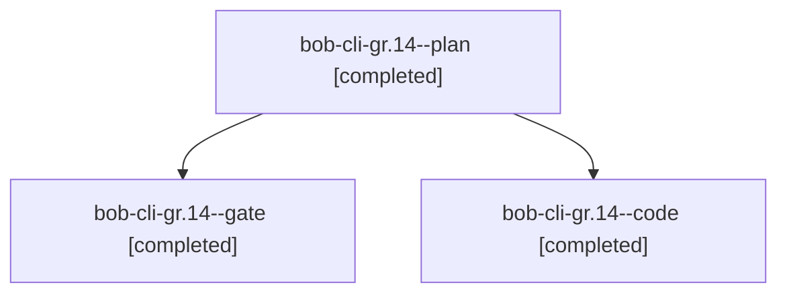

# Session: bob-cli-gr.14

[Agent Hoods](../README.md) / [bbugyi200](../users/bbugyi200/README.md) / [athena](../users/bbugyi200/machines/athena/README.md) / [bob-cli-gr](../users/bbugyi200/machines/athena/hoods/bob-cli-gr/README.md) / bob-cli-gr.14

Owner: `bbugyi200.athena` · Hood: `bob-cli-gr` · Members: 3 · Bead: [bob-cli-gr.14](https://github.com/bobs-org/bob-cli--beads/blob/main/pages/bob-cli-gr/bob-cli-gr.14.md)

## Lineage

The diagram is an optional enhancement; the ordered table below contains the same lineage in accessible text.

| Role | Agent | State | Model / provider | Timing | Commits | Prompt | Chat |
|---|---|---|---|---|---:|---|---|
| plan | bob-cli-gr.14--plan | completed | opus / claude | 2026-11-04T02:34:48.460277+00:00 → 2026-11-04T02:45:57.961967+00:00 | 0 | [Prompt](../agents/bbugyi200.athena.bob-cli-gr.14--plan/prompt.md) | [Chat](../agents/bbugyi200.athena.bob-cli-gr.14--plan/chat.md) |
| gate | bob-cli-gr.14--gate | completed | opus / claude | 2026-11-04T02:42:18.358737+00:00 → 2026-11-04T02:42:40.070424+00:00 | 0 | — | [Chat](../agents/bbugyi200.athena.bob-cli-gr.14--gate/chat.md) |
| code | bob-cli-gr.14--code | completed | gpt-6-luna / codex | 2026-11-04T02:42:59.921910+00:00 → 2026-11-04T02:45:57.961967+00:00 | 0 | — | [Chat](../agents/bbugyi200.athena.bob-cli-gr.14--code/chat.md) |

## Neighbors

| Agent | Relation | State |
|---|---|---|
| [bob-cli-gr.1](bbugyi200.athena.bob-cli-gr.1.md) (session · 3) | bob-cli-gr hood | completed 3 |
| [bob-cli-gr.10](bbugyi200.athena.bob-cli-gr.10.md) (session · 3) | bob-cli-gr hood | completed 3 |
| [bob-cli-gr.11](bbugyi200.athena.bob-cli-gr.11.md) (session · 3) | bob-cli-gr hood | completed 3 |
| [bob-cli-gr.12](bbugyi200.athena.bob-cli-gr.12.md) (session · 3) | bob-cli-gr hood | completed 3 |
| [bob-cli-gr.13](bbugyi200.athena.bob-cli-gr.13.md) (session · 3) | bob-cli-gr hood | completed 3 |
| [bob-cli-gr.15](bbugyi200.athena.bob-cli-gr.15.md) (session · 3) | bob-cli-gr hood | completed 3 |
| [bob-cli-gr.16](bbugyi200.athena.bob-cli-gr.16.md) (session · 3) | bob-cli-gr hood | completed 3 |
| [bob-cli-gr.17](bbugyi200.athena.bob-cli-gr.17.md) (session · 3) | bob-cli-gr hood | completed 3 |
| [bob-cli-gr.2](bbugyi200.athena.bob-cli-gr.2.md) (session · 3) | bob-cli-gr hood | completed 3 |
| [bob-cli-gr.3](bbugyi200.athena.bob-cli-gr.3.md) (session · 3) | bob-cli-gr hood | completed 3 |
| [bob-cli-gr.4](bbugyi200.athena.bob-cli-gr.4.md) (session · 3) | bob-cli-gr hood | completed 3 |
| [bob-cli-gr.5](bbugyi200.athena.bob-cli-gr.5.md) (session · 3) | bob-cli-gr hood | completed 3 |
| [bob-cli-gr.6](bbugyi200.athena.bob-cli-gr.6.md) (session · 3) | bob-cli-gr hood | completed 3 |
| [bob-cli-gr.7](bbugyi200.athena.bob-cli-gr.7.md) (session · 3) | bob-cli-gr hood | completed 3 |
| [bob-cli-gr.8](bbugyi200.athena.bob-cli-gr.8.md) (session · 3) | bob-cli-gr hood | completed 3 |
| [bob-cli-gr.9](bbugyi200.athena.bob-cli-gr.9.md) (session · 3) | bob-cli-gr hood | completed 3 |
| [bob-cli-gr.land](../agents/bbugyi200.athena.bob-cli-gr.land/README.md) | bob-cli-gr hood | completed |
