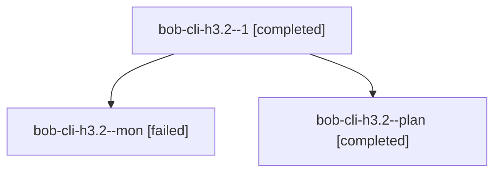

# Session: bob-cli-h3.2

[Agent Hoods](../README.md) / [bbugyi200](../users/bbugyi200/README.md) / [athena](../users/bbugyi200/machines/athena/README.md) / [bob-cli-h3](../users/bbugyi200/machines/athena/hoods/bob-cli-h3/README.md) / bob-cli-h3.2

Owner: `bbugyi200.athena` · Hood: `bob-cli-h3` · Members: 3 · Bead: [bob-cli-h3.2](https://github.com/bobs-org/bob-cli--beads/blob/main/pages/bob-cli-h3/bob-cli-h3.2.md)

## Lineage

The diagram is an optional enhancement; the ordered table below contains the same lineage in accessible text.

| Role | Agent | State | Model / provider | Timing | Commits | Prompt | Chat |
|---|---|---|---|---|---:|---|---|
| 1 | bob-cli-h3.2--1 | completed | gpt-6-luna / codex | 2026-11-04T17:48:45.234633+00:00 → 2026-11-04T18:03:43.512214+00:00 | 0 | [Prompt](../agents/bbugyi200.athena.bob-cli-h3.2--1/prompt.md) | [Chat](../agents/bbugyi200.athena.bob-cli-h3.2--1/chat.md) |
| mon | bob-cli-h3.2--mon | failed | gpt-6-luna / codex | 2026-11-04T17:45:41.865780+00:00 → 2026-11-04T17:47:54.885922+00:00 | 0 | — | [Chat](../agents/bbugyi200.athena.bob-cli-h3.2--mon/chat.md) |
| plan | bob-cli-h3.2--plan | completed | gpt-6-luna / codex | 2026-11-04T17:17:40.209246+00:00 → 2026-11-04T17:46:21.350125+00:00 | 0 | [Prompt](../agents/bbugyi200.athena.bob-cli-h3.2--plan/prompt.md) | [Chat](../agents/bbugyi200.athena.bob-cli-h3.2--plan/chat.md) |

## Neighbors

| Agent | Relation | State |
|---|---|---|
| [bob-cli-h3.1](../agents/bbugyi200.athena.bob-cli-h3.1/README.md) | bob-cli-h3 hood | completed |
| [bob-cli-h3.land](../agents/bbugyi200.athena.bob-cli-h3.land/README.md) | bob-cli-h3 hood | waiting |
