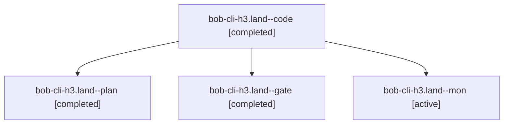

# Session: bob-cli-h3.land

[Agent Hoods](../README.md) / [bbugyi200](../users/bbugyi200/README.md) / [athena](../users/bbugyi200/machines/athena/README.md) / [bob-cli-h3](../users/bbugyi200/machines/athena/hoods/bob-cli-h3/README.md) / bob-cli-h3.land

Owner: `bbugyi200.athena` · Hood: `bob-cli-h3` · Members: 4 · Bead: [bob-cli-h3](https://github.com/bobs-org/bob-cli--beads/blob/main/pages/bob-cli-h3/README.md)

## Lineage

The diagram is an optional enhancement; the ordered table below contains the same lineage in accessible text.

| Role | Agent | State | Model / provider | Timing | Commits | Prompt | Chat |
|---|---|---|---|---|---:|---|---|
| code | bob-cli-h3.land--code | completed | gpt-6-luna / codex | 2026-11-04T18:15:00.765419+00:00 → 2026-11-04T18:44:05.946784+00:00 | 0 | — | [Chat](../agents/bbugyi200.athena.bob-cli-h3.land--code/chat.md) |
| plan | bob-cli-h3.land--plan | completed | gpt-6-astra / codex | 2026-11-04T18:03:59.535586+00:00 → 2026-11-04T18:44:05.946784+00:00 | 0 | [Prompt](../agents/bbugyi200.athena.bob-cli-h3.land--plan/prompt.md) | [Chat](../agents/bbugyi200.athena.bob-cli-h3.land--plan/chat.md) |
| gate | bob-cli-h3.land--gate | completed | gpt-6-astra / codex | 2026-11-04T18:13:54.394659+00:00 → 2026-11-04T18:14:26.038818+00:00 | 0 | — | [Chat](../agents/bbugyi200.athena.bob-cli-h3.land--gate/chat.md) |
| mon | bob-cli-h3.land--mon | active | gpt-6-luna / codex | 2026-11-04T18:42:45.415996+00:00 | 0 | — | — |

## Neighbors

| Agent | Relation | State |
|---|---|---|
| [bob-cli-h3.1](../agents/bbugyi200.athena.bob-cli-h3.1/README.md) | bob-cli-h3 hood | completed |
| [bob-cli-h3.2](bbugyi200.athena.bob-cli-h3.2.md) (session · 3) | bob-cli-h3 hood | completed 2, failed 1 |
