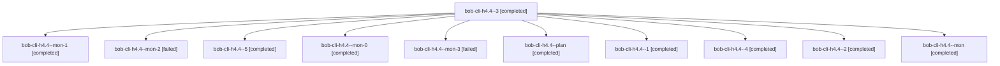

# Session: bob-cli-h4.4

[Agent Hoods](../README.md) / [bbugyi200](../users/bbugyi200/README.md) / [athena](../users/bbugyi200/machines/athena/README.md) / [bob-cli-h4](../users/bbugyi200/machines/athena/hoods/bob-cli-h4/README.md) / bob-cli-h4.4

Owner: `bbugyi200.athena` · Hood: `bob-cli-h4` · Members: 11 · Bead: [bob-cli-h4.4](https://github.com/bobs-org/bob-cli--beads/blob/main/pages/bob-cli-h4/bob-cli-h4.4.md)

## Lineage

The diagram is an optional enhancement; the ordered table below contains the same lineage in accessible text.

| Role | Agent | State | Model / provider | Timing | Commits | Prompt | Chat |
|---|---|---|---|---|---:|---|---|
| 3 | bob-cli-h4.4--3 | completed | gpt-6-luna / codex | 2026-11-04T22:55:36.011672+00:00 → 2026-11-04T22:58:33.985437+00:00 | 0 | [Prompt](../agents/bbugyi200.athena.bob-cli-h4.4--3/prompt.md) | [Chat](../agents/bbugyi200.athena.bob-cli-h4.4--3/chat.md) |
| mon-1 | bob-cli-h4.4--mon-1 | completed | gpt-6-luna / codex | 2026-11-04T22:50:25.491272+00:00 → 2026-11-04T22:55:32.308758+00:00 | 0 | — | [Chat](../agents/bbugyi200.athena.bob-cli-h4.4--mon-1/chat.md) |
| mon-2 | bob-cli-h4.4--mon-2 | failed | gpt-6-luna / codex | 2026-11-04T22:57:45.331160+00:00 → 2026-11-04T23:37:23.539599+00:00 | 0 | — | [Chat](../agents/bbugyi200.athena.bob-cli-h4.4--mon-2/chat.md) |
| 5 | bob-cli-h4.4--5 | completed | gpt-6-luna / codex | 2026-11-04T23:54:48.245485+00:00 → 2026-11-05T00:43:38.508142+00:00 | 0 | [Prompt](../agents/bbugyi200.athena.bob-cli-h4.4--5/prompt.md) | [Chat](../agents/bbugyi200.athena.bob-cli-h4.4--5/chat.md) |
| mon-0 | bob-cli-h4.4--mon-0 | completed | gpt-6-luna / codex | 2026-11-04T22:19:14.345984+00:00 → 2026-11-04T22:24:46.277791+00:00 | 0 | — | [Chat](../agents/bbugyi200.athena.bob-cli-h4.4--mon-0/chat.md) |
| mon-3 | bob-cli-h4.4--mon-3 | failed | gpt-6-luna / codex | 2026-11-04T23:40:03.879752+00:00 → 2026-11-04T23:52:49.795044+00:00 | 0 | — | [Chat](../agents/bbugyi200.athena.bob-cli-h4.4--mon-3/chat.md) |
| plan | bob-cli-h4.4--plan | completed | gpt-6-astra / codex | 2026-11-05T11:33:03.640906+00:00 → 2026-11-05T11:40:01.682560+00:00 | 0 | [Prompt](../agents/bbugyi200.athena.bob-cli-h4.4--plan/prompt.md) | [Chat](../agents/bbugyi200.athena.bob-cli-h4.4--plan/chat.md) |
| 1 | bob-cli-h4.4--1 | completed | gpt-6-astra / codex | 2026-11-05T11:49:25.761183+00:00 → 2026-11-05T11:50:51.692364+00:00 | 0 | [Prompt](../agents/bbugyi200.athena.bob-cli-h4.4--1/prompt.md) | [Chat](../agents/bbugyi200.athena.bob-cli-h4.4--1/chat.md) |
| 4 | bob-cli-h4.4--4 | completed | gpt-6-luna / codex | 2026-11-04T23:37:42.077006+00:00 → 2026-11-04T23:40:48.195911+00:00 | 0 | [Prompt](../agents/bbugyi200.athena.bob-cli-h4.4--4/prompt.md) | [Chat](../agents/bbugyi200.athena.bob-cli-h4.4--4/chat.md) |
| 2 | bob-cli-h4.4--2 | completed | gpt-6-luna / codex | 2026-11-04T22:28:16.707576+00:00 → 2026-11-04T22:51:13.840724+00:00 | 0 | [Prompt](../agents/bbugyi200.athena.bob-cli-h4.4--2/prompt.md) | [Chat](../agents/bbugyi200.athena.bob-cli-h4.4--2/chat.md) |
| mon | bob-cli-h4.4--mon | completed | gpt-6-astra / codex | 2026-11-05T11:39:33.241844+00:00 → 2026-11-05T11:48:33.329044+00:00 | 0 | — | [Chat](../agents/bbugyi200.athena.bob-cli-h4.4--mon/chat.md) |

## Neighbors

| Agent | Relation | State |
|---|---|---|
| [bob-cli-h4.1](../agents/bbugyi200.athena.bob-cli-h4.1/README.md) | bob-cli-h4 hood | completed |
| [bob-cli-h4.2](../agents/bbugyi200.athena.bob-cli-h4.2/README.md) | bob-cli-h4 hood | completed |
| [bob-cli-h4.3](../agents/bbugyi200.athena.bob-cli-h4.3/README.md) | bob-cli-h4 hood | completed |
| [bob-cli-h4.5](../agents/bbugyi200.athena.bob-cli-h4.5/README.md) | bob-cli-h4 hood | completed |
| [bob-cli-h4.6](bbugyi200.athena.bob-cli-h4.6.md) (session · 15) | bob-cli-h4 hood | completed 9, failed 6 |
| [bob-cli-h4.land](bbugyi200.athena.bob-cli-h4.land.md) (session · 4) | bob-cli-h4 hood | completed 3, failed 1 |
