# Session: bob-cli-h4.6

[Agent Hoods](../README.md) / [bbugyi200](../users/bbugyi200/README.md) / [athena](../users/bbugyi200/machines/athena/README.md) / [bob-cli-h4](../users/bbugyi200/machines/athena/hoods/bob-cli-h4/README.md) / bob-cli-h4.6

Owner: `bbugyi200.athena` · Hood: `bob-cli-h4` · Members: 15 · Bead: [bob-cli-h4.6](https://github.com/bobs-org/bob-cli--beads/blob/main/pages/bob-cli-h4/bob-cli-h4.6.md)

## Lineage

```mermaid
flowchart TD
  n0["bob-cli-h4.6--mon [completed]"]
  n1["bob-cli-h4.6--3 [completed]"]
  n0 --> n1
  n2["bob-cli-h4.6--mon-2 [failed]"]
  n0 --> n2
  n3["bob-cli-h4.6--7 [completed]"]
  n0 --> n3
  n4["bob-cli-h4.6--mon-4 [failed]"]
  n0 --> n4
  n5["bob-cli-h4.6--1 [completed]"]
  n0 --> n5
  n6["bob-cli-h4.6--2 [completed]"]
  n0 --> n6
  n7["bob-cli-h4.6--plan [completed]"]
  n0 --> n7
  n8["bob-cli-h4.6--mon-3 [failed]"]
  n0 --> n8
  n9["bob-cli-h4.6--mon-1 [failed]"]
  n0 --> n9
  n10["bob-cli-h4.6--6 [completed]"]
  n0 --> n10
  n11["bob-cli-h4.6--mon-0 [failed]"]
  n0 --> n11
  n12["bob-cli-h4.6--5 [completed]"]
  n0 --> n12
  n13["bob-cli-h4.6--mon-5 [failed]"]
  n0 --> n13
  n14["bob-cli-h4.6--4 [completed]"]
  n0 --> n14
```

The diagram is an optional enhancement; the ordered table below contains the same lineage in accessible text.

| Role | Agent | State | Model / provider | Timing | Commits | Prompt | Chat |
|---|---|---|---|---|---:|---|---|
| mon | bob-cli-h4.6--mon | completed | gpt-6-luna / codex | 2026-11-05T13:00:40.630054+00:00 → 2026-11-05T13:06:24.093764+00:00 | 0 | — | [Chat](../agents/bbugyi200.athena.bob-cli-h4.6--mon/chat.md) |
| 3 | bob-cli-h4.6--3 | completed | gpt-6-luna / codex | 2026-11-05T15:29:32.793381+00:00 → 2026-11-05T15:31:57.967496+00:00 | 0 | [Prompt](../agents/bbugyi200.athena.bob-cli-h4.6--3/prompt.md) | [Chat](../agents/bbugyi200.athena.bob-cli-h4.6--3/chat.md) |
| mon-2 | bob-cli-h4.6--mon-2 | failed | gpt-6-luna / codex | 2026-11-05T15:31:13.814589+00:00 → 2026-11-05T15:33:14.436697+00:00 | 0 | — | [Chat](../agents/bbugyi200.athena.bob-cli-h4.6--mon-2/chat.md) |
| 7 | bob-cli-h4.6--7 | completed | gpt-6-luna / codex | 2026-11-05T17:50:49.807364+00:00 → 2026-11-05T17:55:06.525261+00:00 | 0 | [Prompt](../agents/bbugyi200.athena.bob-cli-h4.6--7/prompt.md) | [Chat](../agents/bbugyi200.athena.bob-cli-h4.6--7/chat.md) |
| mon-4 | bob-cli-h4.6--mon-4 | failed | gpt-6-luna / codex | 2026-11-05T16:39:06.082521+00:00 → 2026-11-05T16:55:41.842748+00:00 | 0 | — | [Chat](../agents/bbugyi200.athena.bob-cli-h4.6--mon-4/chat.md) |
| 1 | bob-cli-h4.6--1 | completed | gpt-6-luna / codex | 2026-11-05T13:07:36.534730+00:00 → 2026-11-05T14:12:51.408990+00:00 | 0 | [Prompt](../agents/bbugyi200.athena.bob-cli-h4.6--1/prompt.md) | [Chat](../agents/bbugyi200.athena.bob-cli-h4.6--1/chat.md) |
| 2 | bob-cli-h4.6--2 | completed | gpt-6-luna / codex | 2026-11-05T14:32:01.827839+00:00 → 2026-11-05T14:42:04.739899+00:00 | 0 | [Prompt](../agents/bbugyi200.athena.bob-cli-h4.6--2/prompt.md) | [Chat](../agents/bbugyi200.athena.bob-cli-h4.6--2/chat.md) |
| plan | bob-cli-h4.6--plan | completed | gpt-6-luna / codex | 2026-11-05T12:34:35.184465+00:00 → 2026-11-05T13:01:53.013656+00:00 | 0 | [Prompt](../agents/bbugyi200.athena.bob-cli-h4.6--plan/prompt.md) | [Chat](../agents/bbugyi200.athena.bob-cli-h4.6--plan/chat.md) |
| mon-3 | bob-cli-h4.6--mon-3 | failed | gpt-6-luna / codex | 2026-11-05T15:44:11.258495+00:00 → 2026-11-05T16:33:29.391854+00:00 | 0 | — | [Chat](../agents/bbugyi200.athena.bob-cli-h4.6--mon-3/chat.md) |
| mon-1 | bob-cli-h4.6--mon-1 | failed | gpt-6-luna / codex | 2026-11-05T14:40:38.717124+00:00 → 2026-11-05T15:28:22.440378+00:00 | 0 | — | [Chat](../agents/bbugyi200.athena.bob-cli-h4.6--mon-1/chat.md) |
| 6 | bob-cli-h4.6--6 | completed | gpt-6-luna / codex | 2026-11-05T16:56:58.465404+00:00 → 2026-11-05T17:03:20.588012+00:00 | 0 | [Prompt](../agents/bbugyi200.athena.bob-cli-h4.6--6/prompt.md) | [Chat](../agents/bbugyi200.athena.bob-cli-h4.6--6/chat.md) |
| mon-0 | bob-cli-h4.6--mon-0 | failed | gpt-6-luna / codex | 2026-11-05T14:11:57.645375+00:00 → 2026-11-05T14:29:59.385509+00:00 | 0 | — | [Chat](../agents/bbugyi200.athena.bob-cli-h4.6--mon-0/chat.md) |
| 5 | bob-cli-h4.6--5 | completed | gpt-6-luna / codex | 2026-11-05T16:37:02.578797+00:00 → 2026-11-05T16:39:58.159277+00:00 | 0 | [Prompt](../agents/bbugyi200.athena.bob-cli-h4.6--5/prompt.md) | [Chat](../agents/bbugyi200.athena.bob-cli-h4.6--5/chat.md) |
| mon-5 | bob-cli-h4.6--mon-5 | failed | gpt-6-luna / codex | 2026-11-05T17:02:09.956030+00:00 → 2026-11-05T17:49:35.300012+00:00 | 0 | — | [Chat](../agents/bbugyi200.athena.bob-cli-h4.6--mon-5/chat.md) |
| 4 | bob-cli-h4.6--4 | completed | gpt-6-luna / codex | 2026-11-05T15:36:35.356705+00:00 → 2026-11-05T15:45:33.982468+00:00 | 0 | [Prompt](../agents/bbugyi200.athena.bob-cli-h4.6--4/prompt.md) | [Chat](../agents/bbugyi200.athena.bob-cli-h4.6--4/chat.md) |

## Neighbors

| Agent | Relation | State |
|---|---|---|
| [bob-cli-h4.1](../agents/bbugyi200.athena.bob-cli-h4.1/README.md) | bob-cli-h4 hood | completed |
| [bob-cli-h4.2](../agents/bbugyi200.athena.bob-cli-h4.2/README.md) | bob-cli-h4 hood | completed |
| [bob-cli-h4.3](../agents/bbugyi200.athena.bob-cli-h4.3/README.md) | bob-cli-h4 hood | completed |
| [bob-cli-h4.4](bbugyi200.athena.bob-cli-h4.4.md) (session · 11) | bob-cli-h4 hood | completed 9, failed 2 |
| [bob-cli-h4.5](../agents/bbugyi200.athena.bob-cli-h4.5/README.md) | bob-cli-h4 hood | completed |
| [bob-cli-h4.land](bbugyi200.athena.bob-cli-h4.land.md) (session · 4) | bob-cli-h4 hood | active 3, completed 1 |
