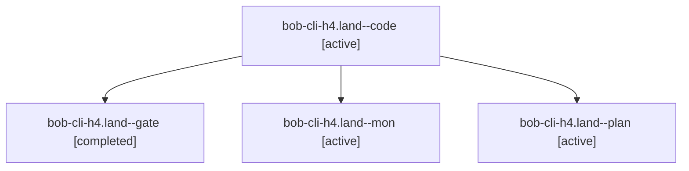

# Session: bob-cli-h4.land

[Agent Hoods](../README.md) / [bbugyi200](../users/bbugyi200/README.md) / [athena](../users/bbugyi200/machines/athena/README.md) / [bob-cli-h4](../users/bbugyi200/machines/athena/hoods/bob-cli-h4/README.md) / bob-cli-h4.land

Owner: `bbugyi200.athena` · Hood: `bob-cli-h4` · Members: 4 · Bead: [bob-cli-h4](https://github.com/bobs-org/bob-cli--beads/blob/main/pages/bob-cli-h4/README.md)

## Lineage

The diagram is an optional enhancement; the ordered table below contains the same lineage in accessible text.

| Role | Agent | State | Model / provider | Timing | Commits | Prompt | Chat |
|---|---|---|---|---|---:|---|---|
| code | bob-cli-h4.land--code | active | muse-spark-1.3-contributor / muse | 2026-11-05T18:38:14.733676+00:00 | 0 | — | — |
| gate | bob-cli-h4.land--gate | completed | opus / claude | 2026-11-05T18:37:13.418704+00:00 → 2026-11-05T18:37:45.389791+00:00 | 0 | — | [Chat](../agents/bbugyi200.athena.bob-cli-h4.land--gate/chat.md) |
| mon | bob-cli-h4.land--mon | active | muse-spark-1.3-contributor / muse | 2026-11-05T18:48:02.716849+00:00 | 0 | — | — |
| plan | bob-cli-h4.land--plan | active | opus / claude | 2026-11-05T18:00:07.007776+00:00 | 0 | [Prompt](../agents/bbugyi200.athena.bob-cli-h4.land--plan/prompt.md) | [Chat](../agents/bbugyi200.athena.bob-cli-h4.land--plan/chat.md) |

## Neighbors

| Agent | Relation | State |
|---|---|---|
| [bob-cli-h4.1](../agents/bbugyi200.athena.bob-cli-h4.1/README.md) | bob-cli-h4 hood | completed |
| [bob-cli-h4.2](../agents/bbugyi200.athena.bob-cli-h4.2/README.md) | bob-cli-h4 hood | completed |
| [bob-cli-h4.3](../agents/bbugyi200.athena.bob-cli-h4.3/README.md) | bob-cli-h4 hood | completed |
| [bob-cli-h4.4](bbugyi200.athena.bob-cli-h4.4.md) (session · 11) | bob-cli-h4 hood | completed 9, failed 2 |
| [bob-cli-h4.5](../agents/bbugyi200.athena.bob-cli-h4.5/README.md) | bob-cli-h4 hood | completed |
| [bob-cli-h4.6](bbugyi200.athena.bob-cli-h4.6.md) (session · 15) | bob-cli-h4 hood | completed 9, failed 6 |
