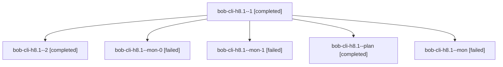

# Session: bob-cli-h8.1

[Agent Hoods](../README.md) / [bbugyi200](../users/bbugyi200/README.md) / [athena](../users/bbugyi200/machines/athena/README.md) / [bob-cli-h8](../users/bbugyi200/machines/athena/hoods/bob-cli-h8/README.md) / bob-cli-h8.1

Owner: `bbugyi200.athena` · Hood: `bob-cli-h8` · Members: 6 · Bead: [bob-cli-h8.1](https://github.com/bobs-org/bob-cli--beads/blob/main/pages/bob-cli-h8/bob-cli-h8.1.md)

## Lineage

The diagram is an optional enhancement; the ordered table below contains the same lineage in accessible text.

| Role | Agent | State | Model / provider | Timing | Commits | Prompt | Chat |
|---|---|---|---|---|---:|---|---|
| 1 | bob-cli-h8.1--1 | completed | gpt-6-luna / codex | 2026-11-04T22:18:33.805029+00:00 → 2026-11-04T22:27:26.294248+00:00 | 0 | [Prompt](../agents/bbugyi200.athena.bob-cli-h8.1--1/prompt.md) | [Chat](../agents/bbugyi200.athena.bob-cli-h8.1--1/chat.md) |
| 2 | bob-cli-h8.1--2 | completed | gpt-6-luna / codex | 2026-11-04T22:32:55.139446+00:00 → 2026-11-04T22:41:17.768937+00:00 | 0 | [Prompt](../agents/bbugyi200.athena.bob-cli-h8.1--2/prompt.md) | [Chat](../agents/bbugyi200.athena.bob-cli-h8.1--2/chat.md) |
| mon-0 | bob-cli-h8.1--mon-0 | failed | gpt-6-luna / codex | 2026-11-04T22:25:25.594259+00:00 → 2026-11-04T22:25:26.585540+00:00 | 0 | — | — |
| mon-1 | bob-cli-h8.1--mon-1 | failed | gpt-6-luna / codex | 2026-11-04T22:26:41.626301+00:00 → 2026-11-04T22:31:46.183248+00:00 | 0 | — | [Chat](../agents/bbugyi200.athena.bob-cli-h8.1--mon-1/chat.md) |
| plan | bob-cli-h8.1--plan | completed | gpt-6-luna / codex | 2026-11-04T21:42:46.854598+00:00 → 2026-11-04T22:09:54.574143+00:00 | 0 | [Prompt](../agents/bbugyi200.athena.bob-cli-h8.1--plan/prompt.md) | [Chat](../agents/bbugyi200.athena.bob-cli-h8.1--plan/chat.md) |
| mon | bob-cli-h8.1--mon | failed | gpt-6-luna / codex | 2026-11-04T22:08:37.859400+00:00 → 2026-11-04T22:14:48.839588+00:00 | 0 | — | [Chat](../agents/bbugyi200.athena.bob-cli-h8.1--mon/chat.md) |

## Neighbors

| Agent | Relation | State |
|---|---|---|
| [bob-cli-h8.10](../agents/bbugyi200.athena.bob-cli-h8.10/README.md) | bob-cli-h8 hood | waiting |
| [bob-cli-h8.11](../agents/bbugyi200.athena.bob-cli-h8.11/README.md) | bob-cli-h8 hood | completed |
| [bob-cli-h8.12](bbugyi200.athena.bob-cli-h8.12.md) (session · 2) | bob-cli-h8 hood | active 1, completed 1 |
| [bob-cli-h8.13](../agents/bbugyi200.athena.bob-cli-h8.13/README.md) | bob-cli-h8 hood | waiting |
| [bob-cli-h8.2](../agents/bbugyi200.athena.bob-cli-h8.2/README.md) | bob-cli-h8 hood | completed |
| [bob-cli-h8.3](../agents/bbugyi200.athena.bob-cli-h8.3/README.md) | bob-cli-h8 hood | completed |
| [bob-cli-h8.4](../agents/bbugyi200.athena.bob-cli-h8.4/README.md) | bob-cli-h8 hood | completed |
| [bob-cli-h8.5](bbugyi200.athena.bob-cli-h8.5.md) (session · 10) | bob-cli-h8 hood | active 1, completed 8, failed 1 |
| [bob-cli-h8.6](../agents/bbugyi200.athena.bob-cli-h8.6/README.md) | bob-cli-h8 hood | completed |
| [bob-cli-h8.7](bbugyi200.athena.bob-cli-h8.7.md) (session · 3) | bob-cli-h8 hood | completed 3 |
| [bob-cli-h8.8](../agents/bbugyi200.athena.bob-cli-h8.8/README.md) | bob-cli-h8 hood | completed |
| [bob-cli-h8.9](bbugyi200.athena.bob-cli-h8.9.md) (session · 2) | bob-cli-h8 hood | active 2 |
| [bob-cli-h8.land](../agents/bbugyi200.athena.bob-cli-h8.land/README.md) | bob-cli-h8 hood | waiting |
