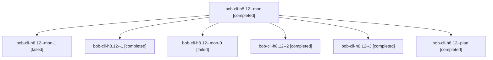

# Session: bob-cli-h8.12

[Agent Hoods](../README.md) / [bbugyi200](../users/bbugyi200/README.md) / [athena](../users/bbugyi200/machines/athena/README.md) / [bob-cli-h8](../users/bbugyi200/machines/athena/hoods/bob-cli-h8/README.md) / bob-cli-h8.12

Owner: `bbugyi200.athena` · Hood: `bob-cli-h8` · Members: 7 · Bead: [bob-cli-h8.12](https://github.com/bobs-org/bob-cli--beads/blob/main/pages/bob-cli-h8/bob-cli-h8.12.md)

## Lineage

The diagram is an optional enhancement; the ordered table below contains the same lineage in accessible text.

| Role | Agent | State | Model / provider | Timing | Commits | Prompt | Chat |
|---|---|---|---|---|---:|---|---|
| mon | bob-cli-h8.12--mon | completed | gpt-6-luna / codex | 2026-11-04T22:16:20.337568+00:00 → 2026-11-05T20:18:41.975580+00:00 | 0 | — | [Chat](../agents/bbugyi200.athena.bob-cli-h8.12--mon/chat.md) |
| mon-1 | bob-cli-h8.12--mon-1 | failed | gpt-6-luna / codex | 2026-11-05T21:02:38.676242+00:00 → 2026-11-05T21:06:50.070657+00:00 | 0 | — | [Chat](../agents/bbugyi200.athena.bob-cli-h8.12--mon-1/chat.md) |
| 1 | bob-cli-h8.12--1 | completed | gpt-6-luna / codex | 2026-11-05T20:20:13.008846+00:00 → 2026-11-05T20:53:46.539027+00:00 | 0 | [Prompt](../agents/bbugyi200.athena.bob-cli-h8.12--1/prompt.md) | [Chat](../agents/bbugyi200.athena.bob-cli-h8.12--1/chat.md) |
| mon-0 | bob-cli-h8.12--mon-0 | failed | gpt-6-luna / codex | 2026-11-05T20:52:50.914278+00:00 → 2026-11-05T20:57:00.585731+00:00 | 0 | — | [Chat](../agents/bbugyi200.athena.bob-cli-h8.12--mon-0/chat.md) |
| 2 | bob-cli-h8.12--2 | completed | gpt-6-luna / codex | 2026-11-05T20:58:00.668477+00:00 → 2026-11-05T21:03:33.106258+00:00 | 0 | [Prompt](../agents/bbugyi200.athena.bob-cli-h8.12--2/prompt.md) | [Chat](../agents/bbugyi200.athena.bob-cli-h8.12--2/chat.md) |
| 3 | bob-cli-h8.12--3 | completed | gpt-6-luna / codex | 2026-11-05T21:08:04.240478+00:00 → 2026-11-05T21:54:00.593207+00:00 | [1](../agents/bbugyi200.athena.bob-cli-h8.12--3/README.md#commits) | [Prompt](../agents/bbugyi200.athena.bob-cli-h8.12--3/prompt.md) | [Chat](../agents/bbugyi200.athena.bob-cli-h8.12--3/chat.md) |
| plan | bob-cli-h8.12--plan | completed | gpt-6-luna / codex | 2026-11-04T22:13:08.961467+00:00 → 2026-11-04T22:16:50.721100+00:00 | 0 | [Prompt](../agents/bbugyi200.athena.bob-cli-h8.12--plan/prompt.md) | [Chat](../agents/bbugyi200.athena.bob-cli-h8.12--plan/chat.md) |

## Commits

| Role | Repo | Commit | Subject | Committed |
|---|---|---|---|---|
| 3 | bob-cli | [`ff1a752`](https://github.com/bobs-org/bob-cli/commit/ff1a7524cf9954c5fa2683009b1e166f5a6697a0) | fix(consumption): align reconcile and completion cleanup | 2026-11-05 16:52:34 EST |

## Neighbors

| Agent | Relation | State |
|---|---|---|
| [bob-cli-h8.1](bbugyi200.athena.bob-cli-h8.1.md) (session · 6) | bob-cli-h8 hood | completed 3, failed 3 |
| [bob-cli-h8.10](../agents/bbugyi200.athena.bob-cli-h8.10/README.md) | bob-cli-h8 hood | completed |
| [bob-cli-h8.11](../agents/bbugyi200.athena.bob-cli-h8.11/README.md) | bob-cli-h8 hood | completed |
| [bob-cli-h8.13](../agents/bbugyi200.athena.bob-cli-h8.13/README.md) | bob-cli-h8 hood | waiting |
| [bob-cli-h8.2](../agents/bbugyi200.athena.bob-cli-h8.2/README.md) | bob-cli-h8 hood | completed |
| [bob-cli-h8.3](../agents/bbugyi200.athena.bob-cli-h8.3/README.md) | bob-cli-h8 hood | completed |
| [bob-cli-h8.4](../agents/bbugyi200.athena.bob-cli-h8.4/README.md) | bob-cli-h8 hood | completed |
| [bob-cli-h8.5](bbugyi200.athena.bob-cli-h8.5.md) (session · 11) | bob-cli-h8 hood | completed 9, failed 2 |
| [bob-cli-h8.6](../agents/bbugyi200.athena.bob-cli-h8.6/README.md) | bob-cli-h8 hood | completed |
| [bob-cli-h8.7](bbugyi200.athena.bob-cli-h8.7.md) (session · 3) | bob-cli-h8 hood | completed 3 |
| [bob-cli-h8.8](../agents/bbugyi200.athena.bob-cli-h8.8/README.md) | bob-cli-h8 hood | completed |
| [bob-cli-h8.9](bbugyi200.athena.bob-cli-h8.9.md) (session · 3) | bob-cli-h8 hood | completed 2, failed 1 |
| [bob-cli-h8.land](../agents/bbugyi200.athena.bob-cli-h8.land/README.md) | bob-cli-h8 hood | waiting |
