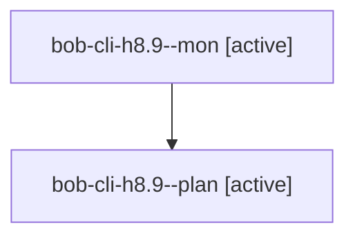

# Session: bob-cli-h8.9

[Agent Hoods](../README.md) / [bbugyi200](../users/bbugyi200/README.md) / [athena](../users/bbugyi200/machines/athena/README.md) / [bob-cli-h8](../users/bbugyi200/machines/athena/hoods/bob-cli-h8/README.md) / bob-cli-h8.9

Owner: `bbugyi200.athena` · Hood: `bob-cli-h8` · Members: 2 · Bead: [bob-cli-h8.9](https://github.com/bobs-org/bob-cli--beads/blob/main/pages/bob-cli-h8/bob-cli-h8.9.md)

## Lineage

The diagram is an optional enhancement; the ordered table below contains the same lineage in accessible text.

| Role | Agent | State | Model / provider | Timing | Commits | Prompt | Chat |
|---|---|---|---|---|---:|---|---|
| mon | bob-cli-h8.9--mon | active | muse-spark-1.3-contributor / muse | 2026-11-04T22:52:48.459071+00:00 | 0 | — | — |
| plan | bob-cli-h8.9--plan | active | muse-spark-1.3-contributor / muse | 2026-11-04T22:14:38.888586+00:00 | 0 | [Prompt](../agents/bbugyi200.athena.bob-cli-h8.9--plan/prompt.md) | — |

## Neighbors

| Agent | Relation | State |
|---|---|---|
| [bob-cli-h8.1](bbugyi200.athena.bob-cli-h8.1.md) (session · 6) | bob-cli-h8 hood | completed 3, failed 3 |
| [bob-cli-h8.10](../agents/bbugyi200.athena.bob-cli-h8.10/README.md) | bob-cli-h8 hood | waiting |
| [bob-cli-h8.11](../agents/bbugyi200.athena.bob-cli-h8.11/README.md) | bob-cli-h8 hood | completed |
| [bob-cli-h8.12](bbugyi200.athena.bob-cli-h8.12.md) (session · 2) | bob-cli-h8 hood | active 1, completed 1 |
| [bob-cli-h8.13](../agents/bbugyi200.athena.bob-cli-h8.13/README.md) | bob-cli-h8 hood | waiting |
| [bob-cli-h8.2](../agents/bbugyi200.athena.bob-cli-h8.2/README.md) | bob-cli-h8 hood | completed |
| [bob-cli-h8.3](../agents/bbugyi200.athena.bob-cli-h8.3/README.md) | bob-cli-h8 hood | completed |
| [bob-cli-h8.4](../agents/bbugyi200.athena.bob-cli-h8.4/README.md) | bob-cli-h8 hood | completed |
| [bob-cli-h8.5](bbugyi200.athena.bob-cli-h8.5.md) (session · 10) | bob-cli-h8 hood | active 1, completed 8, failed 1 |
| [bob-cli-h8.6](../agents/bbugyi200.athena.bob-cli-h8.6/README.md) | bob-cli-h8 hood | completed |
| [bob-cli-h8.7](bbugyi200.athena.bob-cli-h8.7.md) (session · 3) | bob-cli-h8 hood | completed 3 |
| [bob-cli-h8.8](../agents/bbugyi200.athena.bob-cli-h8.8/README.md) | bob-cli-h8 hood | completed |
| [bob-cli-h8.land](../agents/bbugyi200.athena.bob-cli-h8.land/README.md) | bob-cli-h8 hood | waiting |
