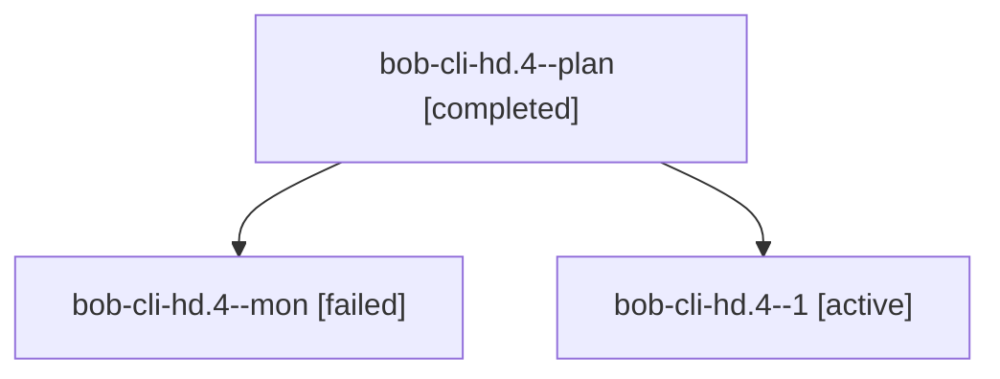

# Session: bob-cli-hd.4

[Agent Hoods](../README.md) / [bbugyi200](../users/bbugyi200/README.md) / [athena](../users/bbugyi200/machines/athena/README.md) / [bob-cli-hd](../users/bbugyi200/machines/athena/hoods/bob-cli-hd/README.md) / bob-cli-hd.4

Owner: `bbugyi200.athena` · Hood: `bob-cli-hd` · Members: 3 · Bead: [bob-cli-hd.4](https://github.com/bobs-org/bob-cli--beads/blob/main/pages/bob-cli-hd/bob-cli-hd.4.md)

## Lineage

The diagram is an optional enhancement; the ordered table below contains the same lineage in accessible text.

| Role | Agent | State | Model / provider | Timing | Commits | Prompt | Chat |
|---|---|---|---|---|---:|---|---|
| plan | bob-cli-hd.4--plan | completed | gpt-6-luna / codex | 2026-11-05T16:09:43.997903+00:00 → 2026-11-05T16:32:09.141202+00:00 | 0 | [Prompt](../agents/bbugyi200.athena.bob-cli-hd.4--plan/prompt.md) | [Chat](../agents/bbugyi200.athena.bob-cli-hd.4--plan/chat.md) |
| mon | bob-cli-hd.4--mon | failed | gpt-6-luna / codex | 2026-11-05T16:30:25.193406+00:00 → 2026-11-05T16:36:10.457103+00:00 | 0 | — | [Chat](../agents/bbugyi200.athena.bob-cli-hd.4--mon/chat.md) |
| 1 | bob-cli-hd.4--1 | active | gpt-6-luna / codex | 2026-11-05T16:37:45.034863+00:00 | 0 | [Prompt](../agents/bbugyi200.athena.bob-cli-hd.4--1/prompt.md) | — |

## Neighbors

| Agent | Relation | State |
|---|---|---|
| [bob-cli-hd.1](bbugyi200.athena.bob-cli-hd.1.md) (session · 3) | bob-cli-hd hood | completed 3 |
| [bob-cli-hd.2](../agents/bbugyi200.athena.bob-cli-hd.2/README.md) | bob-cli-hd hood | completed |
| [bob-cli-hd.3](../agents/bbugyi200.athena.bob-cli-hd.3/README.md) | bob-cli-hd hood | completed |
| [bob-cli-hd.5](../agents/bbugyi200.athena.bob-cli-hd.5/README.md) | bob-cli-hd hood | waiting |
| [bob-cli-hd.6](../agents/bbugyi200.athena.bob-cli-hd.6/README.md) | bob-cli-hd hood | waiting |
| [bob-cli-hd.7](../agents/bbugyi200.athena.bob-cli-hd.7/README.md) | bob-cli-hd hood | waiting |
| [bob-cli-hd.8](../agents/bbugyi200.athena.bob-cli-hd.8/README.md) | bob-cli-hd hood | waiting |
| [bob-cli-hd.9](../agents/bbugyi200.athena.bob-cli-hd.9/README.md) | bob-cli-hd hood | waiting |
| [bob-cli-hd.land](../agents/bbugyi200.athena.bob-cli-hd.land/README.md) | bob-cli-hd hood | waiting |
