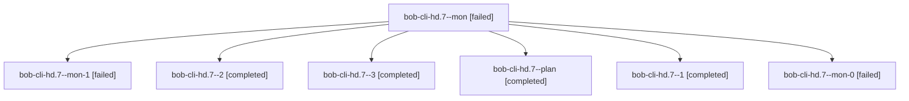

# Session: bob-cli-hd.7

[Agent Hoods](../README.md) / [bbugyi200](../users/bbugyi200/README.md) / [athena](../users/bbugyi200/machines/athena/README.md) / [bob-cli-hd](../users/bbugyi200/machines/athena/hoods/bob-cli-hd/README.md) / bob-cli-hd.7

Owner: `bbugyi200.athena` · Hood: `bob-cli-hd` · Members: 7 · Bead: [bob-cli-hd.7](https://github.com/bobs-org/bob-cli--beads/blob/main/pages/bob-cli-hd/bob-cli-hd.7.md)

## Lineage

The diagram is an optional enhancement; the ordered table below contains the same lineage in accessible text.

| Role | Agent | State | Model / provider | Timing | Commits | Prompt | Chat |
|---|---|---|---|---|---:|---|---|
| mon | bob-cli-hd.7--mon | failed | gpt-6-luna / codex | 2026-11-05T17:35:25.537250+00:00 → 2026-11-05T17:37:51.517269+00:00 | 0 | — | [Chat](../agents/bbugyi200.athena.bob-cli-hd.7--mon/chat.md) |
| mon-1 | bob-cli-hd.7--mon-1 | failed | gpt-6-luna / codex | 2026-11-05T18:02:17.154209+00:00 → 2026-11-05T18:05:19.893168+00:00 | 0 | — | [Chat](../agents/bbugyi200.athena.bob-cli-hd.7--mon-1/chat.md) |
| 2 | bob-cli-hd.7--2 | completed | gpt-6-luna / codex | 2026-11-05T17:48:26.593161+00:00 → 2026-11-05T18:02:58.229541+00:00 | 0 | [Prompt](../agents/bbugyi200.athena.bob-cli-hd.7--2/prompt.md) | [Chat](../agents/bbugyi200.athena.bob-cli-hd.7--2/chat.md) |
| 3 | bob-cli-hd.7--3 | completed | gpt-6-luna / codex | 2026-11-05T18:06:31.157789+00:00 → 2026-11-05T18:10:33.337567+00:00 | 0 | [Prompt](../agents/bbugyi200.athena.bob-cli-hd.7--3/prompt.md) | [Chat](../agents/bbugyi200.athena.bob-cli-hd.7--3/chat.md) |
| plan | bob-cli-hd.7--plan | completed | gpt-6-luna / codex | 2026-11-05T17:01:30.115006+00:00 → 2026-11-05T17:35:59.443020+00:00 | 0 | [Prompt](../agents/bbugyi200.athena.bob-cli-hd.7--plan/prompt.md) | [Chat](../agents/bbugyi200.athena.bob-cli-hd.7--plan/chat.md) |
| 1 | bob-cli-hd.7--1 | completed | gpt-6-luna / codex | 2026-11-05T17:39:10.145009+00:00 → 2026-11-05T17:45:08.148456+00:00 | 0 | [Prompt](../agents/bbugyi200.athena.bob-cli-hd.7--1/prompt.md) | [Chat](../agents/bbugyi200.athena.bob-cli-hd.7--1/chat.md) |
| mon-0 | bob-cli-hd.7--mon-0 | failed | gpt-6-luna / codex | 2026-11-05T17:44:17.297981+00:00 → 2026-11-05T17:47:52.216093+00:00 | 0 | — | [Chat](../agents/bbugyi200.athena.bob-cli-hd.7--mon-0/chat.md) |

## Neighbors

| Agent | Relation | State |
|---|---|---|
| [bob-cli-hd.1](bbugyi200.athena.bob-cli-hd.1.md) (session · 3) | bob-cli-hd hood | completed 3 |
| [bob-cli-hd.2](../agents/bbugyi200.athena.bob-cli-hd.2/README.md) | bob-cli-hd hood | completed |
| [bob-cli-hd.3](../agents/bbugyi200.athena.bob-cli-hd.3/README.md) | bob-cli-hd hood | completed |
| [bob-cli-hd.4](bbugyi200.athena.bob-cli-hd.4.md) (session · 5) | bob-cli-hd hood | completed 4, failed 1 |
| [bob-cli-hd.5](../agents/bbugyi200.athena.bob-cli-hd.5/README.md) | bob-cli-hd hood | completed |
| [bob-cli-hd.6](../agents/bbugyi200.athena.bob-cli-hd.6/README.md) | bob-cli-hd hood | completed |
| [bob-cli-hd.8](bbugyi200.athena.bob-cli-hd.8.md) (session · 3) | bob-cli-hd hood | completed 2, failed 1 |
| [bob-cli-hd.9](../agents/bbugyi200.athena.bob-cli-hd.9/README.md) | bob-cli-hd hood | completed |
| [bob-cli-hd.land](../agents/bbugyi200.athena.bob-cli-hd.land/README.md) | bob-cli-hd hood | completed |
