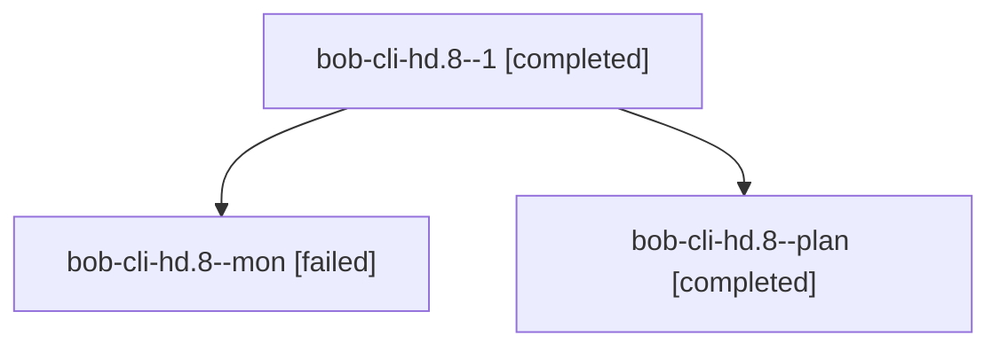

# Session: bob-cli-hd.8

[Agent Hoods](../README.md) / [bbugyi200](../users/bbugyi200/README.md) / [athena](../users/bbugyi200/machines/athena/README.md) / [bob-cli-hd](../users/bbugyi200/machines/athena/hoods/bob-cli-hd/README.md) / bob-cli-hd.8

Owner: `bbugyi200.athena` · Hood: `bob-cli-hd` · Members: 3 · Bead: [bob-cli-hd.8](https://github.com/bobs-org/bob-cli--beads/blob/main/pages/bob-cli-hd/bob-cli-hd.8.md)

## Lineage

The diagram is an optional enhancement; the ordered table below contains the same lineage in accessible text.

| Role | Agent | State | Model / provider | Timing | Commits | Prompt | Chat |
|---|---|---|---|---|---:|---|---|
| 1 | bob-cli-hd.8--1 | completed | gpt-6-luna / codex | 2026-11-05T17:31:12.540228+00:00 → 2026-11-05T17:44:47.147275+00:00 | [1](../agents/bbugyi200.athena.bob-cli-hd.8--1/README.md#commits) | [Prompt](../agents/bbugyi200.athena.bob-cli-hd.8--1/prompt.md) | [Chat](../agents/bbugyi200.athena.bob-cli-hd.8--1/chat.md) |
| mon | bob-cli-hd.8--mon | failed | gpt-6-luna / codex | 2026-11-05T17:25:43.245175+00:00 → 2026-11-05T17:29:20.422383+00:00 | 0 | — | [Chat](../agents/bbugyi200.athena.bob-cli-hd.8--mon/chat.md) |
| plan | bob-cli-hd.8--plan | completed | gpt-6-luna / codex | 2026-11-05T17:01:14.330887+00:00 → 2026-11-05T17:26:42.638067+00:00 | 0 | [Prompt](../agents/bbugyi200.athena.bob-cli-hd.8--plan/prompt.md) | [Chat](../agents/bbugyi200.athena.bob-cli-hd.8--plan/chat.md) |

## Commits

| Role | Repo | Commit | Subject | Committed |
|---|---|---|---|---|
| 1 | bob-cli | [`f36cc03`](https://github.com/bobs-org/bob-cli/commit/f36cc0396a7739941ef2ce85b61608c70f3d7333) | docs(memory): clarify merged Pomodoro type agreement | 2026-11-05 12:44:01 EST |

## Neighbors

| Agent | Relation | State |
|---|---|---|
| [bob-cli-hd.1](bbugyi200.athena.bob-cli-hd.1.md) (session · 3) | bob-cli-hd hood | completed 3 |
| [bob-cli-hd.2](../agents/bbugyi200.athena.bob-cli-hd.2/README.md) | bob-cli-hd hood | completed |
| [bob-cli-hd.3](../agents/bbugyi200.athena.bob-cli-hd.3/README.md) | bob-cli-hd hood | completed |
| [bob-cli-hd.4](bbugyi200.athena.bob-cli-hd.4.md) (session · 5) | bob-cli-hd hood | completed 4, failed 1 |
| [bob-cli-hd.5](../agents/bbugyi200.athena.bob-cli-hd.5/README.md) | bob-cli-hd hood | completed |
| [bob-cli-hd.6](../agents/bbugyi200.athena.bob-cli-hd.6/README.md) | bob-cli-hd hood | completed |
| [bob-cli-hd.7](bbugyi200.athena.bob-cli-hd.7.md) (session · 7) | bob-cli-hd hood | completed 4, failed 3 |
| [bob-cli-hd.9](../agents/bbugyi200.athena.bob-cli-hd.9/README.md) | bob-cli-hd hood | completed |
| [bob-cli-hd.land](../agents/bbugyi200.athena.bob-cli-hd.land/README.md) | bob-cli-hd hood | completed |
