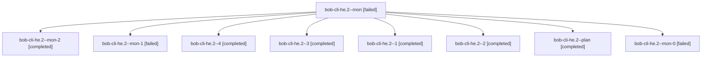

# Session: bob-cli-he.2

[Agent Hoods](../README.md) / [bbugyi200](../users/bbugyi200/README.md) / [athena](../users/bbugyi200/machines/athena/README.md) / [bob-cli-he](../users/bbugyi200/machines/athena/hoods/bob-cli-he/README.md) / bob-cli-he.2

Owner: `bbugyi200.athena` · Hood: `bob-cli-he` · Members: 9 · Bead: [bob-cli-he.2](https://github.com/bobs-org/bob-cli--beads/blob/main/pages/bob-cli-he/bob-cli-he.2.md)

## Lineage

The diagram is an optional enhancement; the ordered table below contains the same lineage in accessible text.

| Role | Agent | State | Model / provider | Timing | Commits | Prompt | Chat |
|---|---|---|---|---|---:|---|---|
| mon | bob-cli-he.2--mon | failed | gpt-6-luna / codex | 2026-11-05T17:13:06.634288+00:00 → 2026-11-05T17:21:48.125956+00:00 | 0 | — | [Chat](../agents/bbugyi200.athena.bob-cli-he.2--mon/chat.md) |
| mon-2 | bob-cli-he.2--mon-2 | completed | gpt-6-luna / codex | 2026-11-05T17:50:59.443015+00:00 → 2026-11-05T18:00:50.625055+00:00 | 0 | — | [Chat](../agents/bbugyi200.athena.bob-cli-he.2--mon-2/chat.md) |
| mon-1 | bob-cli-he.2--mon-1 | failed | gpt-6-luna / codex | 2026-11-05T17:39:54.622533+00:00 → 2026-11-05T17:44:42.030140+00:00 | 0 | — | [Chat](../agents/bbugyi200.athena.bob-cli-he.2--mon-1/chat.md) |
| 4 | bob-cli-he.2--4 | completed | muse-spark-1.3-contributor / muse | 2026-11-05T18:02:03.969338+00:00 → 2026-11-05T18:03:53.121760+00:00 | [1](../agents/bbugyi200.athena.bob-cli-he.2--4/README.md#commits) | [Prompt](../agents/bbugyi200.athena.bob-cli-he.2--4/prompt.md) | [Chat](../agents/bbugyi200.athena.bob-cli-he.2--4/chat.md) |
| 3 | bob-cli-he.2--3 | completed | gpt-6-luna / codex | 2026-11-05T17:45:52.728695+00:00 → 2026-11-05T17:51:40.777749+00:00 | 0 | [Prompt](../agents/bbugyi200.athena.bob-cli-he.2--3/prompt.md) | [Chat](../agents/bbugyi200.athena.bob-cli-he.2--3/chat.md) |
| 1 | bob-cli-he.2--1 | completed | gpt-6-luna / codex | 2026-11-05T17:23:36.301851+00:00 → 2026-11-05T17:31:39.548224+00:00 | 0 | [Prompt](../agents/bbugyi200.athena.bob-cli-he.2--1/prompt.md) | [Chat](../agents/bbugyi200.athena.bob-cli-he.2--1/chat.md) |
| 2 | bob-cli-he.2--2 | completed | gpt-6-luna / codex | 2026-11-05T17:38:53.503788+00:00 → 2026-11-05T17:40:41.836771+00:00 | 0 | [Prompt](../agents/bbugyi200.athena.bob-cli-he.2--2/prompt.md) | [Chat](../agents/bbugyi200.athena.bob-cli-he.2--2/chat.md) |
| plan | bob-cli-he.2--plan | completed | gpt-6-luna / codex | 2026-11-05T16:48:34.391411+00:00 → 2026-11-05T17:14:01.185605+00:00 | 0 | [Prompt](../agents/bbugyi200.athena.bob-cli-he.2--plan/prompt.md) | [Chat](../agents/bbugyi200.athena.bob-cli-he.2--plan/chat.md) |
| mon-0 | bob-cli-he.2--mon-0 | failed | gpt-6-luna / codex | 2026-11-05T17:30:40.211369+00:00 → 2026-11-05T17:37:31.070526+00:00 | 0 | — | [Chat](../agents/bbugyi200.athena.bob-cli-he.2--mon-0/chat.md) |

## Commits

| Role | Repo | Commit | Subject | Committed |
|---|---|---|---|---|
| 4 | bob-cli | [`84da37b`](https://github.com/bobs-org/bob-cli/commit/84da37ba2dc438f56ce6a4f7cbc1a0ceb3ef3067) | feat(capture): trust counted clipboard history only on live agreement | 2026-11-05 13:03:21 EST |

## Neighbors

| Agent | Relation | State |
|---|---|---|
| [bob-cli-he.1](../agents/bbugyi200.athena.bob-cli-he.1/README.md) | bob-cli-he hood | completed |
| [bob-cli-he.3](../agents/bbugyi200.athena.bob-cli-he.3/README.md) | bob-cli-he hood | waiting |
| [bob-cli-he.4](../agents/bbugyi200.athena.bob-cli-he.4/README.md) | bob-cli-he hood | waiting |
| [bob-cli-he.5](../agents/bbugyi200.athena.bob-cli-he.5/README.md) | bob-cli-he hood | completed |
| [bob-cli-he.6](../agents/bbugyi200.athena.bob-cli-he.6/README.md) | bob-cli-he hood | waiting |
| [bob-cli-he.7](../agents/bbugyi200.athena.bob-cli-he.7/README.md) | bob-cli-he hood | waiting |
| [bob-cli-he.8](../agents/bbugyi200.athena.bob-cli-he.8/README.md) | bob-cli-he hood | waiting |
| [bob-cli-he.land](../agents/bbugyi200.athena.bob-cli-he.land/README.md) | bob-cli-he hood | waiting |
