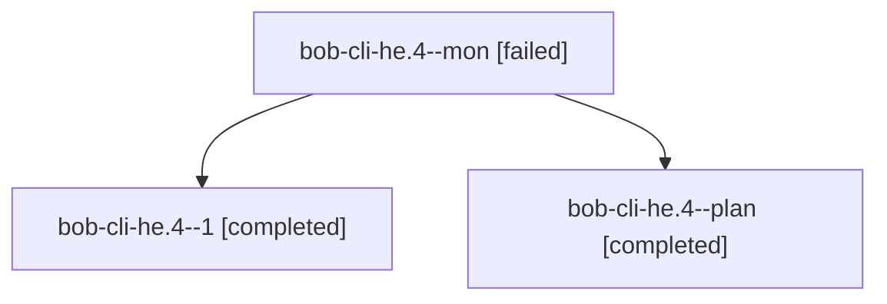

# Session: bob-cli-he.4

[Agent Hoods](../README.md) / [bbugyi200](../users/bbugyi200/README.md) / [athena](../users/bbugyi200/machines/athena/README.md) / [bob-cli-he](../users/bbugyi200/machines/athena/hoods/bob-cli-he/README.md) / bob-cli-he.4

Owner: `bbugyi200.athena` · Hood: `bob-cli-he` · Members: 3 · Bead: [bob-cli-he.4](https://github.com/bobs-org/bob-cli--beads/blob/main/pages/bob-cli-he/bob-cli-he.4.md)

## Lineage

The diagram is an optional enhancement; the ordered table below contains the same lineage in accessible text.

| Role | Agent | State | Model / provider | Timing | Commits | Prompt | Chat |
|---|---|---|---|---|---:|---|---|
| mon | bob-cli-he.4--mon | failed | muse-spark-1.3-contributor / muse | 2026-11-05T18:56:51.817815+00:00 → 2026-11-05T19:35:03.392596+00:00 | 0 | — | [Chat](../agents/bbugyi200.athena.bob-cli-he.4--mon/chat.md) |
| 1 | bob-cli-he.4--1 | completed | muse-spark-1.3-contributor / muse | 2026-11-05T19:36:16.572437+00:00 → 2026-11-05T19:39:54.774993+00:00 | 0 | [Prompt](../agents/bbugyi200.athena.bob-cli-he.4--1/prompt.md) | [Chat](../agents/bbugyi200.athena.bob-cli-he.4--1/chat.md) |
| plan | bob-cli-he.4--plan | completed | muse-spark-1.3-contributor / muse | 2026-11-05T18:32:16.925397+00:00 → 2026-11-05T19:16:43.179476+00:00 | 0 | [Prompt](../agents/bbugyi200.athena.bob-cli-he.4--plan/prompt.md) | [Chat](../agents/bbugyi200.athena.bob-cli-he.4--plan/chat.md) |

## Neighbors

| Agent | Relation | State |
|---|---|---|
| [bob-cli-he.1](../agents/bbugyi200.athena.bob-cli-he.1/README.md) | bob-cli-he hood | completed |
| [bob-cli-he.2](bbugyi200.athena.bob-cli-he.2.md) (session · 9) | bob-cli-he hood | completed 6, failed 3 |
| [bob-cli-he.3](../agents/bbugyi200.athena.bob-cli-he.3/README.md) | bob-cli-he hood | completed |
| [bob-cli-he.5](../agents/bbugyi200.athena.bob-cli-he.5/README.md) | bob-cli-he hood | completed |
| [bob-cli-he.6](../agents/bbugyi200.athena.bob-cli-he.6/README.md) | bob-cli-he hood | completed |
| [bob-cli-he.7](../agents/bbugyi200.athena.bob-cli-he.7/README.md) | bob-cli-he hood | completed |
| [bob-cli-he.8](../agents/bbugyi200.athena.bob-cli-he.8/README.md) | bob-cli-he hood | completed |
| [bob-cli-he.land](../agents/bbugyi200.athena.bob-cli-he.land/README.md) | bob-cli-he hood | completed |
