# Session: bob-cli-hj.6

[Agent Hoods](../README.md) / [bbugyi200](../users/bbugyi200/README.md) / [athena](../users/bbugyi200/machines/athena/README.md) / [bob-cli-hj](../users/bbugyi200/machines/athena/hoods/bob-cli-hj/README.md) / bob-cli-hj.6

Owner: `bbugyi200.athena` · Hood: `bob-cli-hj` · Members: 20 · Bead: [bob-cli-hj.6](https://github.com/bobs-org/bob-cli--beads/blob/main/pages/bob-cli-hj/bob-cli-hj.6.md)

## Lineage

```mermaid
flowchart TD
  n0["bob-cli-hj.6--3 [completed]"]
  n1["bob-cli-hj.6--plan [completed]"]
  n0 --> n1
  n2["bob-cli-hj.6--9 [completed]"]
  n0 --> n2
  n3["bob-cli-hj.6--mon-3 [failed]"]
  n0 --> n3
  n4["bob-cli-hj.6--mon-0 [completed]"]
  n0 --> n4
  n5["bob-cli-hj.6--7 [completed]"]
  n0 --> n5
  n6["bob-cli-hj.6--mon-8 [active]"]
  n0 --> n6
  n7["bob-cli-hj.6--mon-4 [completed]"]
  n0 --> n7
  n8["bob-cli-hj.6--2 [completed]"]
  n0 --> n8
  n9["bob-cli-hj.6--6 [completed]"]
  n0 --> n9
  n10["bob-cli-hj.6--5 [completed]"]
  n0 --> n10
  n11["bob-cli-hj.6--mon-7 [failed]"]
  n0 --> n11
  n12["bob-cli-hj.6--8 [completed]"]
  n0 --> n12
  n13["bob-cli-hj.6--mon-6 [completed]"]
  n0 --> n13
  n14["bob-cli-hj.6--mon-1 [failed]"]
  n0 --> n14
  n15["bob-cli-hj.6--1 [completed]"]
  n0 --> n15
  n16["bob-cli-hj.6--4 [completed]"]
  n0 --> n16
  n17["bob-cli-hj.6--mon [completed]"]
  n0 --> n17
  n18["bob-cli-hj.6--mon-2 [completed]"]
  n0 --> n18
  n19["bob-cli-hj.6--mon-5 [failed]"]
  n0 --> n19
```

The diagram is an optional enhancement; the ordered table below contains the same lineage in accessible text.

| Role | Agent | State | Model / provider | Timing | Commits | Prompt | Chat |
|---|---|---|---|---|---:|---|---|
| 3 | bob-cli-hj.6--3 | completed | gpt-6-luna / codex | 2026-11-06T01:36:21.436363+00:00 → 2026-11-06T01:48:23.314696+00:00 | 0 | [Prompt](../agents/bbugyi200.athena.bob-cli-hj.6--3/prompt.md) | [Chat](../agents/bbugyi200.athena.bob-cli-hj.6--3/chat.md) |
| plan | bob-cli-hj.6--plan | completed | gpt-6-luna / codex | 2026-11-05T23:53:23.886957+00:00 → 2026-11-06T00:33:24.964657+00:00 | 0 | [Prompt](../agents/bbugyi200.athena.bob-cli-hj.6--plan/prompt.md) | [Chat](../agents/bbugyi200.athena.bob-cli-hj.6--plan/chat.md) |
| 9 | bob-cli-hj.6--9 | completed | gpt-6-luna / codex | 2026-11-06T03:13:30.320955+00:00 → 2026-11-06T03:20:24.645961+00:00 | 0 | [Prompt](../agents/bbugyi200.athena.bob-cli-hj.6--9/prompt.md) | [Chat](../agents/bbugyi200.athena.bob-cli-hj.6--9/chat.md) |
| mon-3 | bob-cli-hj.6--mon-3 | failed | gpt-6-luna / codex | 2026-11-06T01:58:23.228710+00:00 → 2026-11-06T02:11:25.712733+00:00 | 0 | — | [Chat](../agents/bbugyi200.athena.bob-cli-hj.6--mon-3/chat.md) |
| mon-0 | bob-cli-hj.6--mon-0 | completed | gpt-6-luna / codex | 2026-11-06T00:50:34.038054+00:00 → 2026-11-06T00:54:44.028958+00:00 | 0 | — | [Chat](../agents/bbugyi200.athena.bob-cli-hj.6--mon-0/chat.md) |
| 7 | bob-cli-hj.6--7 | completed | gpt-6-luna / codex | 2026-11-06T02:52:31.049250+00:00 → 2026-11-06T02:57:17.270200+00:00 | 0 | [Prompt](../agents/bbugyi200.athena.bob-cli-hj.6--7/prompt.md) | [Chat](../agents/bbugyi200.athena.bob-cli-hj.6--7/chat.md) |
| mon-8 | bob-cli-hj.6--mon-8 | active | gpt-6-luna / codex | 2026-11-06T03:19:12.463514+00:00 | 0 | — | — |
| mon-4 | bob-cli-hj.6--mon-4 | completed | gpt-6-luna / codex | 2026-11-06T02:23:46.369230+00:00 → 2026-11-06T02:30:03.687742+00:00 | 0 | — | [Chat](../agents/bbugyi200.athena.bob-cli-hj.6--mon-4/chat.md) |
| 2 | bob-cli-hj.6--2 | completed | gpt-6-luna / codex | 2026-11-06T00:56:04.431728+00:00 → 2026-11-06T01:24:00.960315+00:00 | 0 | [Prompt](../agents/bbugyi200.athena.bob-cli-hj.6--2/prompt.md) | [Chat](../agents/bbugyi200.athena.bob-cli-hj.6--2/chat.md) |
| 6 | bob-cli-hj.6--6 | completed | gpt-6-luna / codex | 2026-11-06T02:31:51.217438+00:00 → 2026-11-06T02:34:30.909897+00:00 | 0 | [Prompt](../agents/bbugyi200.athena.bob-cli-hj.6--6/prompt.md) | [Chat](../agents/bbugyi200.athena.bob-cli-hj.6--6/chat.md) |
| 5 | bob-cli-hj.6--5 | completed | gpt-6-luna / codex | 2026-11-06T02:12:58.191885+00:00 → 2026-11-06T02:24:25.849631+00:00 | 0 | [Prompt](../agents/bbugyi200.athena.bob-cli-hj.6--5/prompt.md) | [Chat](../agents/bbugyi200.athena.bob-cli-hj.6--5/chat.md) |
| mon-7 | bob-cli-hj.6--mon-7 | failed | gpt-6-luna / codex | 2026-11-06T03:09:11.981293+00:00 → 2026-11-06T03:11:31.677619+00:00 | 0 | — | [Chat](../agents/bbugyi200.athena.bob-cli-hj.6--mon-7/chat.md) |
| 8 | bob-cli-hj.6--8 | completed | gpt-6-luna / codex | 2026-11-06T03:03:02.614298+00:00 → 2026-11-06T03:09:53.402532+00:00 | 0 | [Prompt](../agents/bbugyi200.athena.bob-cli-hj.6--8/prompt.md) | [Chat](../agents/bbugyi200.athena.bob-cli-hj.6--8/chat.md) |
| mon-6 | bob-cli-hj.6--mon-6 | completed | gpt-6-luna / codex | 2026-11-06T02:56:41.322980+00:00 → 2026-11-06T03:00:57.060138+00:00 | 0 | — | [Chat](../agents/bbugyi200.athena.bob-cli-hj.6--mon-6/chat.md) |
| mon-1 | bob-cli-hj.6--mon-1 | failed | gpt-6-luna / codex | 2026-11-06T01:22:29.122316+00:00 → 2026-11-06T01:34:24.779217+00:00 | 0 | — | [Chat](../agents/bbugyi200.athena.bob-cli-hj.6--mon-1/chat.md) |
| 1 | bob-cli-hj.6--1 | completed | gpt-6-luna / codex | 2026-11-06T00:48:12.787801+00:00 → 2026-11-06T00:51:09.005104+00:00 | 0 | [Prompt](../agents/bbugyi200.athena.bob-cli-hj.6--1/prompt.md) | [Chat](../agents/bbugyi200.athena.bob-cli-hj.6--1/chat.md) |
| 4 | bob-cli-hj.6--4 | completed | gpt-6-luna / codex | 2026-11-06T01:53:41.618252+00:00 → 2026-11-06T01:59:00.561041+00:00 | 0 | [Prompt](../agents/bbugyi200.athena.bob-cli-hj.6--4/prompt.md) | [Chat](../agents/bbugyi200.athena.bob-cli-hj.6--4/chat.md) |
| mon | bob-cli-hj.6--mon | completed | gpt-6-luna / codex | 2026-11-06T00:32:25.901557+00:00 → 2026-11-06T00:38:02.496056+00:00 | 0 | — | [Chat](../agents/bbugyi200.athena.bob-cli-hj.6--mon/chat.md) |
| mon-2 | bob-cli-hj.6--mon-2 | completed | gpt-6-luna / codex | 2026-11-06T01:47:41.247818+00:00 → 2026-11-06T01:52:02.526176+00:00 | 0 | — | [Chat](../agents/bbugyi200.athena.bob-cli-hj.6--mon-2/chat.md) |
| mon-5 | bob-cli-hj.6--mon-5 | failed | gpt-6-luna / codex | 2026-11-06T02:34:00.134575+00:00 → 2026-11-06T02:52:10.773916+00:00 | 0 | — | [Chat](../agents/bbugyi200.athena.bob-cli-hj.6--mon-5/chat.md) |

## Neighbors

| Agent | Relation | State |
|---|---|---|
| [bob-cli-hj.1](../agents/bbugyi200.athena.bob-cli-hj.1/README.md) | bob-cli-hj hood | completed |
| [bob-cli-hj.2](../agents/bbugyi200.athena.bob-cli-hj.2/README.md) | bob-cli-hj hood | completed |
| [bob-cli-hj.3](../agents/bbugyi200.athena.bob-cli-hj.3/README.md) | bob-cli-hj hood | completed |
| [bob-cli-hj.4](../agents/bbugyi200.athena.bob-cli-hj.4/README.md) | bob-cli-hj hood | completed |
| [bob-cli-hj.5](../agents/bbugyi200.athena.bob-cli-hj.5/README.md) | bob-cli-hj hood | completed |
| [bob-cli-hj.land](../agents/bbugyi200.athena.bob-cli-hj.land/README.md) | bob-cli-hj hood | waiting |
