# Session: bob-cli-hl.3.1.3

[Agent Hoods](../README.md) / [bbugyi200](../users/bbugyi200/README.md) / [athena](../users/bbugyi200/machines/athena/README.md) / [bob-cli-hl](../users/bbugyi200/machines/athena/hoods/bob-cli-hl/README.md) / bob-cli-hl.3.1.3

Owner: `bbugyi200.athena` · Hood: `bob-cli-hl` · Members: 13 · Bead: [bob-cli-hl.3.1.3](https://github.com/bobs-org/bob-cli--beads/blob/main/pages/bob-cli-hl/bob-cli-hl.3.1.3.md)

## Lineage

```mermaid
flowchart TD
  n0["bob-cli-hl.3.1.3--6 [completed]"]
  n1["bob-cli-hl.3.1.3--3 [completed]"]
  n0 --> n1
  n2["bob-cli-hl.3.1.3--mon [failed]"]
  n0 --> n2
  n3["bob-cli-hl.3.1.3--mon-0 [failed]"]
  n0 --> n3
  n4["bob-cli-hl.3.1.3--2 [completed]"]
  n0 --> n4
  n5["bob-cli-hl.3.1.3--mon-1 [completed]"]
  n0 --> n5
  n6["bob-cli-hl.3.1.3--mon-4 [completed]"]
  n0 --> n6
  n7["bob-cli-hl.3.1.3--1 [completed]"]
  n0 --> n7
  n8["bob-cli-hl.3.1.3--mon-2 [failed]"]
  n0 --> n8
  n9["bob-cli-hl.3.1.3--plan [completed]"]
  n0 --> n9
  n10["bob-cli-hl.3.1.3--5 [completed]"]
  n0 --> n10
  n11["bob-cli-hl.3.1.3--mon-3 [failed]"]
  n0 --> n11
  n12["bob-cli-hl.3.1.3--4 [completed]"]
  n0 --> n12
```

The diagram is an optional enhancement; the ordered table below contains the same lineage in accessible text.

| Role | Agent | State | Model / provider | Timing | Commits | Prompt | Chat |
|---|---|---|---|---|---:|---|---|
| 6 | bob-cli-hl.3.1.3--6 | completed | gpt-6-luna / codex | 2026-11-06T04:30:00.074693+00:00 → 2026-11-06T04:58:07.520576+00:00 | [1](../agents/bbugyi200.athena.bob-cli-hl.3.1.3--6/README.md#commits) | [Prompt](../agents/bbugyi200.athena.bob-cli-hl.3.1.3--6/prompt.md) | [Chat](../agents/bbugyi200.athena.bob-cli-hl.3.1.3--6/chat.md) |
| 3 | bob-cli-hl.3.1.3--3 | completed | gpt-6-luna / codex | 2026-11-06T03:41:08.678049+00:00 → 2026-11-06T03:45:34.564469+00:00 | 0 | [Prompt](../agents/bbugyi200.athena.bob-cli-hl.3.1.3--3/prompt.md) | [Chat](../agents/bbugyi200.athena.bob-cli-hl.3.1.3--3/chat.md) |
| mon | bob-cli-hl.3.1.3--mon | failed | gpt-6-luna / codex | 2026-11-06T02:44:03.421350+00:00 → 2026-11-06T02:48:40.668013+00:00 | 0 | — | [Chat](../agents/bbugyi200.athena.bob-cli-hl.3.1.3--mon/chat.md) |
| mon-0 | bob-cli-hl.3.1.3--mon-0 | failed | gpt-6-luna / codex | 2026-11-06T03:02:40.796669+00:00 → 2026-11-06T03:15:38.426463+00:00 | 0 | — | [Chat](../agents/bbugyi200.athena.bob-cli-hl.3.1.3--mon-0/chat.md) |
| 2 | bob-cli-hl.3.1.3--2 | completed | gpt-6-luna / codex | 2026-11-06T03:17:04.743053+00:00 → 2026-11-06T03:35:45.119968+00:00 | 0 | [Prompt](../agents/bbugyi200.athena.bob-cli-hl.3.1.3--2/prompt.md) | [Chat](../agents/bbugyi200.athena.bob-cli-hl.3.1.3--2/chat.md) |
| mon-1 | bob-cli-hl.3.1.3--mon-1 | completed | gpt-6-luna / codex | 2026-11-06T03:34:44.733085+00:00 → 2026-11-06T03:41:09.726056+00:00 | 0 | — | [Chat](../agents/bbugyi200.athena.bob-cli-hl.3.1.3--mon-1/chat.md) |
| mon-4 | bob-cli-hl.3.1.3--mon-4 | completed | gpt-6-luna / codex | 2026-11-06T04:19:53.859028+00:00 → 2026-11-06T04:28:29.253063+00:00 | 0 | — | [Chat](../agents/bbugyi200.athena.bob-cli-hl.3.1.3--mon-4/chat.md) |
| 1 | bob-cli-hl.3.1.3--1 | completed | gpt-6-luna / codex | 2026-11-06T02:50:57.795618+00:00 → 2026-11-06T03:03:18.892525+00:00 | 0 | [Prompt](../agents/bbugyi200.athena.bob-cli-hl.3.1.3--1/prompt.md) | [Chat](../agents/bbugyi200.athena.bob-cli-hl.3.1.3--1/chat.md) |
| mon-2 | bob-cli-hl.3.1.3--mon-2 | failed | gpt-6-luna / codex | 2026-11-06T03:44:51.925427+00:00 → 2026-11-06T03:51:56.010451+00:00 | 0 | — | [Chat](../agents/bbugyi200.athena.bob-cli-hl.3.1.3--mon-2/chat.md) |
| plan | bob-cli-hl.3.1.3--plan | completed | gpt-6-luna / codex | 2026-11-06T02:16:34.275050+00:00 → 2026-11-06T02:44:49.378226+00:00 | 0 | [Prompt](../agents/bbugyi200.athena.bob-cli-hl.3.1.3--plan/prompt.md) | [Chat](../agents/bbugyi200.athena.bob-cli-hl.3.1.3--plan/chat.md) |
| 5 | bob-cli-hl.3.1.3--5 | completed | gpt-6-luna / codex | 2026-11-06T04:10:21.559606+00:00 → 2026-11-06T04:20:31.158561+00:00 | 0 | [Prompt](../agents/bbugyi200.athena.bob-cli-hl.3.1.3--5/prompt.md) | [Chat](../agents/bbugyi200.athena.bob-cli-hl.3.1.3--5/chat.md) |
| mon-3 | bob-cli-hl.3.1.3--mon-3 | failed | gpt-6-luna / codex | 2026-11-06T03:57:49.592008+00:00 → 2026-11-06T04:09:02.091059+00:00 | 0 | — | [Chat](../agents/bbugyi200.athena.bob-cli-hl.3.1.3--mon-3/chat.md) |
| 4 | bob-cli-hl.3.1.3--4 | completed | gpt-6-luna / codex | 2026-11-06T03:53:37.127099+00:00 → 2026-11-06T03:58:27.794579+00:00 | 0 | [Prompt](../agents/bbugyi200.athena.bob-cli-hl.3.1.3--4/prompt.md) | [Chat](../agents/bbugyi200.athena.bob-cli-hl.3.1.3--4/chat.md) |

## Commits

| Role | Repo | Commit | Subject | Committed |
|---|---|---|---|---|
| 6 | bob-cli | [`3fe50bc`](https://github.com/bobs-org/bob-cli/commit/3fe50bc75ef4b6c7ef35d878b4f881b7df1d2128) | feat(capture): execute atomic merge-in captures | 2026-11-05 23:56:30 EST |

## Neighbors

| Agent | Relation | State |
|---|---|---|
| [bob-cli-hl.3](bbugyi200.athena.bob-cli-hl.3.md) (session · 3) | ancestor | active 1, completed 2 |
| [bob-cli-hl.3.1.1](bbugyi200.athena.bob-cli-hl.3.1.1.md) (session · 5) | bob-cli-hl.3.1 hood | completed 3, failed 2 |
| [bob-cli-hl.3.1.2](../agents/bbugyi200.athena.bob-cli-hl.3.1.2/README.md) | bob-cli-hl.3.1 hood | completed |
| [bob-cli-hl.3.1.4](../agents/bbugyi200.athena.bob-cli-hl.3.1.4/README.md) | bob-cli-hl.3.1 hood | completed |
| [bob-cli-hl.3.1.5](../agents/bbugyi200.athena.bob-cli-hl.3.1.5/README.md) | bob-cli-hl.3.1 hood | waiting |
| [bob-cli-hl.3.1.land](../agents/bbugyi200.athena.bob-cli-hl.3.1.land/README.md) | bob-cli-hl.3.1 hood | waiting |
| [bob-cli-hl.1](../agents/bbugyi200.athena.bob-cli-hl.1/README.md) | bob-cli-hl hood | completed |
| [bob-cli-hl.2](bbugyi200.athena.bob-cli-hl.2.md) (session · 3) | bob-cli-hl hood | completed 3 |
| [bob-cli-hl.4](../agents/bbugyi200.athena.bob-cli-hl.4/README.md) | bob-cli-hl hood | completed |
| [bob-cli-hl.5](../agents/bbugyi200.athena.bob-cli-hl.5/README.md) | bob-cli-hl hood | waiting |
| [bob-cli-hl.6](../agents/bbugyi200.athena.bob-cli-hl.6/README.md) | bob-cli-hl hood | waiting |
| [bob-cli-hl.land](../agents/bbugyi200.athena.bob-cli-hl.land/README.md) | bob-cli-hl hood | waiting |
