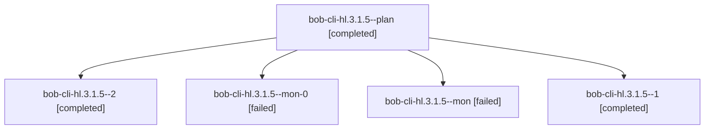

# Session: bob-cli-hl.3.1.5

[Agent Hoods](../README.md) / [bbugyi200](../users/bbugyi200/README.md) / [athena](../users/bbugyi200/machines/athena/README.md) / [bob-cli-hl](../users/bbugyi200/machines/athena/hoods/bob-cli-hl/README.md) / bob-cli-hl.3.1.5

Owner: `bbugyi200.athena` · Hood: `bob-cli-hl` · Members: 5 · Bead: [bob-cli-hl.3.1.5](https://github.com/bobs-org/bob-cli--beads/blob/main/pages/bob-cli-hl/bob-cli-hl.3.1.5.md)

## Lineage

The diagram is an optional enhancement; the ordered table below contains the same lineage in accessible text.

| Role | Agent | State | Model / provider | Timing | Commits | Prompt | Chat |
|---|---|---|---|---|---:|---|---|
| plan | bob-cli-hl.3.1.5--plan | completed | gpt-6-luna / codex | 2026-11-06T04:59:07.520183+00:00 → 2026-11-06T05:34:46.847397+00:00 | 0 | [Prompt](../agents/bbugyi200.athena.bob-cli-hl.3.1.5--plan/prompt.md) | [Chat](../agents/bbugyi200.athena.bob-cli-hl.3.1.5--plan/chat.md) |
| 2 | bob-cli-hl.3.1.5--2 | completed | gpt-6-luna / codex | 2026-11-06T05:57:28.396165+00:00 → 2026-11-06T06:01:19.942656+00:00 | [1](../agents/bbugyi200.athena.bob-cli-hl.3.1.5--2/README.md#commits) | [Prompt](../agents/bbugyi200.athena.bob-cli-hl.3.1.5--2/prompt.md) | [Chat](../agents/bbugyi200.athena.bob-cli-hl.3.1.5--2/chat.md) |
| mon-0 | bob-cli-hl.3.1.5--mon-0 | failed | gpt-6-luna / codex | 2026-11-06T05:47:17.203768+00:00 → 2026-11-06T05:56:10.132719+00:00 | 0 | — | [Chat](../agents/bbugyi200.athena.bob-cli-hl.3.1.5--mon-0/chat.md) |
| mon | bob-cli-hl.3.1.5--mon | failed | gpt-6-luna / codex | 2026-11-06T05:33:45.913792+00:00 → 2026-11-06T05:42:12.559428+00:00 | 0 | — | [Chat](../agents/bbugyi200.athena.bob-cli-hl.3.1.5--mon/chat.md) |
| 1 | bob-cli-hl.3.1.5--1 | completed | gpt-6-luna / codex | 2026-11-06T05:43:50.192969+00:00 → 2026-11-06T05:48:10.006717+00:00 | 0 | [Prompt](../agents/bbugyi200.athena.bob-cli-hl.3.1.5--1/prompt.md) | [Chat](../agents/bbugyi200.athena.bob-cli-hl.3.1.5--1/chat.md) |

## Commits

| Role | Repo | Commit | Subject | Committed |
|---|---|---|---|---|
| 2 | bob-cli | [`6af313b`](https://github.com/bobs-org/bob-cli/commit/6af313b4d36460174ff6b951e208653ea0160afc) | test(capture): complete merge-in acceptance coverage | 2026-11-06 01:00:42 EST |

## Neighbors

| Agent | Relation | State |
|---|---|---|
| [bob-cli-hl.3](bbugyi200.athena.bob-cli-hl.3.md) (session · 3) | ancestor | active 1, completed 2 |
| [bob-cli-hl.3.1.1](bbugyi200.athena.bob-cli-hl.3.1.1.md) (session · 5) | bob-cli-hl.3.1 hood | completed 3, failed 2 |
| [bob-cli-hl.3.1.2](../agents/bbugyi200.athena.bob-cli-hl.3.1.2/README.md) | bob-cli-hl.3.1 hood | completed |
| [bob-cli-hl.3.1.3](bbugyi200.athena.bob-cli-hl.3.1.3.md) (session · 13) | bob-cli-hl.3.1 hood | completed 9, failed 4 |
| [bob-cli-hl.3.1.4](../agents/bbugyi200.athena.bob-cli-hl.3.1.4/README.md) | bob-cli-hl.3.1 hood | completed |
| [bob-cli-hl.3.1.land](../agents/bbugyi200.athena.bob-cli-hl.3.1.land/README.md) | bob-cli-hl.3.1 hood | completed |
| [bob-cli-hl.1](../agents/bbugyi200.athena.bob-cli-hl.1/README.md) | bob-cli-hl hood | completed |
| [bob-cli-hl.2](bbugyi200.athena.bob-cli-hl.2.md) (session · 3) | bob-cli-hl hood | completed 3 |
| [bob-cli-hl.4](../agents/bbugyi200.athena.bob-cli-hl.4/README.md) | bob-cli-hl hood | completed |
| [bob-cli-hl.5](bbugyi200.athena.bob-cli-hl.5.md) (session · 3) | bob-cli-hl hood | active 1, completed 2 |
| [bob-cli-hl.5.1.1](../agents/bbugyi200.athena.bob-cli-hl.5.1.1/README.md) | bob-cli-hl hood | completed |
| [bob-cli-hl.5.1.2](bbugyi200.athena.bob-cli-hl.5.1.2.md) (session · 3) | bob-cli-hl hood | completed 2, failed 1 |
| [bob-cli-hl.5.1.3](../agents/bbugyi200.athena.bob-cli-hl.5.1.3/README.md) | bob-cli-hl hood | completed |
| [bob-cli-hl.5.1.4](bbugyi200.athena.bob-cli-hl.5.1.4.md) (session · 9) | bob-cli-hl hood | completed 5, failed 4 |
| [bob-cli-hl.5.1.5](bbugyi200.athena.bob-cli-hl.5.1.5.md) (session · 5) | bob-cli-hl hood | completed 3, failed 2 |
| [bob-cli-hl.5.1.5](../agents/bbugyi200.athena.bob-cli-hl.5.1.5/README.md) | bob-cli-hl hood | waiting |
| [bob-cli-hl.5.1.land](../agents/bbugyi200.athena.bob-cli-hl.5.1.land/README.md) | bob-cli-hl hood | waiting |
| [bob-cli-hl.6](../agents/bbugyi200.athena.bob-cli-hl.6/README.md) | bob-cli-hl hood | completed |
| [bob-cli-hl.land](../agents/bbugyi200.athena.bob-cli-hl.land/README.md) | bob-cli-hl hood | waiting |
