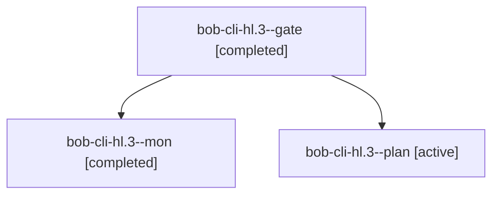

# Session: bob-cli-hl.3

[Agent Hoods](../README.md) / [bbugyi200](../users/bbugyi200/README.md) / [athena](../users/bbugyi200/machines/athena/README.md) / [bob-cli-hl](../users/bbugyi200/machines/athena/hoods/bob-cli-hl/README.md) / bob-cli-hl.3

Owner: `bbugyi200.athena` · Hood: `bob-cli-hl` · Members: 3 · Bead: [bob-cli-hl.3](https://github.com/bobs-org/bob-cli--beads/blob/main/pages/bob-cli-hl/bob-cli-hl.3.md)

## Lineage

The diagram is an optional enhancement; the ordered table below contains the same lineage in accessible text.

| Role | Agent | State | Model / provider | Timing | Commits | Prompt | Chat |
|---|---|---|---|---|---:|---|---|
| gate | bob-cli-hl.3--gate | completed | gpt-6-astra / codex | 2026-11-06T00:48:12.925613+00:00 → 2026-11-06T00:49:38.317766+00:00 | 0 | — | [Chat](../agents/bbugyi200.athena.bob-cli-hl.3--gate/chat.md) |
| mon | bob-cli-hl.3--mon | completed | gpt-6-astra / codex | 2026-11-06T00:49:37.126987+00:00 → 2026-11-06T00:52:55.539839+00:00 | 0 | — | [Chat](../agents/bbugyi200.athena.bob-cli-hl.3--mon/chat.md) |
| plan | bob-cli-hl.3--plan | active | gpt-6-astra / codex | 2026-11-06T00:40:34.485592+00:00 → 2026-11-06T00:49:42.430125+00:00 | 0 | [Prompt](../agents/bbugyi200.athena.bob-cli-hl.3--plan/prompt.md) | [Chat](../agents/bbugyi200.athena.bob-cli-hl.3--plan/chat.md) |

## Neighbors

| Agent | Relation | State |
|---|---|---|
| [bob-cli-hl.3.1.1](bbugyi200.athena.bob-cli-hl.3.1.1.md) (session · 5) | descendant | completed 3, failed 2 |
| [bob-cli-hl.3.1.2](../agents/bbugyi200.athena.bob-cli-hl.3.1.2/README.md) | descendant | completed |
| [bob-cli-hl.3.1.3](bbugyi200.athena.bob-cli-hl.3.1.3.md) (session · 13) | descendant | completed 9, failed 4 |
| [bob-cli-hl.3.1.4](../agents/bbugyi200.athena.bob-cli-hl.3.1.4/README.md) | descendant | completed |
| [bob-cli-hl.3.1.5](bbugyi200.athena.bob-cli-hl.3.1.5.md) (session · 5) | descendant | completed 3, failed 2 |
| [bob-cli-hl.3.1.land](../agents/bbugyi200.athena.bob-cli-hl.3.1.land/README.md) | descendant | waiting |
| [bob-cli-hl.1](../agents/bbugyi200.athena.bob-cli-hl.1/README.md) | bob-cli-hl hood | completed |
| [bob-cli-hl.2](bbugyi200.athena.bob-cli-hl.2.md) (session · 3) | bob-cli-hl hood | completed 3 |
| [bob-cli-hl.4](../agents/bbugyi200.athena.bob-cli-hl.4/README.md) | bob-cli-hl hood | completed |
| [bob-cli-hl.5](../agents/bbugyi200.athena.bob-cli-hl.5/README.md) | bob-cli-hl hood | waiting |
| [bob-cli-hl.6](../agents/bbugyi200.athena.bob-cli-hl.6/README.md) | bob-cli-hl hood | waiting |
| [bob-cli-hl.land](../agents/bbugyi200.athena.bob-cli-hl.land/README.md) | bob-cli-hl hood | waiting |
