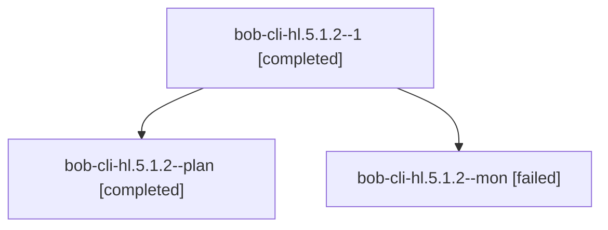

# Session: bob-cli-hl.5.1.2

[Agent Hoods](../README.md) / [bbugyi200](../users/bbugyi200/README.md) / [athena](../users/bbugyi200/machines/athena/README.md) / [bob-cli-hl](../users/bbugyi200/machines/athena/hoods/bob-cli-hl/README.md) / bob-cli-hl.5.1.2

Owner: `bbugyi200.athena` · Hood: `bob-cli-hl` · Members: 3 · Bead: [bob-cli-hl.5.1.2](https://github.com/bobs-org/bob-cli--beads/blob/main/pages/bob-cli-hl/bob-cli-hl.5.1.2.md)

## Lineage

The diagram is an optional enhancement; the ordered table below contains the same lineage in accessible text.

| Role | Agent | State | Model / provider | Timing | Commits | Prompt | Chat |
|---|---|---|---|---|---:|---|---|
| 1 | bob-cli-hl.5.1.2--1 | completed | gpt-6-luna / codex | 2026-11-06T07:43:30.151517+00:00 → 2026-11-06T07:50:07.717333+00:00 | 0 | [Prompt](../agents/bbugyi200.athena.bob-cli-hl.5.1.2--1/prompt.md) | [Chat](../agents/bbugyi200.athena.bob-cli-hl.5.1.2--1/chat.md) |
| plan | bob-cli-hl.5.1.2--plan | completed | gpt-6-luna / codex | 2026-11-06T07:11:46.114760+00:00 → 2026-11-06T07:37:37.714175+00:00 | 0 | [Prompt](../agents/bbugyi200.athena.bob-cli-hl.5.1.2--plan/prompt.md) | [Chat](../agents/bbugyi200.athena.bob-cli-hl.5.1.2--plan/chat.md) |
| mon | bob-cli-hl.5.1.2--mon | failed | gpt-6-luna / codex | 2026-11-06T07:36:37.647907+00:00 → 2026-11-06T07:42:03.330168+00:00 | 0 | — | [Chat](../agents/bbugyi200.athena.bob-cli-hl.5.1.2--mon/chat.md) |

## Neighbors

| Agent | Relation | State |
|---|---|---|
| [bob-cli-hl.5](bbugyi200.athena.bob-cli-hl.5.md) (session · 3) | ancestor | active 1, completed 2 |
| [bob-cli-hl.5.1.1](../agents/bbugyi200.athena.bob-cli-hl.5.1.1/README.md) | bob-cli-hl.5.1 hood | completed |
| [bob-cli-hl.5.1.3](../agents/bbugyi200.athena.bob-cli-hl.5.1.3/README.md) | bob-cli-hl.5.1 hood | completed |
| [bob-cli-hl.5.1.4](../agents/bbugyi200.athena.bob-cli-hl.5.1.4/README.md) | bob-cli-hl.5.1 hood | waiting |
| [bob-cli-hl.5.1.5](../agents/bbugyi200.athena.bob-cli-hl.5.1.5/README.md) | bob-cli-hl.5.1 hood | waiting |
| [bob-cli-hl.5.1.land](../agents/bbugyi200.athena.bob-cli-hl.5.1.land/README.md) | bob-cli-hl.5.1 hood | waiting |
| [bob-cli-hl.1](../agents/bbugyi200.athena.bob-cli-hl.1/README.md) | bob-cli-hl hood | completed |
| [bob-cli-hl.2](bbugyi200.athena.bob-cli-hl.2.md) (session · 3) | bob-cli-hl hood | completed 3 |
| [bob-cli-hl.3](bbugyi200.athena.bob-cli-hl.3.md) (session · 3) | bob-cli-hl hood | active 1, completed 2 |
| [bob-cli-hl.3.1.1](bbugyi200.athena.bob-cli-hl.3.1.1.md) (session · 5) | bob-cli-hl hood | completed 3, failed 2 |
| [bob-cli-hl.3.1.2](../agents/bbugyi200.athena.bob-cli-hl.3.1.2/README.md) | bob-cli-hl hood | completed |
| [bob-cli-hl.3.1.3](bbugyi200.athena.bob-cli-hl.3.1.3.md) (session · 13) | bob-cli-hl hood | completed 9, failed 4 |
| [bob-cli-hl.3.1.4](../agents/bbugyi200.athena.bob-cli-hl.3.1.4/README.md) | bob-cli-hl hood | completed |
| [bob-cli-hl.3.1.5](bbugyi200.athena.bob-cli-hl.3.1.5.md) (session · 5) | bob-cli-hl hood | completed 3, failed 2 |
| [bob-cli-hl.3.1.land](../agents/bbugyi200.athena.bob-cli-hl.3.1.land/README.md) | bob-cli-hl hood | completed |
| [bob-cli-hl.4](../agents/bbugyi200.athena.bob-cli-hl.4/README.md) | bob-cli-hl hood | completed |
| [bob-cli-hl.6](../agents/bbugyi200.athena.bob-cli-hl.6/README.md) | bob-cli-hl hood | completed |
| [bob-cli-hl.land](../agents/bbugyi200.athena.bob-cli-hl.land/README.md) | bob-cli-hl hood | waiting |
