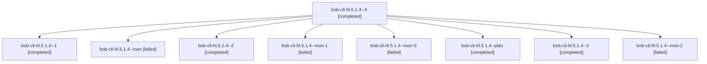

# Session: bob-cli-hl.5.1.4

[Agent Hoods](../README.md) / [bbugyi200](../users/bbugyi200/README.md) / [athena](../users/bbugyi200/machines/athena/README.md) / [bob-cli-hl](../users/bbugyi200/machines/athena/hoods/bob-cli-hl/README.md) / bob-cli-hl.5.1.4

Owner: `bbugyi200.athena` · Hood: `bob-cli-hl` · Members: 9 · Bead: [bob-cli-hl.5.1.4](https://github.com/bobs-org/bob-cli--beads/blob/main/pages/bob-cli-hl/bob-cli-hl.5.1.4.md)

## Lineage

The diagram is an optional enhancement; the ordered table below contains the same lineage in accessible text.

| Role | Agent | State | Model / provider | Timing | Commits | Prompt | Chat |
|---|---|---|---|---|---:|---|---|
| 4 | bob-cli-hl.5.1.4--4 | completed | gpt-6-luna / codex | 2026-11-06T09:42:40.737420+00:00 → 2026-11-06T09:48:06.972144+00:00 | 0 | [Prompt](../agents/bbugyi200.athena.bob-cli-hl.5.1.4--4/prompt.md) | [Chat](../agents/bbugyi200.athena.bob-cli-hl.5.1.4--4/chat.md) |
| 1 | bob-cli-hl.5.1.4--1 | completed | gpt-6-luna / codex | 2026-11-06T08:41:18.931563+00:00 → 2026-11-06T08:47:22.812712+00:00 | 0 | [Prompt](../agents/bbugyi200.athena.bob-cli-hl.5.1.4--1/prompt.md) | [Chat](../agents/bbugyi200.athena.bob-cli-hl.5.1.4--1/chat.md) |
| mon | bob-cli-hl.5.1.4--mon | failed | gpt-6-luna / codex | 2026-11-06T08:31:17.117727+00:00 → 2026-11-06T08:39:48.110105+00:00 | 0 | — | [Chat](../agents/bbugyi200.athena.bob-cli-hl.5.1.4--mon/chat.md) |
| 2 | bob-cli-hl.5.1.4--2 | completed | gpt-6-luna / codex | 2026-11-06T09:07:45.275485+00:00 → 2026-11-06T09:13:54.982395+00:00 | 0 | [Prompt](../agents/bbugyi200.athena.bob-cli-hl.5.1.4--2/prompt.md) | [Chat](../agents/bbugyi200.athena.bob-cli-hl.5.1.4--2/chat.md) |
| mon-1 | bob-cli-hl.5.1.4--mon-1 | failed | gpt-6-luna / codex | 2026-11-06T09:12:45.745430+00:00 → 2026-11-06T09:19:15.030741+00:00 | 0 | — | [Chat](../agents/bbugyi200.athena.bob-cli-hl.5.1.4--mon-1/chat.md) |
| mon-0 | bob-cli-hl.5.1.4--mon-0 | failed | gpt-6-luna / codex | 2026-11-06T08:46:30.309786+00:00 → 2026-11-06T09:06:14.170273+00:00 | 0 | — | [Chat](../agents/bbugyi200.athena.bob-cli-hl.5.1.4--mon-0/chat.md) |
| plan | bob-cli-hl.5.1.4--plan | completed | gpt-6-luna / codex | 2026-11-06T08:07:15.148650+00:00 → 2026-11-06T08:32:26.985332+00:00 | 0 | [Prompt](../agents/bbugyi200.athena.bob-cli-hl.5.1.4--plan/prompt.md) | [Chat](../agents/bbugyi200.athena.bob-cli-hl.5.1.4--plan/chat.md) |
| 3 | bob-cli-hl.5.1.4--3 | completed | gpt-6-luna / codex | 2026-11-06T09:20:42.345303+00:00 → 2026-11-06T09:25:15.221231+00:00 | 0 | [Prompt](../agents/bbugyi200.athena.bob-cli-hl.5.1.4--3/prompt.md) | [Chat](../agents/bbugyi200.athena.bob-cli-hl.5.1.4--3/chat.md) |
| mon-2 | bob-cli-hl.5.1.4--mon-2 | failed | gpt-6-luna / codex | 2026-11-06T09:24:33.333467+00:00 → 2026-11-06T09:41:24.438059+00:00 | 0 | — | [Chat](../agents/bbugyi200.athena.bob-cli-hl.5.1.4--mon-2/chat.md) |

## Neighbors

| Agent | Relation | State |
|---|---|---|
| [bob-cli-hl.5](bbugyi200.athena.bob-cli-hl.5.md) (session · 3) | ancestor | active 1, completed 2 |
| [bob-cli-hl.5.1.1](../agents/bbugyi200.athena.bob-cli-hl.5.1.1/README.md) | bob-cli-hl.5.1 hood | completed |
| [bob-cli-hl.5.1.2](bbugyi200.athena.bob-cli-hl.5.1.2.md) (session · 3) | bob-cli-hl.5.1 hood | completed 2, failed 1 |
| [bob-cli-hl.5.1.3](../agents/bbugyi200.athena.bob-cli-hl.5.1.3/README.md) | bob-cli-hl.5.1 hood | completed |
| [bob-cli-hl.5.1.5](bbugyi200.athena.bob-cli-hl.5.1.5.md) (session · 5) | bob-cli-hl.5.1 hood | completed 3, failed 2 |
| [bob-cli-hl.5.1.5](../agents/bbugyi200.athena.bob-cli-hl.5.1.5/README.md) | bob-cli-hl.5.1 hood | waiting |
| [bob-cli-hl.5.1.land](bbugyi200.athena.bob-cli-hl.5.1.land.md) (session · 11) | bob-cli-hl.5.1 hood | completed 8, failed 3 |
| [bob-cli-hl.1](../agents/bbugyi200.athena.bob-cli-hl.1/README.md) | bob-cli-hl hood | completed |
| [bob-cli-hl.2](bbugyi200.athena.bob-cli-hl.2.md) (session · 3) | bob-cli-hl hood | completed 3 |
| [bob-cli-hl.3](bbugyi200.athena.bob-cli-hl.3.md) (session · 3) | bob-cli-hl hood | active 1, completed 2 |
| [bob-cli-hl.3.1.1](bbugyi200.athena.bob-cli-hl.3.1.1.md) (session · 5) | bob-cli-hl hood | completed 3, failed 2 |
| [bob-cli-hl.3.1.2](../agents/bbugyi200.athena.bob-cli-hl.3.1.2/README.md) | bob-cli-hl hood | completed |
| [bob-cli-hl.3.1.3](bbugyi200.athena.bob-cli-hl.3.1.3.md) (session · 13) | bob-cli-hl hood | completed 9, failed 4 |
| [bob-cli-hl.3.1.4](../agents/bbugyi200.athena.bob-cli-hl.3.1.4/README.md) | bob-cli-hl hood | completed |
| [bob-cli-hl.3.1.5](bbugyi200.athena.bob-cli-hl.3.1.5.md) (session · 5) | bob-cli-hl hood | completed 3, failed 2 |
| [bob-cli-hl.3.1.land](../agents/bbugyi200.athena.bob-cli-hl.3.1.land/README.md) | bob-cli-hl hood | completed |
| [bob-cli-hl.4](../agents/bbugyi200.athena.bob-cli-hl.4/README.md) | bob-cli-hl hood | completed |
| [bob-cli-hl.6](../agents/bbugyi200.athena.bob-cli-hl.6/README.md) | bob-cli-hl hood | completed |
| [bob-cli-hl.land](../agents/bbugyi200.athena.bob-cli-hl.land/README.md) | bob-cli-hl hood | completed |
