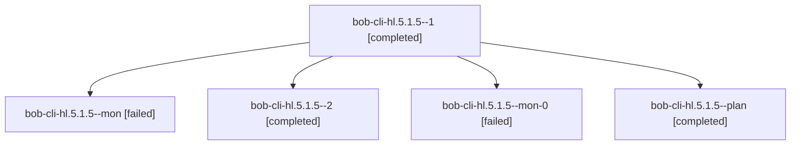

# Session: bob-cli-hl.5.1.5

[Agent Hoods](../README.md) / [bbugyi200](../users/bbugyi200/README.md) / [athena](../users/bbugyi200/machines/athena/README.md) / [bob-cli-hl](../users/bbugyi200/machines/athena/hoods/bob-cli-hl/README.md) / bob-cli-hl.5.1.5

Owner: `bbugyi200.athena` · Hood: `bob-cli-hl` · Members: 5 · Bead: [bob-cli-hl.5.1.5](https://github.com/bobs-org/bob-cli--beads/blob/main/pages/bob-cli-hl/bob-cli-hl.5.1.5.md)

## Lineage



The diagram is an optional enhancement; the ordered table below contains the same lineage in accessible text.

| Role | Agent | State | Model / provider | Timing | Commits | Prompt | Chat |
|---|---|---|---|---|---:|---|---|
| <a id="member-1"></a>1 | bob-cli-hl.5.1.5--1 | completed | gpt-6-astra / codex | 2026-11-06T11:22:37.376009+00:00 → 2026-11-06T11:34:39.938599+00:00 | 0 | [Prompt](../agents/bbugyi200.athena.bob-cli-hl.5.1.5--1/prompt.md) | [Chat](../agents/bbugyi200.athena.bob-cli-hl.5.1.5--1/chat.md) |
| <a id="member-mon"></a>mon | bob-cli-hl.5.1.5--mon | failed | gpt-6-astra / codex | 2026-11-06T10:57:27.066112+00:00 → 2026-11-06T11:21:10.380378+00:00 | 0 | — | [Chat](../agents/bbugyi200.athena.bob-cli-hl.5.1.5--mon/chat.md) |
| <a id="member-2"></a>2 | bob-cli-hl.5.1.5--2 | completed | gpt-6-astra / codex | 2026-11-06T12:13:26.446308+00:00 → 2026-11-06T12:21:08.655233+00:00 | 0 | [Prompt](../agents/bbugyi200.athena.bob-cli-hl.5.1.5--2/prompt.md) | [Chat](../agents/bbugyi200.athena.bob-cli-hl.5.1.5--2/chat.md) |
| <a id="member-mon-0"></a>mon-0 | bob-cli-hl.5.1.5--mon-0 | failed | gpt-6-astra / codex | 2026-11-06T11:34:08.539445+00:00 → 2026-11-06T12:00:04.959056+00:00 | 0 | — | [Chat](../agents/bbugyi200.athena.bob-cli-hl.5.1.5--mon-0/chat.md) |
| <a id="member-plan"></a>plan | bob-cli-hl.5.1.5--plan | completed | gpt-6-astra / codex | 2026-11-06T10:45:32.031763+00:00 → 2026-11-06T10:58:08.499325+00:00 | 0 | [Prompt](../agents/bbugyi200.athena.bob-cli-hl.5.1.5--plan/prompt.md) | [Chat](../agents/bbugyi200.athena.bob-cli-hl.5.1.5--plan/chat.md) |

## Variables

| Role | Variable | Value |
|---|---|---|
| 1 | `artifacts` | \[{bead: bob-cli-hl.5.1.5, kind: file, label: Merge-in rollout exact-SHA baseline comparison and render review, path: /home/bryan/.sase/artifacts/agents/gh\_bobs-org\_\_bob-cli/20261106062010/comparison-… |
| 2 | `artifacts` | \[{bead: bob-cli-hl.5.1.5, kind: file, label: Final merge-in rollout verification at 04041733: baseline comparison and render review, path: /home/bryan/.sase/artifacts/agents/gh\_bobs-org\_\_bob-cli/2026… |

#### artifacts

**Role:** `1`

```yaml
- bead: bob-cli-hl.5.1.5
  kind: file
  label: Merge-in rollout exact-SHA baseline comparison and render review
  path: /home/bryan/.sase/artifacts/agents/gh_bobs-org__bob-cli/20261106062010/comparison-42207807508-a6132af69b2e.json
  ref: file:explicit:f7c87874f1ec8abb2832fe8f
  source_path: /home/bryan/.local/state/sase/workspaces/bobs-org/bob-cli/bob-cli_28/target/rollout-verification/comparison-42207807508.json
```

#### artifacts

**Role:** `2`

```yaml
- bead: bob-cli-hl.5.1.5
  kind: file
  label: Final merge-in rollout verification at 04041733: baseline comparison and render review
  path: /home/bryan/.sase/artifacts/agents/gh_bobs-org__bob-cli/20261106065904/comparison-f4e6d15ce1c8.json
  ref: file:explicit:80ea345ad2f4aa2a61b9599d
  source_path: /home/bryan/.local/state/sase/workspaces/bobs-org/bob-cli/bob-cli_28/target/rollout-verification/layout/comparison.json
- bead: bob-cli-hl.5.1.5
  kind: file
  label: Merge-in rollout renders and hosted-test evidence from macOS run 42212293089
  path: /home/bryan/.sase/artifacts/agents/gh_bobs-org__bob-cli/20261106065904/merge-in-evidence-42212293089-37b14313b9da.zip
  ref: file:explicit:93caffd02e31ab101cc20f9c
  source_path: /home/bryan/.local/state/sase/workspaces/bobs-org/bob-cli/bob-cli_28/target/rollout-verification/layout/merge-in-evidence-42212293089.zip
```

Values are truncated for display; see each member's agent meta.json for the full values.

## Neighbors

| Agent | Relation | State |
|---|---|---|
| [bob-cli-hl.5](bbugyi200.athena.bob-cli-hl.5.md) (session · 3) | ancestor | active 1, completed 2 |
| [bob-cli-hl.5.1.1](../agents/bbugyi200.athena.bob-cli-hl.5.1.1/README.md) | bob-cli-hl.5.1 hood | completed |
| [bob-cli-hl.5.1.2](bbugyi200.athena.bob-cli-hl.5.1.2.md) (session · 3) | bob-cli-hl.5.1 hood | completed 2, failed 1 |
| [bob-cli-hl.5.1.3](../agents/bbugyi200.athena.bob-cli-hl.5.1.3/README.md) | bob-cli-hl.5.1 hood | completed |
| [bob-cli-hl.5.1.4](bbugyi200.athena.bob-cli-hl.5.1.4.md) (session · 9) | bob-cli-hl.5.1 hood | completed 5, failed 4 |
| [bob-cli-hl.5.1.land](bbugyi200.athena.bob-cli-hl.5.1.land.md) (session · 11) | bob-cli-hl.5.1 hood | completed 8, failed 3 |
| [bob-cli-hl.1](../agents/bbugyi200.athena.bob-cli-hl.1/README.md) | bob-cli-hl hood | completed |
| [bob-cli-hl.2](bbugyi200.athena.bob-cli-hl.2.md) (session · 3) | bob-cli-hl hood | completed 3 |
| [bob-cli-hl.3](bbugyi200.athena.bob-cli-hl.3.md) (session · 3) | bob-cli-hl hood | active 1, completed 2 |
| [bob-cli-hl.3.1.1](bbugyi200.athena.bob-cli-hl.3.1.1.md) (session · 5) | bob-cli-hl hood | completed 3, failed 2 |
| [bob-cli-hl.3.1.2](../agents/bbugyi200.athena.bob-cli-hl.3.1.2/README.md) | bob-cli-hl hood | completed |
| [bob-cli-hl.3.1.3](bbugyi200.athena.bob-cli-hl.3.1.3.md) (session · 13) | bob-cli-hl hood | completed 9, failed 4 |
| [bob-cli-hl.3.1.4](../agents/bbugyi200.athena.bob-cli-hl.3.1.4/README.md) | bob-cli-hl hood | completed |
| [bob-cli-hl.3.1.5](bbugyi200.athena.bob-cli-hl.3.1.5.md) (session · 5) | bob-cli-hl hood | completed 3, failed 2 |
| [bob-cli-hl.3.1.land](../agents/bbugyi200.athena.bob-cli-hl.3.1.land/README.md) | bob-cli-hl hood | completed |
| [bob-cli-hl.4](../agents/bbugyi200.athena.bob-cli-hl.4/README.md) | bob-cli-hl hood | completed |
| [bob-cli-hl.6](../agents/bbugyi200.athena.bob-cli-hl.6/README.md) | bob-cli-hl hood | completed |
| [bob-cli-hl.land](../agents/bbugyi200.athena.bob-cli-hl.land/README.md) | bob-cli-hl hood | completed |
